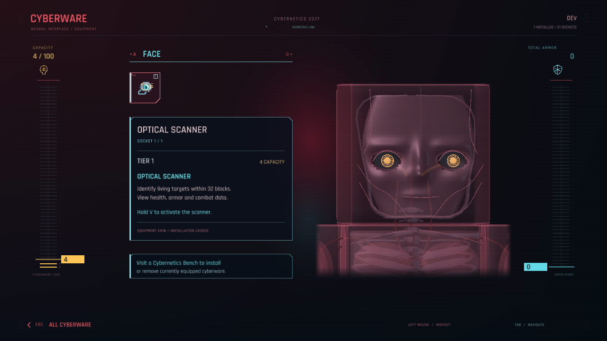
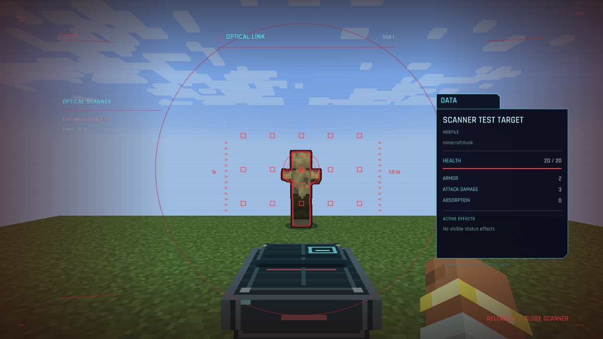
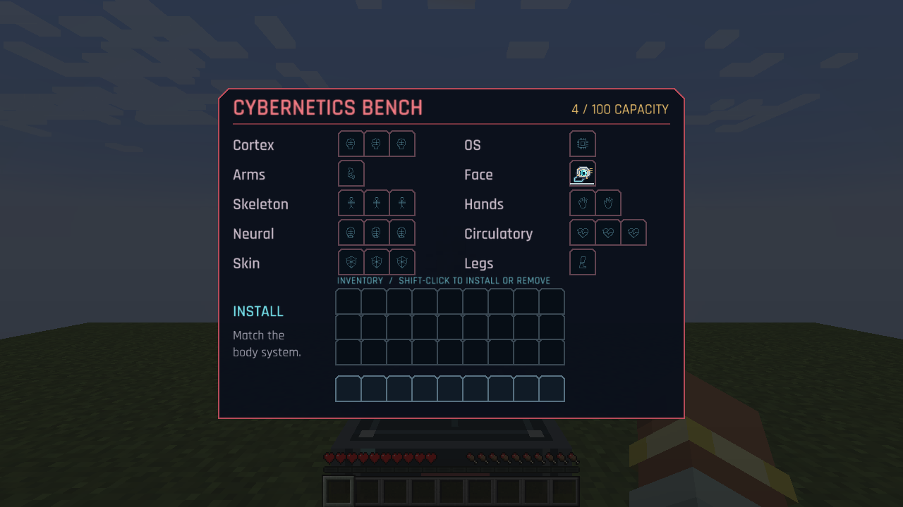

# Cybernetics 2077

A standalone **Minecraft 1.21.1 / NeoForge** mod inspired by Cyberpunk 2077's cyberware interface.



## Cyberware

Open your inventory and press the **cyberware chip button**. Select a socket to zoom into that body system and inspect its installed implant. Use **A / D** or the arrows in the category header to change systems. **Esc** returns to the full body; press it again to return to your inventory. **Tab / Enter** also navigate and select sockets.

The inventory viewer is **read-only**. Its 21 sockets cover ten body systems. The diagnostic body is modeled in Blender, with a translucent Minecraft-shaped exterior, shaped facial tissue, recessed optics and separate anatomical layers. Selecting a category reveals its corresponding anatomy. Capacity and armor meters reflect your equipment.

All implants have a strength tier from **1–5**, shown in their tooltip and socket badge: white, green, blue, purple and orange respectively. This release introduces the first implant:

| Implant | Tier | Body system | Capacity | Effect |
| --- | --- | --- | --- | --- |
| Optical Scanner | 1 | Face | 4 | Hold **V** to identify a visible living target within 32 blocks. |

The scanner shows the target's name, entity type, health, armor, attack damage, absorption and visible status effects. It uses an animated optical overlay and target outline, with a gradual transition from the normal Minecraft HUD. Release the key to close it. The key is rebindable in **Options → Controls → Cybernetics 2077**.



Quickhacks and operating-system functions are not included yet.

## Install cyberware

Craft and place a **Cybernetics Bench**, then right-click it. Move an implant from your inventory into a matching body-system socket, or **shift-click** to install it. Move it back to your inventory to remove it. Category and total capacity limits apply; merely carrying the scanner does not enable it. Equipment is saved with the player and retained on death.



[Recipes and item IDs](docs/CYBERWARE.md) · [In-game screenshots and clips](docs/PREVIEWS.md) · [Editable Blender source](art/blender/README.md)

## Install the mod

Use [Cybernetics2077-0.3.0.jar](releases/Cybernetics2077-0.3.0.jar) with **Minecraft 1.21.1** and **NeoForge 21.1.248 or newer for 1.21.1**. Replace the old Cybernetics 2077 JAR rather than keeping both. Install on both the server and client for multiplayer.

No Tensura mod or other addon is required. Base cyberware capacity defaults to 100 and can be configured in the world's server configuration. Existing 0.1.0 and 0.2.0 saves remain compatible.

## Build

Requires **Java 21**. The Gradle wrapper downloads Gradle and the development dependencies.

```sh
./gradlew test build
python3 scripts/verify-release.py
```

Development client: `./gradlew runClient`. See [validation and review instructions](docs/VALIDATION.md) for native Minecraft checks and more screenshots.

## Credits

Interface artwork, Blender diagnostic model, shaders, implant and workstation textures, and category glyphs are original mod assets. Rajdhani is distributed under the [SIL Open Font License](src/main/resources/assets/cybernetics2077/font/rajdhani-license.txt). Cyberpunk 2077 belongs to CD PROJEKT; this is an independent fan project, with no game textures included.
