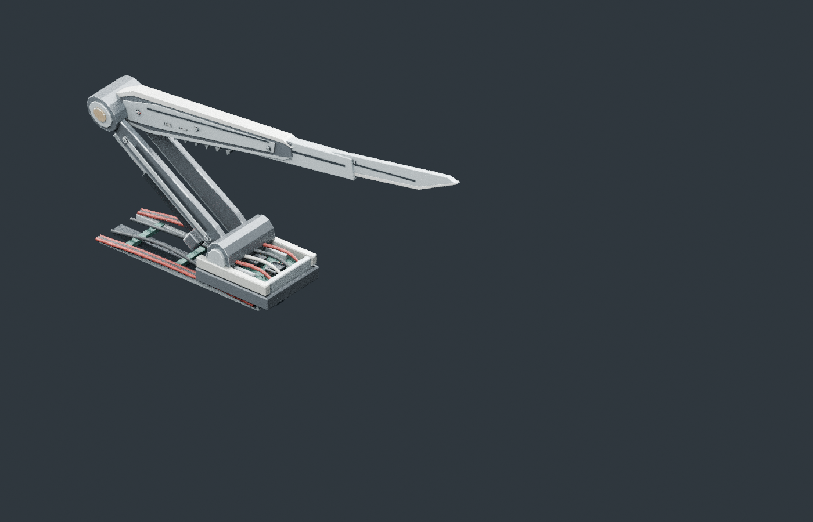

# Mantis Blades — Blender source

[Open the editable Blender model](mantis_blades.blend) · [In-game deployment and combat](../../docs/media/mantis-claws.mp4) · [Native mechanism close-up](../../docs/media/mantis-mechanism.mp4)



This is an original model authored in **Blender 4.3.2**. The user's side-view reference and uploaded physical-blade video guide the two-section silhouette: a lower support extends backward and upward from the dorsal forearm, and the cutting assembly pivots at its far end to point forward past the hand. The fixed mount, sliding carriage, support, blade receiver, inner sliding leaf and distal leaf have separate named pivots. The leaves telescope inside each other; geometry is not stretched. The custom rig defines the elbow and hand sections; vanilla Minecraft supplies a single rigid arm. The mount and support keep their full-size layout. The receiver has a deeper, wider section, and the sliding cutting leaves have shorter travel and length.

The source includes chamfered housings, inset panels, hinge rings, bolts, serrations, rails and cable bundles. Minecraft supplies the wearer's skin and the segmented forearm covers and solid underlying arm separately. The source preview shows just the mechanical assembly; the linked videos show the actual in-game result.

## Rebuild

From the repository root, with Blender and its bundled Python/NumPy:

```sh
blender -b -t 4 --python art/mantis/build_mantis.py -- "$PWD"
```

The generator writes the editable `.blend`, a studio image, the packed colour/AO atlas, two runtime meshes and [mesh-report.json](mesh-report.json). It uses CPU Cycles for baking; Blender is **not** a mod dependency. Running it overwrites these generated assets. The model scene uses X across the arm, +Y toward the hand and +Z dorsal/up. Export maps these to Minecraft's canonical arm coordinates `(X, Y, -Z)` and reverses triangle winding. Ready-pose parent transforms are excluded from the export; Minecraft animates each local pivot.

`GAME_*` objects retain the source geometry. Hidden `RUNTIME_*` and `LOD_*` objects contain the exported near and far meshes. Runtime groups are `mount`, `carriage`, `support`, `blade`, `tip`, and `edge`.

## Runtime budget

| Asset | Budget |
| --- | ---: |
| Near mechanical mesh, per arm | 3,504 triangles |
| Far mechanical mesh, per arm | 588 triangles |
| Far switch, third person | Beyond 16 blocks |
| Shared colour / ambient-occlusion atlas | 512 × 512 RGBA |
| Animated rigid groups | 6 |

Both LODs share the same texture and pivots. Far geometry removes small fasteners and other details before simplification, reducing the triangle count by **83.2%**. Baking preserves surface shading without adding material passes. Mesh files are decoded during resource reload into cached primitive arrays, with no runtime Blender processing, subdivision, physics rig or per-frame file reads. The blade uses a triangle material, with no duplicate fourth vertex or degenerate triangle per face. Relative to 0.5.2, the reduced mesh and triangle pipeline submit about **50% fewer vertices**. Skin patches are clipped once and reused. The existing opaque forearm backing is independent of LOD.

The mesh reader validates counts, indices, finite coordinates and group names. JVM tests check UVs, normals, triangle budgets, near/far bounds and the two-hinge alignment and actual exported-vertex clearance through deployment. Eight separate covers begin opening before the folded assembly rises; they continue moving during that rise. Diagonal skin seams separate the middle plates; the wrist collar slides forward and the proximal cover retracts. Side leaves expose long red flex bundles. The hand and palm stay closed. The 0.5.6 proportions add depth to the mount and support, increase housing depth by about 40% and width by 30%, and shorten the deployed cutting assembly by about 29% relative to 0.5.5. The support length stays unchanged. The moving-cover collision test checks exported triangles against the actual plate surfaces through deployment. Native Minecraft review verifies deployment, retraction, slashes and ground/air/free leaps. These measures bound model cost; performance still depends on hardware, shaders and the number of visible players.

The skin and mechanics use different source coordinate systems. Native arm skin is rotated around its longitudinal axis: the outward X face of each hanging hand becomes dorsal −Z in mount space. The inverse mapping preserves the original empty-hand pose, while the ready stance rolls that knuckle face upward. Slim arms retain their native 3×4-pixel cross section; after rebasing, their mount-space width and depth are swapped. The 0.5.8 rig keeps the overall implant proportions and adds a sliding hinge shoe and fixed guides. The support bridge and piston sit below the folded receiver to leave its unfolding sweep clear.

Deployment uses separate eased channels: covers begin at 6% of the sequence; the folded support and receiver rise together from 16–48%; the carriage slides 6 cm backward at 50–68%; the cutting receiver pivots forward at 70–92%; and the tip extends at 88–100%. Retraction reverses the sequence. The mount remains anchored. The upper hinge stays folded during the shared rise instead of counter-rotating continuously. First-person hands blend from Minecraft’s original hand matrix into a dedicated 52° vertical weapon lens with closer, higher framing; the player’s world FOV option is preserved.
