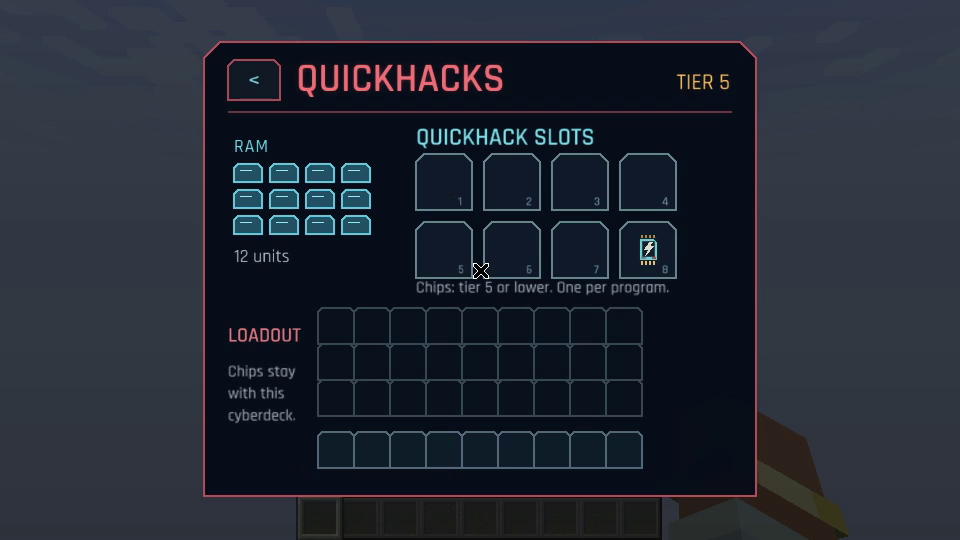
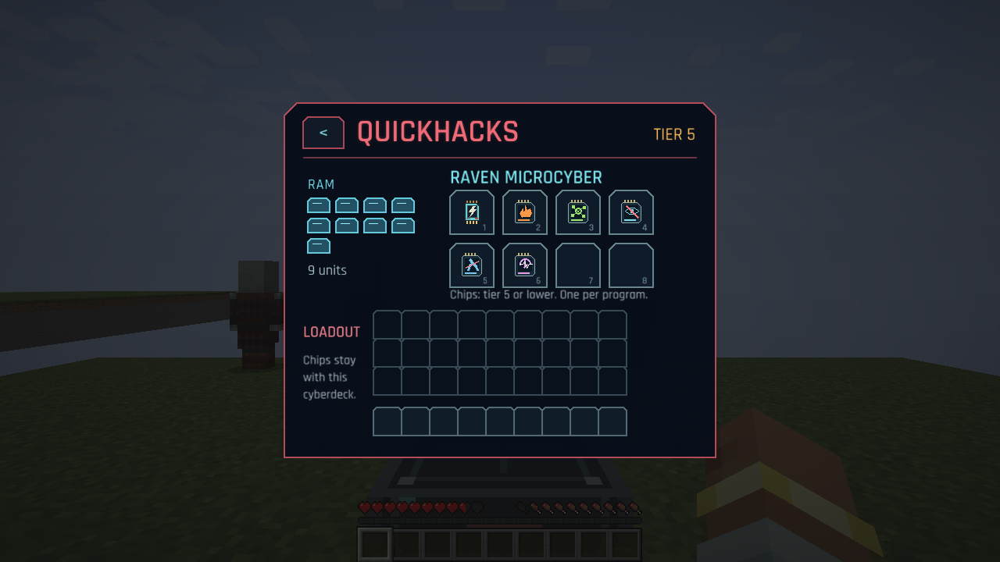
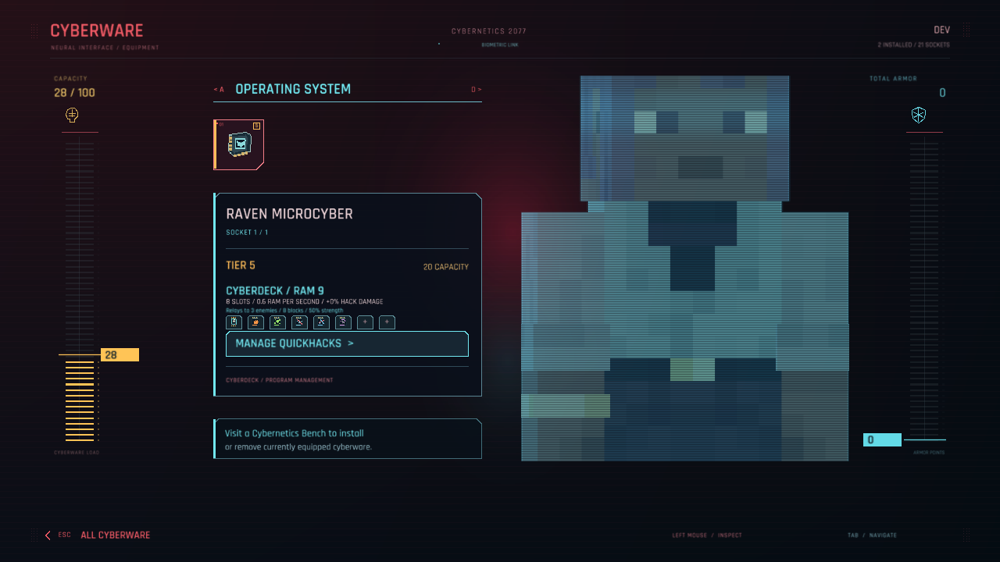
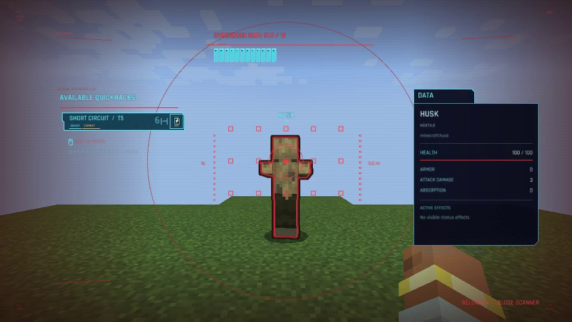
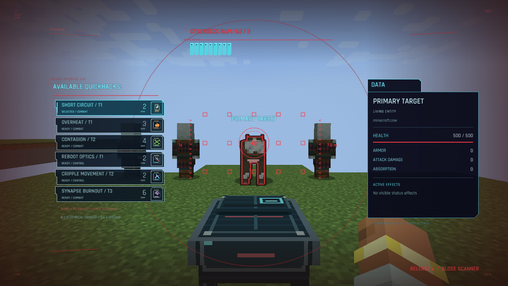

# Cyberware reference

Install implants at a **ripperdoc** or **Cybernetics Bench**. The tab beside your inventory views your equipment and manages quickhack chips. Basic Kiroshi Optics, Paraline and Short Circuit have **tiers 1–5**; **Raven Microcyber starts at tier 3**; Mantis Blades start at **tier 2**, shown in white, green, blue, purple and orange. Higher tiers improve their actual effects.

| Implant | System | Capacity, tier 1 → 5 |
| --- | --- | --- |
| Basic Kiroshi Optics | Face | 4 / 5 / 6 / 7 / 8 |
| Militech Paraline | Operating System | 8 / 12 / 16 / 20 / 24 |
| Raven Microcyber | Operating System | 16 / 18 / 20 (tiers 3–5) |
| Mantis Blades | Arms | 15 / 18 / 21 / 24 (tiers 2–5) |

[14 new implant families and their starting tiers](IMPLANTS.md) · [Cyberpunk 2077 cyberware catalogue](research/CYBERWARE-CATALOGUE.md) · [Upgrade recipes](#tier-upgrades)

## Basic Kiroshi Optics

Hold **V** to scan a living target with clear line of sight. Range is **32 / 40 / 48 / 56 / 64 blocks** at tiers 1–5. Release to close. Shows health, armor, attack damage, absorption and visible effects. Installing a loaded cyberdeck adds quickhack controls to this same overlay.

Tier 1 ID: `cybernetics2077:optical_scanner`. Tiers 2–5: `cybernetics2077:kiroshi_optics_tier_2` through `_5`.

| | | |
| --- | --- | --- |
| Iron ingot | Glass | Iron ingot |
| Redstone | Amethyst shard | Copper ingot |
| Iron ingot | Lapis lazuli | Iron ingot |

## Militech Paraline

| Tier | RAM | Program sockets | RAM / second | Queue limit | Upload time | Quickhack damage bonus |
| --- | --- | --- | --- | --- | --- | --- |
| 1 | 4 | 2 | 0.2 | 2 | 1.0 s | — |
| 2 | 6 | 3 | 0.3 | 2 | 0.9 s | +5% |
| 3 | 8 | 4 | 0.4 | 3 | 0.8 s | +10% |
| 4 | 10 | 6 | 0.5 | 3 | 0.7 s | +15% |
| 5 | 12 | 8 | 0.6 | 4 | 0.6 s | +20% |

Install the deck in the bench’s **OS** socket. Select the installed deck under **Operating System** in the inventory cyberware menu, then press **Manage Quickhacks**. The back arrow returns to the same Operating System page. The bench also has a **Cyberdeck** shortcut. Shift-click a chip to install it, or move it into a quickhack socket. Chips must be the same tier as the deck or lower. Only one copy of each program can be installed, including across different tiers. Available programs are Short Circuit, Overheat, Contagion, Reboot Optics, Cripple Movement and Synapse Burnout. Each has its own minimum tier. Different programs can share a deck and a queue; duplicate copies of the same program cannot. Removing the deck preserves its chips; removing the deck or program cancels pending uploads and refunds their reserved RAM.

Tier 1 ID: `cybernetics2077:cyberdeck_tier_1`. Tiers 2–5: `cybernetics2077:militech_paraline_tier_2` through `_5`.

| | | |
| --- | --- | --- |
| Gold ingot | Copper ingot | Gold ingot |
| Redstone | Amethyst shard | Redstone |
| Iron ingot | Copper ingot | Iron ingot |

## Raven Microcyber

A spread-focused alternative to Paraline. It has less base RAM and no direct quickhack damage bonus. Its relays hit nearby hostile mobs and combat opponents, respecting teams, PvP settings, walls and scanning range. Bystanders are excluded from automatic spread.

| Tier | Capacity | RAM | Sockets | RAM/s | Queue | Extra relay targets | Relay radius |
| --- | ---: | ---: | ---: | ---: | ---: | ---: | ---: |
| 3 | 16 | 7 | 4 | 0.4 | 3 | 1 | 4 blocks |
| 4 | 18 | 8 | 6 | 0.5 | 3 | 2 | 6 blocks |
| 5 | 20 | 9 | 8 | 0.6 | 4 | 3 | 8 blocks |

Relayed damage is **50%** of the primary hit; relayed control lasts **half as long**. DOT relays retain their duration at half damage. Relays happen once per uploaded hack. **Contagion** instead retains full infection damage, doubles its spread radius to **16 blocks**, and gains Raven's extra targets, up to seven secondary targets.

Raven uses the same basic upload speeds and chip-loading menu as Paraline. Ex-Disk and Memory Boost work with either deck. Buy it through the daily ripperdoc inventory at **Street Cred 20 / 30 / 40** for tiers 3 / 4 / 5, priced at **€$9,000 / 16,000 / 25,000**. No crafting recipes are added for this family.

IDs: `cybernetics2077:raven_microcyber_tier_3` through `_5`.

## Short Circuit

| Chip tier | RAM cost | Base electrical damage |
| --- | --- | --- |
| 1 | 2 | 8 |
| 2 | 3 | 11 |
| 3 | 4 | 14 |
| 4 | 5 | 18 |
| 5 | 6 | 22 |

The installed deck supplies the upload time and damage bonus above. A tier-5 chip in a tier-5 Paraline deals **26.4 electrical damage**, costs **6 RAM**, and uploads in **0.6 seconds**.

Install its chip in the cyberdeck. Hold **V**, aim at a living target, use the **mouse wheel** to select a program, then **left-click** to upload it. The deck’s queue limit applies to all pending uploads, with RAM reserved immediately. Progress appears above the target’s head. Electrical damage bypasses armor; it respects invulnerability and server PvP/team rules. A locked upload can finish after losing sight, within the installed optics’ range plus 16 blocks, in the same dimension. Removing or switching the deck or loaded program cancels affected uploads and refunds only their reserved RAM, capped to the current deck’s capacity.

IDs: `cybernetics2077:short_circuit_tier_1` through `_5`.

| | | |
| --- | --- | --- |
| *(empty)* | Redstone | *(empty)* |
| Copper ingot | Lapis lazuli | Copper ingot |
| *(empty)* | Iron nugget | *(empty)* |

## Additional quickhacks

Install chips through **Operating System → Manage Quickhacks**. The deck must match or exceed the chip's tier. These programs join the daily ripperdoc pool at the normal tier thresholds and cost `300 × tier²` eddies. They also appear in Creative's Tools & Utilities tab. No new recipes are added.

| Program | Tiers | RAM cost by tier | Base damage by tier | Effect |
| --- | --- | --- | --- | --- |
| Overheat | 1–5 | 3 / 4 / 5 / 6 / 7 | 12 / 16 / 20 / 24 / 28 thermal | Total damage over 4 seconds in four pulses. |
| Contagion | 2–5 | 4 / 5 / 6 / 7 | 12 / 18 / 24 / 30 chemical | Total damage over 8 seconds in four pulses. Spreads to 2 secondary targets at T2, or 4 at T3–5, within 8 blocks. |
| Reboot Optics | 1–5 | 2 / 2 / 3 / 3 / 4 | None | Blinds players and clears/blocks mob attack targeting for 4 / 5 / 6 / 7 / 8 seconds. |
| Cripple Movement | 2–5 | 2 / 3 / 4 / 5 | None | Roots movement and interrupts jumping/player flight for 4 / 5 / 6 / 7 seconds. |
| Synapse Burnout | 3–5 | 6 / 7 / 8 | 24 / 30 / 36 physical | Increases damage by 10% per RAM missing after paying for the upload, capped at +100%. |

**Damage types:** Short Circuit is electrical; Overheat is thermal; Contagion is chemical. These bypass armor. Synapse Burnout is physical and respects armor. Fire immunity and Fire Resistance affect thermal damage. Team/PvP and ordinary invulnerability rules still apply. Independent quickhack hits bypass Minecraft's shared hurt cooldown so simultaneous pulses are not discarded.

**Combination:** applying Overheat to a target with **tier 4 or 5 Contagion** consumes that infection and causes a **16 / 18 thermal damage** detonation. Up to three nearby enemies within 3 blocks take half that burst. The Overheat DOT then continues. No blocks are destroyed.

**Scaling:** Paraline's damage bonus multiplies direct hits and DOT totals. Synapse Burnout calculates its spent-RAM bonus when queued and includes its own cost once. Queued damage remains tied to the original deck and program. Reapplying the same DOT refreshes it instead of stacking duplicate instances.

**Uploads:** controls take half the deck's base upload time, with a minimum of 6 ticks. Overheat and Contagion add 6 ticks to the base time; Synapse Burnout adds 12. Ex-Disk then reduces upload time, with the same 6-tick minimum. The scanner shows the selected program's actual cost, damage, duration and upload time. Different programs can be queued together up to the installed deck's queue limit.

IDs: `cybernetics2077:<program>_tier_<tier>`, with program names `overheat`, `contagion`, `reboot_optics`, `cripple_movement` and `synapse_burnout`.

[Overheat upload](images/quickhack-overheat-upload.png) · [Contagion spread](images/raven-contagion-spread.png) · [Synapse Burnout upload](images/quickhack-synapse-upload.png)

## Mantis Blades

Install in **Arms** and press **G** with both hands empty to deploy. Press **G** again to retract the pair. A shallow dorsal hatch opens on the back of each forearm, while the palm, wrist and sides stay opaque. Native skin and enabled sleeve UVs remain on the arm and hatch. The mount faces upward; the blade points forward past the hand.

**Left-click** alternates two slashes and a rising cut, with a **0.5-second** interval. **Hold right-click for at least 0.4 seconds**, then release for a charged lunge, with a **1.1-second** interval. Damage is physical.

| Tier | Slash 1 / 2 | Rising cut | Lunge |
| --- | --- | --- | --- |
| 2 | 10 | 12.5 | 17.5 |
| 3 | 12 | 15 | 21 |
| 4 | 14 | 17.5 | 24.5 |
| 5 | 16 | 20 | 28 |

Deployment takes **1.5 seconds**: the original Minecraft hand moves into position, the covers start opening, the folded support and blade rise together, the support/housing slides backward, then the blade pivots forward and the nested tip extends. Retraction pulls the tip in first and returns the same hand to its normal pose. Damage lands on the animated contact frame and requires aim, range and line of sight. Aim at a visible living target within **8 blocks** to leap toward it, including from midair. With no target, leap **6 blocks in the direction you are looking**. Both use normal collision and stop at solid obstacles. When the guided leap ends, its remaining velocity passes into normal movement with ordinary gravity and friction. Aimed leaps deal damage at contact; free leaps can hit an enemy at their endpoint. Selected items stay stored and inactive while the claws are out: their attack attributes, enchantments, use actions and durability do not contribute to Mantis attacks. Both hands must be empty to deploy. Retracting the claws restores ordinary item use. Keys can be rebound under **Options → Controls → Cybernetics 2077**.

Tiers 2–5: `cybernetics2077:mantis_blades_tier_2` through `_5`.

Light attacks alternate hands with a quick cross-body cut and a rising third hit. The free hand stays in guard. The sliding blade compacts during wind-up and extends for contact. Holding a charged attack reels both arms back; releasing drives them forward. The ready pose has subtle breathing and balance motion.

[Watch deployment and attacks](media/mantis-claws.mp4) · [Combat close-up](media/mantis-attacks.mp4) · [Idle movement](media/mantis-idle.mp4)

| | | |
| --- | --- | --- |
| Iron sword | *(empty)* | Iron sword |
| Piston | Diamond | Piston |
| Copper ingot | Redstone | Copper ingot |

## Cybernetics Bench

Right-click to install or remove matching implants. Shift-clicking an implant out requires room in your inventory. Capacity and body-system restrictions apply. The **Cyberdeck** button becomes available when a deck is installed and your cursor is empty.

ID: `cybernetics2077:cybernetics_bench` · Creative tab: **Functional Blocks**. Implants and quickhack chips appear in **Tools & Utilities**.

| | | |
| --- | --- | --- |
| Iron ingot | Glass | Iron ingot |
| Redstone | Crafting table | Redstone |
| Iron ingot | *(empty)* | Iron ingot |

The tier-1 crafting recipes unlock in the recipe book after obtaining redstone. Breaking a bench drops the workstation; installed cyberware stays with your character. Installed equipment is retained on death.

## Tier upgrades

Remove the item at the Cybernetics Bench, then use a **vanilla smithing table**. Put **one redstone dust in the left template slot**, the previous tier item in the middle, and the material below in the right slot. Each recipe makes one item of the next tier and consumes its inputs.

| Upgrade | Right slot material |
| --- | --- |
| Tier 1 → 2 | Gold block |
| Tier 2 → 3 | Diamond |
| Tier 3 → 4 | Netherite ingot |
| Tier 4 → 5 | Nether star |

These earlier recipes apply to optics, Paraline and Short Circuit chips, and upgrade Mantis Blades from tier 2 onward. The new implant families have no recipes yet. Loaded deck programs, custom names and other item components carry over. New recipes unlock after obtaining the preceding tier. Install the upgraded implant back at the bench; merely carrying it gives no effects.

Existing worlds keep their installed tier-1 implants and loaded chips. Existing tier-1 Mantis Blades now function as tier 2; other original IDs and values are retained. Tier stats are Minecraft adaptations. Older tier-1 screenshots show the same interfaces with the earlier display names.
