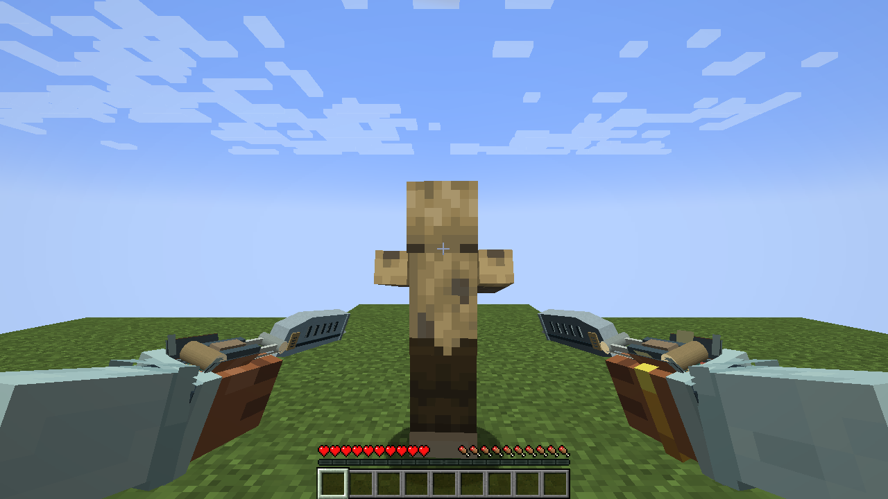

# Cyberware reference

Install implants at a **Cybernetics Bench**. The tab beside your inventory is an equipment viewer. All implants in this release are **tier 1**; tiers 1–5 use white, green, blue, purple and orange.

| Implant | System | Capacity |
| --- | --- | --- |
| Optical Scanner | Face | 4 |
| Cyberdeck | Operating System | 8 |
| Mantis Claws | Arms | 12 |

## Optical Scanner

Hold **V** to scan a living target within **32 blocks**, with clear line of sight. Release to close. Shows health, armor, attack damage, absorption and visible effects. Installing a loaded cyberdeck adds quickhack controls to this same overlay.

ID: `cybernetics2077:optical_scanner`

| | | |
| --- | --- | --- |
| Iron ingot | Glass | Iron ingot |
| Redstone | Amethyst shard | Copper ingot |
| Iron ingot | Lapis lazuli | Iron ingot |

## Cyberdeck

**4 RAM · 2 quickhack slots · regenerates 1 RAM per 5 seconds**

Install the deck in the bench’s **OS** socket. Select the installed deck under **Operating System** in the inventory cyberware menu, then press **Manage Quickhacks**. The back arrow returns to the same Operating System page. The bench also has a **Cyberdeck** shortcut. Shift-click a chip to install it, or move it into a quickhack socket. Only one copy of each program can be installed. Removing the deck preserves its chips; removing the deck or program cancels pending uploads and refunds their reserved RAM.

ID: `cybernetics2077:cyberdeck_tier_1`

| | | |
| --- | --- | --- |
| Gold ingot | Copper ingot | Gold ingot |
| Redstone | Amethyst shard | Redstone |
| Iron ingot | Copper ingot | Iron ingot |

## Short Circuit

**Tier 1 · 2 RAM · 1-second upload · 8 electrical damage**

Install its chip in the cyberdeck. Hold **V**, aim at a living target, and **left-click** the Short Circuit entry or crosshair to upload. Up to two uploads can be queued, with RAM reserved immediately. Progress appears above the target’s head. Electrical damage bypasses armor; it respects invulnerability and server PvP/team rules. A locked upload can finish after losing sight, within 48 blocks and the same dimension.

ID: `cybernetics2077:short_circuit_tier_1`

| | | |
| --- | --- | --- |
| *(empty)* | Redstone | *(empty)* |
| Copper ingot | Lapis lazuli | Copper ingot |
| *(empty)* | Iron nugget | *(empty)* |

## Mantis Claws

Install in **Arms**, empty both hands, and press **G** to deploy or retract the pair. A shallow dorsal hatch opens on the back of each forearm, while the palm, wrist and sides stay opaque. Native skin and enabled sleeve UVs remain on the arm and hatch. The mount faces upward; the blade points forward past the hand.

| Control | Attack | Physical damage | Interval |
| --- | --- | --- | --- |
| Left-click | Alternating right/left slash, then rising cut | 8 / 8 / 10 | 0.5 seconds |
| Hold right-click ≥0.4 seconds, release | Charged double-blade lunge | 14 | 1.1 seconds |

Deployment takes **1.5 seconds**: the original Minecraft hand moves into position, the hatch opens, the dorsal hinge and support deploy, then the distinct blade tip slides out of its fixed sleeve. Retraction pulls the tip in first and returns the same hand to its normal pose. Damage lands on the animated contact frame and requires aim, range and line of sight. Aim at a visible living target within **8 blocks** to leap toward it, including from midair. With no target, leap **6 blocks in the direction you are looking**. Both use normal collision and stop at solid obstacles. Aimed leaps deal damage at contact; free leaps can hit an enemy at their endpoint. Holding an item retracts the claws. Keys can be rebound under **Options → Controls → Cybernetics 2077**.

ID: `cybernetics2077:mantis_claws_tier_1`

[Watch deployment and attacks](media/mantis-claws.mp4)

| | | |
| --- | --- | --- |
| Iron sword | *(empty)* | Iron sword |
| Piston | Diamond | Piston |
| Copper ingot | Redstone | Copper ingot |

## Cybernetics Bench

Right-click to install or remove matching implants. Shift-clicking an implant out requires room in your inventory. Capacity and body-system restrictions apply. The **Cyberdeck** button becomes available when a deck is installed and your cursor is empty.

ID: `cybernetics2077:cybernetics_bench` · Creative tab: **Functional Blocks**. Implants and quickhack chips appear in **Tools & Utilities**.

| | | |
| --- | --- | --- |
| Iron ingot | Glass | Iron ingot |
| Redstone | Crafting table | Redstone |
| Iron ingot | *(empty)* | Iron ingot |

All recipes unlock in the recipe book after obtaining redstone. Breaking a bench drops the workstation; installed cyberware stays with your character. Installed equipment is retained on death.
