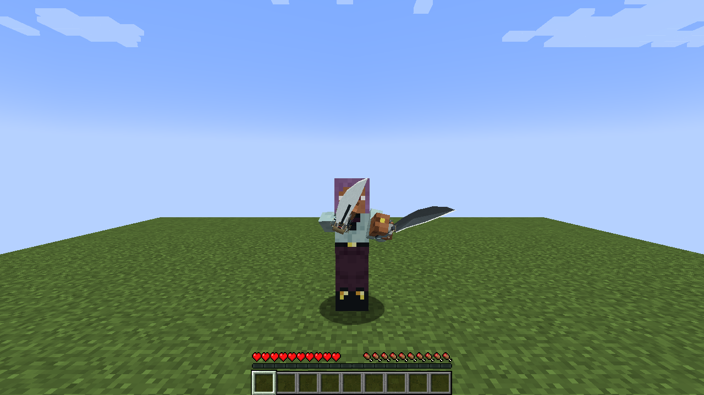

# Native previews

These captures come from Minecraft 1.21.1 with NeoForge and Cybernetics 2077 0.4.1. The hologram displays the local player’s current Minecraft skin with translucent cyan shading, scanlines, an animated scan sweep and a subtle edge glow. The body retains its normal Minecraft proportions and is centered in the overview; close-ups track the selected region. This review includes the corrected shoulder/elbow rig, ground/air lunge movement, attributed Cyberpunk icons and chip-shaped quickhack/upload display.

[Body-area zoom](media/face-zoom.mp4) · [Scanner opening](media/scanner-opening.mp4)

[Cortex category](images/cortex.png) · [4:3 layout](images/four-three.png) · [Ultrawide layout](images/ultrawide.png) · [Creative inventory entry](images/creative.png)

## Classic and slim skins

The review switches the local player's loaded skin to Minecraft's built-in Steve and Alex skins to verify live texture and model changes. These textures are supplied by Minecraft and are not bundled in the mod.

| Classic model | Slim model |
| --- | --- |
|  |  |

[Outer layers enabled](images/player-skin-layers-enabled.png) · [Outer layers disabled](images/player-skin-layers-disabled.png)

## Cyberdeck and Mantis Claws

[Deployment, combo, charged lunge and retraction](media/mantis-claws.mp4) · [Short Circuit upload](media/short-circuit.mp4)

These are native Minecraft captures. The forearm hatch and mechanism open from the **outer side** of each arm. Player skin and sleeve pixels follow the articulated panels; the blade has a tapered mesh, separate bevels, fuller, serrated heel and articulated hinge.
