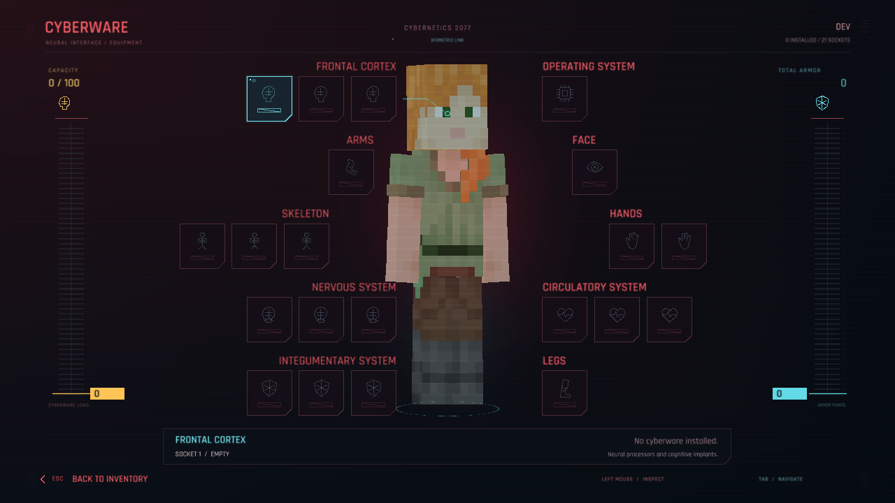
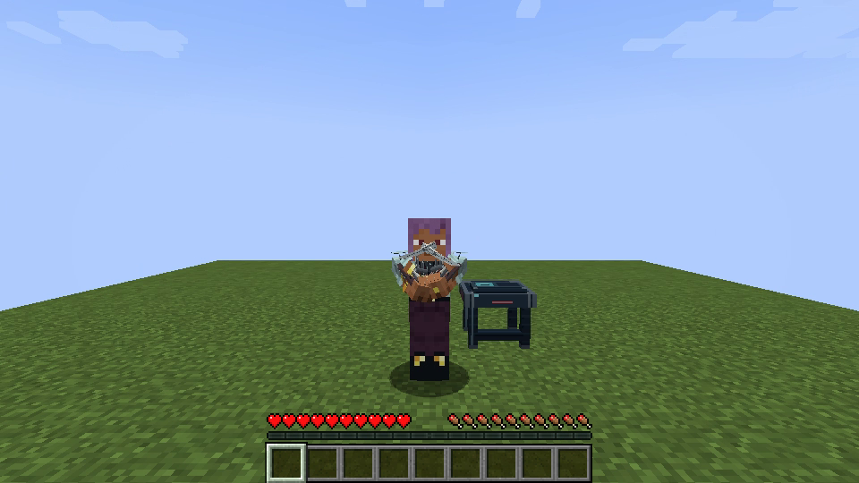
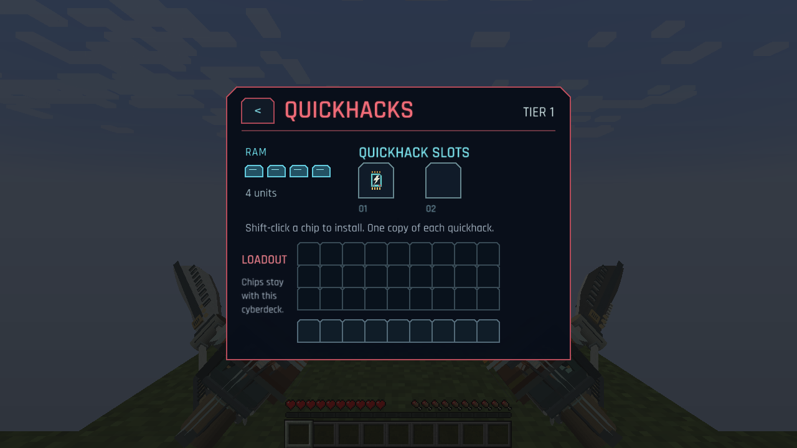
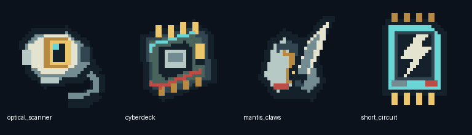

# Native previews

These captures come from Minecraft 1.21.1 with NeoForge and Cybernetics 2077. Mantis previews are updated for 0.5.9; the interface images show the same features in earlier builds. The hologram displays the local player’s current Minecraft skin with translucent cyan shading, scanlines, an animated scan sweep and a subtle edge glow. The body retains its normal Minecraft proportions and is centered in the overview; close-ups track the selected region. This review includes the corrected shoulder/elbow rig, ground/air lunge movement, Minecraft-style pixel icons native-hand pose handover and independent dorsal hatch/hinge/carriage/tip deployment, free leaps, chip-shaped quickhack/upload display and viewer-based quickhack installation.

[Body-area zoom](media/face-zoom.mp4) · [Scanner opening](media/scanner-opening.mp4)

[Cortex category](images/cortex.png) · [4:3 layout](images/four-three.png) · [Ultrawide layout](images/ultrawide.png) · [Creative inventory entry](images/creative.png)

## Classic and slim skins

The review switches the local player's loaded skin to Minecraft's built-in Steve and Alex skins to verify live texture and model changes. These textures are supplied by Minecraft and are not bundled in the mod.

| Classic model | Slim model |
| --- | --- |
|  |  |

[Outer layers enabled](images/player-skin-layers-enabled.png) · [Outer layers disabled](images/player-skin-layers-disabled.png)

## Cyberdeck and Mantis Claws

[Deployment, combo, charged lunge and retraction](media/mantis-claws.mp4) · [Short Circuit upload](media/short-circuit.mp4)

The 0.5.8 blades use the [original Blender model](../art/mantis/README.md). The lower support angles backward and upward, then the shorter cutting section points forward from its hinge. The mount and linkage retain their size, while the housing is deeper and wider and the cutting section is shorter. Eight independent covers lift and shift away to expose the harness. The covers start opening before the folded support and receiver rise together; the palm and hand stay closed. The gameplay clips above use this model.

These are native Minecraft captures. The hatch and mount sit on the **dorsal side** of each forearm. The mount faces up and the blades point forward past the hands. The recess has an opaque backing; the rest of the arm remains closed. Player skin and sleeve pixels follow the articulated panels; the blade has a tapered mesh, separate bevels, fuller, serrated heel and articulated hinge.

## Quickhack management

[Watch quickhack editing from the cyberware menu](media/quickhack-management.mp4)

Select your installed Operating System, then **Manage Quickhacks**. Implant installation stays at the bench.

[Watch the distal tip retract and extend in a native close-up](media/mantis-mechanism.mp4)

The current Mantis clips are native 960×540 recordings exported at 30 fps. They use a recording profile without per-tick screenshot capture, which caused stalls in the earlier preview. Full-size diagnostic screenshots are collected separately.

[Watch the segmented forearm opening from a fixed native close-up](media/mantis-forearm-panels.mp4)

The 0.5.8 captures show overlapping cover opening and shared support/receiver rise, a backward carriage slide, then forward blade unfolding. The first-person weapon lens and hand framing are adjusted against the supplied Cyberpunk video. World FOV remains unchanged.

## Lower first-person stance (0.5.9)

The ready hands sit near the bottom corners rather than floating in the centre of the view. The upper arms continue below the bottom edge, with the forearms angled forward. The supplied Cyberpunk physical-blade video guides the idle framing; deployment still lifts into view for inspection. This changes only first-person placement, retaining the segmented covers, shared lift and backward housing slide from 0.5.8.
