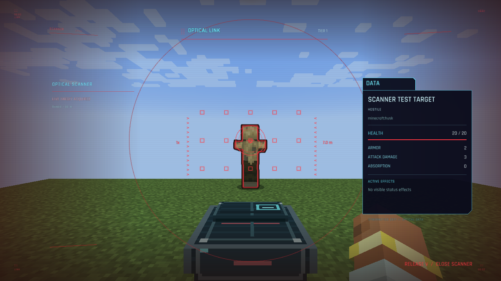

# Native previews

These captures come from Minecraft 1.21.1 with NeoForge and Cybernetics 2077 0.3.2. The hologram displays the local player’s current Minecraft skin with transparency and scanlines. The tier 1 Optical Scanner, installation bench and category close-ups remain available.

[Body-area zoom](media/face-zoom.mp4) · [Scanner opening](media/scanner-opening.mp4)

[Cortex category](images/cortex.png) · [4:3 layout](images/four-three.png) · [Ultrawide layout](images/ultrawide.png) · [Creative inventory entry](images/creative.png)

## Classic and slim skins

The review switches the local player's loaded skin to Minecraft's built-in Steve and Alex skins to verify live texture and model changes. These textures are supplied by Minecraft and are not bundled in the mod.

| Classic model | Slim model |
| --- | --- |
|  |  |

[Outer layers enabled](images/player-skin-layers-enabled.png) · [Outer layers disabled](images/player-skin-layers-disabled.png)
