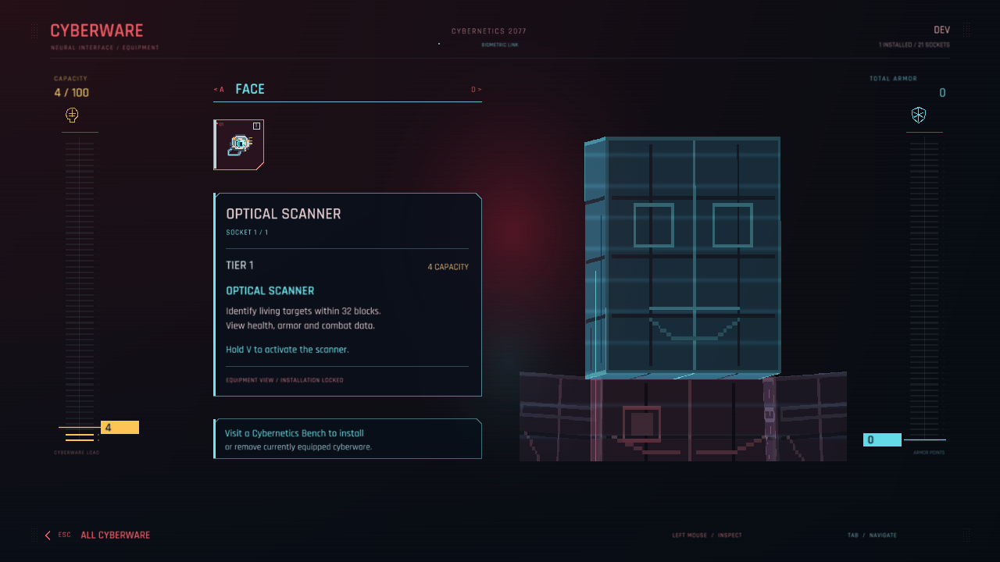
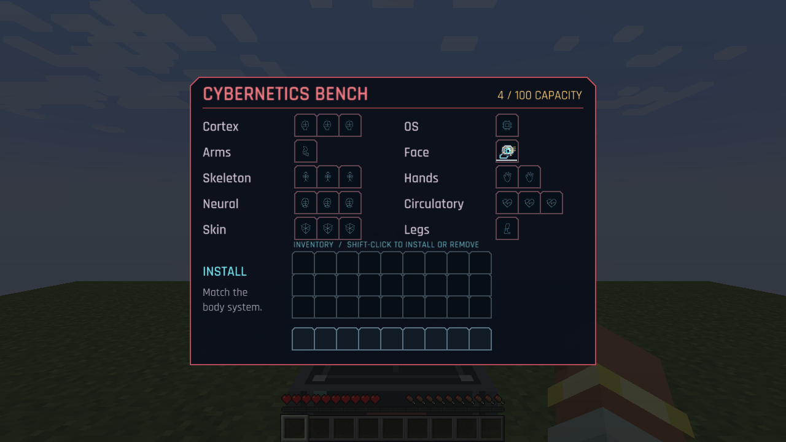

# Native previews

These captures come from Minecraft 1.21.1 with NeoForge and Cybernetics 2077 0.3.1. The original first-release player-model hologram and diagnostic texture are restored. The tier 1 Optical Scanner, installation bench and category close-ups remain available.

[Body-area zoom](media/face-zoom.mp4) · [Scanner opening](media/scanner-opening.mp4)

[Cortex category](images/cortex.png) · [4:3 layout](images/four-three.png) · [Ultrawide layout](images/ultrawide.png) · [Creative inventory entry](images/creative.png)
