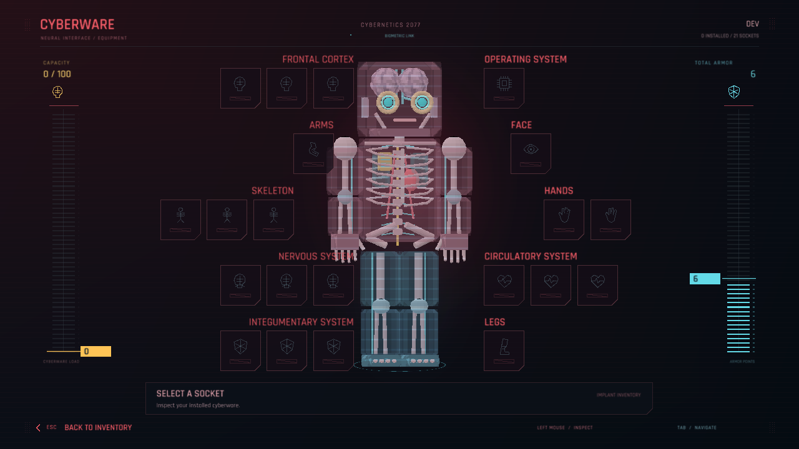

# Native previews

These captures come from Minecraft 1.21.1 with NeoForge and Cybernetics 2077. The scanner target is a stationary husk used only for review. The installed item is the actual craftable tier 1 Optical Scanner.

[Body-area zoom animation](media/face-zoom.mp4) · [Scanner opening animation](media/scanner-opening.mp4)

[Frontal cortex view](images/cortex.png) · [4:3 category view](images/four-three.png) · [Ultrawide category view](images/ultrawide.png) · [Creative inventory entry](images/creative.png)
