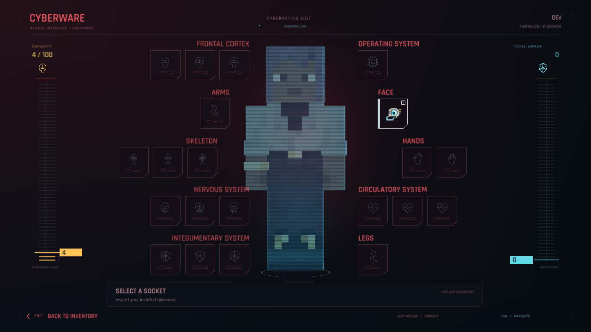
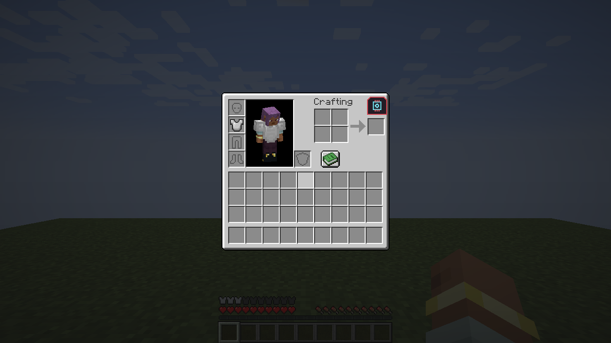

# Validation

Minecraft 1.21.1, NeoForge 21.1.248, Java 21. Tests use NeoForge alone, without Tensura or other gameplay mods.

## Animated blocks and smooth pistons (0.19.0)

**98 JVM tests, 133 dedicated-server GameTests, native shader pixel/piston review, clean package audit and strict wiki build pass.** [Results](review/results/animation-0.19.0.json) · [Rendering design and native references](research/LOCAL-ANIMATION-0.19.0.md) · [Player guide](wiki/dynalar-sandevistan.md#time-bubble).

Four added JVM cases verify local visual rates/phase, restoration/expiry, the clock-state bound and Java/GLSL hash agreement near both world limits. Four added server scenarios verify continuous native piston progress/interpolation for both models in both directions, actual bound-ticker progress, straight-line assembly timing across a bubble edge and normal resumption, and native slime push/velocity. The 129 prior scenarios also pass, including actual furnace, fluid, repeater, scheduler, shop and combat behavior.

The integrated client compares actual shader framebuffer output against independently selected source animation frames for water, lava, fire, Nether portal and magma. It separately compares the same shader outside the field with vanilla pixels. It samples client piston endpoints on consecutive native ticks, checks frame/storage bounds and confirms visual clocks expire after their restoration fade. The prior native Dynalar input/installation/trail review runs before the new fixture. Native screenshots are direct client output.

```sh
./gradlew test runGameTestServer -I docs/review/server.init.gradle
./gradlew runClient -I docs/review/client.init.gradle -PanimationReview
./gradlew clean test build
python3 scripts/verify-release.py
python3 scripts/check-wiki.py
mkdocs build --strict
```

Native graphics checks use 1280×720 software OpenGL in a disposable integrated world, without working audio or session services. This is not a hardware benchmark or authenticated two-computer multiplayer test. The default atlas has 49 supported animated block sprites; cache budgets and renderer/resource-pack limits are documented in the rendering notes. Procedural End portal rendering and replacement shader/terrain pipelines are outside the tested path. Review classes and reference downloads are excluded from the clean release.

## Iconic requisitions and Apogee (0.18.0)

**94 JVM tests, 129 dedicated-server GameTests, native purchase/install/activation review, clean release audit and strict wiki build pass.** [Results](review/results/iconics-0.18.0.json) · [Reference mechanics and implementation](research/ICONICS-APOGEE-0.18.0.md) · [Iconic player guide](wiki/iconics.md) · [Apogee stats](wiki/militech-apogee.md).

Five added JVM cases cover rare-drop odds, invalid loadouts, model-specific battery/bonuses, equal/unequal-user relative speeds and unchanged Dynalar tiers. Eight new server scenarios exercise mandatory exact-tier chip payment through every purchase path, atomic delivery and inventory-slot reclamation, funds/reputation/stale-stock failures, chip plus salvage loot and duplicate/mob-loot guards, different/equal models and PvP, saved/legacy battery state, native enemy deaths and passive-animal exclusion, projectile impact-height/damage matching, and installed capacity/socket/client state.

The native integrated-client fixture uses the real shop button and inventory synchronization: disabled acquisition without a chip, enabled acquisition after receipt, €$75,000 payment and chip consumption, actual clinic installation, Iconic equipment details, O activation, 0.1875× ordinary environmental pace, first-person full-body echoes and early-off recharge. Screenshots are direct client output, without generated frames or substituted UI artwork. The existing Dynalar client playthrough also runs before these scenarios.

```sh
./gradlew test runGameTestServer -I docs/review/server.init.gradle
./gradlew runClient -I docs/review/client.init.gradle -PiconicReview
./gradlew clean test build
python3 scripts/verify-release.py
python3 scripts/check-wiki.py
mkdocs build --strict
```

The native environment uses 1280×720 software OpenGL in a disposable world, without working audio or session services. This is not a hardware benchmark or authenticated two-computer multiplayer test. Headshot tests feed native impact events at chosen heights into actual damage calls; they do not cover every target shape or external projectile implementation. Review fixtures are excluded from the clean release.

## Local time bubble and first-person body trails (0.17.0)

**89 JVM tests, 121 dedicated-server GameTests, the native bubble review, the established trail review, clean release audit and strict wiki build pass.** [Results](review/results/bubble-0.17.0.json) · [Clock/scheduler design and compatibility](research/SANDEVISTAN-BUBBLE-0.17.0.md) · [Player guide](wiki/dynalar-sandevistan.md).

The 32-block field now paces standard block-entity tickers, existing/new scheduled block/fluid delays, random updates and loose world entities. Native tick queues retain ownership, duplicate checks, priorities and chunk serialization. Remaining local delays are persisted separately, indexed by loaded chunk, and preserved across area copy/clear and chunk lifecycle. Deferred callbacks run once when ready; the field does not accumulate a backlog of missed update calls.

Five added JVM cases cover complete local delays, exit behavior, visual-clock continuity, frame subdivision and restoring fractional timers. Nine added server cases exercise local block/fluid scheduling, activation after scheduling, field exit, saved NBT/cancellation, overlap/range/random frequency, real furnace/control progress, copied unfinished delays, real water flow and real repeater timing. Native furnace measurements confirm unchanged game/sun clocks. Saved-delay persistence is verified through NBT round trips, not a full external process restart.

The native client review validates actual rain UV hooks, paced WaterDropParticle updates, visible own full-body poses in first person, third-person rendering and normal rain speed after deactivation. It asserts the sun continues with world time. The trail review repeats camera/body overlap, camera inside an old head, reversal and view switching with the new 1.25-block own-body clearance. The first-person trail screenshot is direct native output.

```sh
./gradlew test runGameTestServer -I docs/review/server.init.gradle
./gradlew runClient -I docs/review/client.init.gradle -PbubbleReview
./gradlew runClient -I docs/review/client.init.gradle -PtrailReview
./gradlew clean test build
python3 scripts/verify-release.py
python3 scripts/check-wiki.py
mkdocs build --strict
```

Native review uses a disposable integrated world and software OpenGL at 1280×720, without working audio or session-service connectivity. It is not authenticated two-computer testing or a hardware performance benchmark. Vanilla/standard ticker, scheduler and weather paths are covered; custom global machine timers and replacement weather renderers may keep their own clocks. The sun/shared weather cycle and global server tick rate are not changed. Review fixtures are excluded from the clean release.

## Sandevistan camera anchoring (0.16.2)

**84 JVM tests, eight native pixel camera scenes, the established native trail suite, clean release audit and strict wiki build pass.** [Results](review/results/trail-camera-0.16.2.json) · [Root causes](research/SANDEVISTAN-CAMERA-0.16.2.md) · [Visible before/after](images/sandevistan-camera-comparison-0.16.2.png).

World replay previously read a global model-view matrix before Minecraft had applied the camera view at that render stage. It now uses the render event's view/projection explicitly. First-person arms save their camera position/quaternion at capture and transform through the current view during replay. Saved positions no longer follow the camera. Birth colors, draw/history budgets and anti-overlap/proximity fading remain.

Three added JVM regressions check 24 compass/pitch views, turning away from a captured hand and camera translation past a known saved point. The isolated native pixel test checks six first-person yaw/pitch angles and both third-person modes. It moves the live owner away, measures the saved pose's region, clears history, then measures the same background. Held hands/HUD and animated clouds are disabled to isolate ghost pixels. An earlier broad framebuffer comparison included moving hands/clouds, so its figures are discarded. The final fixture confirms that the scripted actor is tracked/interpolated at the expected position before moving it away; an initially short window missed this at a chunk boundary.

The shipped renderer reproduced missing ghost pixels at several angles. The corrected renderer produces **4,152–8,136 changed pixels** in the expected region across all eight final cases. These figures validate visible output for those scenes, not every graphics-mod combination. The established suite also passes stationary first/third person, camera inside a saved head, reversal and returning to first person, reaching 12 echoes / 70,944 replayed vertices within existing budgets. First-person arm camera anchoring has separate mathematical regression coverage; the camera pixel scenes measure remote world poses.

```sh
./gradlew test runClient -I docs/review/client.init.gradle -PcameraReview
./gradlew runClient -I docs/review/client.init.gradle -PtrailReview
./gradlew clean test build
python3 scripts/verify-release.py
python3 scripts/check-wiki.py
mkdocs build --strict
```

Native review uses 1280×720 software OpenGL in a disposable integrated world, without working audio or session-service connectivity. It is not a hardware benchmark or authenticated two-computer multiplayer test. Combat timing, sun/weather clocks and server gameplay are unchanged; previous server combat tests are not rerun for this client-only correction. Review classes are excluded from the clean release.

## Distinct Mantis receivers and elemental effects (0.16.1)

**81 JVM tests, the native client review, clean release audit and strict wiki build pass.** [Results](review/results/mantis-appearance-0.16.1.json) · [Design and render budgets](research/MANTIS-APPEARANCE-0.16.1.md) · [Visual comparison](images/mantis-variants-0.16.1.png).

All elemental receivers now have different cross sections, material treatments, hardware and inventory silhouettes. A shared small emissive texture supplies three local animation patterns: heat wisps, electrical filaments and green vapor. Their transforms follow the actual blade/tip/edge animation; the Physical model has no elemental effect. The full native review checks deployment, attacks, retraction, daylight/night and third-person views, synchronized types, valid item models/translations and bounded effect counts. All variant near/far meshes pass moving-cover intersection checks on regular/slim arms. The same six groups, cached mesh pipeline and near/far switch remain.

Maximum effect geometry is 54 / 66 / 42 quads per arm for Thermal / Electrifying / Toxic, using one cached render type and one reused buffer. Distance fading and omission from far LODs and captured Sandevistan poses bound the extra cost. No persistent particle entities or dynamic lights are spawned. The native run uses 1280×720 software OpenGL in an integrated test world, without working audio or session services; it does not establish hardware performance or authenticated two-computer multiplayer. Server gameplay is unchanged, so the previous 112 server scenarios were not repeated. Review fixtures are excluded from the clean release.

```sh
./gradlew runClient -I docs/review/client.init.gradle -PhandsReview
./gradlew clean test build
python3 scripts/verify-release.py
python3 scripts/check-wiki.py
mkdocs build --strict
```

## Hands cyberware and Mantis variants (0.16.0)

**81 JVM tests, 112 dedicated-server GameTests, the native client review, clean release audit and strict wiki build pass.** [Results](review/results/hands-mantis-0.16.0.json) · [References and Minecraft adaptations](research/HANDS-MANTIS-0.16.0.md) · [Player guides](wiki/cyberware.md).

The new rules tests cover bounded homing, preserved speed, reflection, no reverse tracking, degenerate vectors, charge periods and distinct per-variant geometry/LOD budgets. The existing exported-triangle test now checks all three elemental near/far meshes against the moving forearm covers throughout deployment, on both normal and slim arm depths. Every checked mesh clears those plate surfaces.

Thirteen added server scenarios cover all six Hands families and four blade families, preserved old shop indexes, scan/optics requirements, solid-wall obstruction, real-arrow ricochets without tunneling, deferred rebounds after owner loss, landed trident guidance, real secondary electrical damage and primary hurt-memory preservation, saved cooldowns, Handle Wrap without optics and anti-refresh behavior, ranged knockback, stationary/airborne charging, no-gravity arrows, elemental statuses, non-stacking bleed, killing-hit bursts, four-target limits and passive-bystander exclusion. The new burst damage still respects armor; it does not clear ordinary weapon hit protection. Existing server coverage continues to check PvP, installation, shops and all prior systems.

The server run exposed a timing assumption in an old Sandevistan test: forced chunks were not always entity-ticking before the sample began. The fixture now waits for ticking readiness. The new bleed fixture retains its fake owner and explicitly delivers the due entity-post event if the fake environment has not ticked the mob. Production Sandevistan/bleed clocks are unchanged by these fixture corrections.

The native review runs actual deployment/retraction and attack input for each variant, checks synchronized equipped types and six rigid groups, and captures first/third-person views. It renders every new tier item without missing models or translation keys and draws the bow trajectory with two installed Hands implants. A first capture had the old combat target obscuring the front camera; the final capture clears that fixture before inspecting the player. [Variant comparison](images/mantis-variants-0.16.png) · [Native item gallery](images/hands-catalogue-0.16.png) · [Bow preview](images/hands-bow-preview-0.16.png).

```sh
./gradlew runGameTestServer -I docs/review/server.init.gradle
./gradlew runClient -I docs/review/client.init.gradle -PhandsReview
./gradlew clean test build
python3 scripts/verify-release.py
python3 scripts/check-wiki.py
mkdocs build --strict
```

The client uses a disposable integrated world at 1280×720 with Mesa software OpenGL. No working OpenAL device or Mojang session-service connection was available. This validates these native visual/input paths and a dedicated-server launch, not hardware frame rates, sound, authenticated skins or a two-computer multiplayer session. New models retain cached six-group meshes, one atlas per variant and the existing 16-block far-LOD switch. The bow preview is bounded to 40 segments and one rebound. Review classes, reference downloads and Blender/Python source files are excluded from the clean release JAR.

## Captured Sandevistan colors (0.15.2)

The supplied Edgerunners clip was inspected in sequential frames. Older cyan snapshots remain cyan as newer blue/violet snapshots appear. The renderer now captures each pose's birth time and RGB once; only alpha changes afterward. New poses advance through a shared hand/body palette per observed activation. [Reference observations and implementation](research/SANDEVISTAN-FIXED-TINTS-0.15.2.md) · [Player guide](wiki/dynalar-sandevistan.md).

**75 JVM tests and the native trail review pass.** The tests cover immutable birth hues during later frames, different hues for successive captures, fade without RGB rotation, smooth palette wrapping, independent activation timing, first-person opacity, LOD limits and local-body suppression. The native review repeats stationary first/third-person views, actual Mantis attacks, camera overlap, reversal and view switching in a disposable integrated world. It reached 12 simultaneous echoes / 70,944 replayed vertices, retaining the existing 48-pose global limit. [Results](review/results/trails-0.15.2.json).

The new [native screenshot](images/sandevistan-fixed-tints.png) is from that running client. The third-party reference clip and extracted frames are not redistributed. This adapts the observed snapshot behavior; it is not a claim of pixel-identical anime colors, shot timing, or matching colors between different networked observers. Existing two-second trail lengths, clipping safeguards and all server gameplay/battery rules remain. Dedicated-server GameTests were not rerun for this client-only change.

The native run used 1280×720 software OpenGL and had no working OpenAL audio device or Mojang session-service connection. It validates the local visual scenarios, not audio, authenticated skins, hardware performance, or a two-computer connection. The older previews below document their respective versions and show the previous age-based color behavior.

## Sandevistan trail corrections (0.15.1)

**74 JVM tests, 99 dedicated-server GameTests, the native trail review and clean package audit pass.** [Results](review/results/trails-0.15.1.json) · [Rendering changes and root causes](research/SANDEVISTAN-TRAILS-0.15.1.md) · [Player guide](wiki/dynalar-sandevistan.md).

Six new JVM cases cover visible late-spectrum colors, continuous interpolation, independent opacity, bounded history sampling and first-person suppression. The extended native review exercises stationary views, attacks, a camera inside a saved head, reversal through the player's trail and returning to first person. It reached 12 simultaneous world echoes / 70,944 replayed vertices in the extended scenes and remained within the global 48-pose draw limit. Live-body exclusions and first-person body suppression are asserted. The first full server run exposed an existing Biomonitor fixture scheduling a zero-delay callback from inside another callback. Its ten checks now all run on future ticks so every absolute clock phase is covered; production medical code is unchanged.

Comparing the native camera-inside-ghost capture with the same scene after clearing the history gives a mean channel difference of **0.276 / 255** in the central 400×240 region; no upper-view pixel changes by more than 64 in any channel. This is evidence for that regression scene, not an exhaustive guarantee for every camera/shader combination.

The [silent preview](media/sandevistan-trails-0.15.1.mp4) is direct 960×540 X11 footage encoded at 30 fps without generated/interpolated frames. While recording the longer-trail segment, software OpenGL measured **28.0 ms median / 36.2 ms p95**, across 185 intervals. This differs from the older two-moving-runner scene and is not a controlled comparison or a hardware benchmark. Testing uses an integrated server plus a scripted tracked player, not two computers.

```sh
./gradlew test runGameTestServer -I docs/review/server.init.gradle
./gradlew runClient -I docs/review/client.init.gradle -PtrailReview
./gradlew clean test build
python3 scripts/verify-release.py
```

Native success writes `capture/trails-passed.txt`. Review fixtures are excluded from the clean release. Tier slowing strength and all combat/battery rules remain unchanged.

## Dynalar Sandevistan (0.15.0)

**68 JVM tests, 99 dedicated-server GameTests, the native client review and clean package audit pass.** [Results](review/results/sandevistan-0.15.0.json) · [Research and clock/rendering design](research/SANDEVISTAN-0.15.0.md) · [Player guide](wiki/dynalar-sandevistan.md).

Seven new pure rules tests cover fixed Dynalar slowing, proportional different-model interaction, equal-user parity, non-stacking fields, fractional clock accumulation, virtual interpolation and tier progression. Six new server scenarios cover saved battery/rearm/recharge, reversible attributes, equal-strength different-tier users, PvP-off protection, projectile ownership/range, actual paced mob/projectile ticks with unchanged world time, real-time hurt protection and weapon critical/recovery benefits. The native-tick fixture explicitly forces its test chunks so asynchronous chunk loading cannot produce an unticked entity. Existing installation coverage now includes all 115 augment variants.

The client review installs Dynalar and Mantis Blades through actual bench transactions, opens the native OS page, activates/deactivates through the real keybind and checks the charge HUD. A tracked scripted second player receives independent Sandy/Mantis state. When the local player switches off first, their real server-authoritative movement pace drops to 0.625 while the opponent remains active. Visual inspection checks textured skin/armor/cyberarm pose echoes, first-person trails and the framebuffer lens. The final run reached two trailed actors, 14 visible echoes and 97,176 replayed vertices; no duplicate ghost entities are spawned.

The silent [native preview](media/sandevistan-native-preview.mp4) uses direct X11 capture without generated/interpolated frames. During the recorded active segment at 960×540, this software-rendered environment measured median **35.7 ms**, p95 **55.3 ms** (142 intervals). Retained GPU replay improved the median from **40.1 ms** in the preceding capture. These are capture-environment timings, not hardware GPU promises or a two-computer latency test. The recorded frame rate is 30 fps; the renderer can deliver fewer unique frames.

```sh
./gradlew test runGameTestServer -I docs/review/server.init.gradle
./gradlew runClient -I docs/review/client.init.gradle -PsandevistanReview
```

Use the disposable **Cybernetics Review** save. Success writes `capture/sandevistan-passed.txt`; failure writes `capture/failed.txt`. Clean before packaging to exclude review code. Source assets can be regenerated with `python3 art/sandevistan/build_assets.py` (Pillow and FFmpeg).

## Fourteen-family expansion (0.14.0)

**61 JVM tests, 93 dedicated-server GameTests, the native client review, clean build, package audit and 55-page wiki validation pass.** [Results](review/results/expansion-0.14.0.json) · [Sources and adaptation notes](research/CYBERWARE-EXPANSION-0.14.0.md).

The eleven new server scenarios cover category counts and saved shop indices, all tiered offers, real RAM recovery, armor/toughness and removal, Self-ICE damage/control interception and saved cooldown, PvP rules, Pain Editor against quickhacks, medical supply consumption, Second Heart fatal damage/recharge/void exclusion, once-only melee bonuses and weapon crits, different leg movement effects, cover-aware specialized optics, and bounded Shock-n-Awe retaliation. The original variant-installation test now covers all 111 augment variants. Blood Pump now schedules its first regeneration pulse one second after casting, preventing an extra immediate pulse on globally aligned ticks.

The native review resolves all 56 new item models/translations, shift-clicks actual bench installations, opens the real Self-ICE detail page and verifies the synchronized medical loadout. A fatal hit on the actual integrated-server player is cancelled by Second Heart, restores full HP, and updates the visible recharge indicator. Native captures are in the [preview archive](PREVIEWS.md#cyberware-expansion-0140). This is not a two-client network-latency test.

```sh
./gradlew test runGameTestServer -I docs/review/server.init.gradle
./gradlew runClient -I docs/review/client.init.gradle -PexpansionReview
```

Use the disposable **Cybernetics Review** save. Native success writes `capture/expansion-passed.txt`; failure writes `capture/failed.txt`. Clean before packaging to exclude review classes.

## Cyberware recipe removal (0.13.1)

Removed all 18 implant, cyberdeck and quickhack crafting/smithing recipes and their 18 recipe-book advancements. The Cybernetics Bench recipe and its redstone unlock remain. Cyberware is obtained from ripperdoc stock; installed items and inventories retain their existing IDs and data.

**61 JVM tests and all 82 remaining dedicated-server GameTests pass.** The clean release build and package audit pass.

The obsolete smithing-upgrade GameTest was removed. The release verifier now requires the packaged recipe and recipe-unlock directories to contain only the bench, checks its result/unlock, and continues verifying every tier's item model and metadata. [Results](review/results/recipes-0.13.1.json).

## Enhanced mobs and salvage (0.13.0)

Release 0.13.0 passes **61 JVM tests**, **83 dedicated-server GameTests**, and the native enhanced-mob/shop review.

The new checks cover rare spawn probability and spawn-source exclusions; real installed loadouts; combat attributes and ranged damage; save/load without modifier stacking or free healing; Blood Pump/Adrenaline activation and saved cooldowns; vanilla water conversion; actual death drops, duplicate-drop protection and `doMobLoot`; matching-tier payment; normal purchases keeping parts; quickhack/Street Cred/stock exclusions; full inventories; and insufficient funds. Probability tests verify that increasing either average implant tier or implant count improves every higher-tier drop threshold.

The native review renders the actual enhanced mob layers and all five part item models, opens a real doctor menu, reads the discount tooltip and uses the mouse to purchase €$1,000 optics for €$700 and exactly one Tier 1 part. The client confirms the synchronized wallet, part count and purchased item. It also checks every visible shop widget at **320×240**. This uses an integrated server, not two separate computers.

```sh
./gradlew test runGameTestServer -I docs/review/server.init.gradle
./gradlew runClient -I docs/review/client.init.gradle -PenhancedReview
```

Native success writes `capture/enhanced-passed.txt`; failure writes `capture/failed.txt`. Clean before packaging. [Results](review/results/enhanced-mobs-0.13.0.json) · [Player guide and screenshots](wiki/enhanced-mobs.md).

The previous 0.9.1 village-services release passed **53 JVM tests**, **55 server GameTests**, the expanded native village-services review and clean-release verification. The client verifies all 25 furniture items in GUI, both first-person hands, both third-person hands, ground and frame contexts. The local player’s skin remains in the hologram.

## Raven and additional quickhacks (0.12.0)

Release 0.12.0 passes **58 JVM tests**, **73 dedicated-server GameTests**, the native six-program review and clean-release verification.

The nine new server scenarios cover Raven's three profiles and all new chip tiers; mixed-loadout serialization and menu-wire identity; duplicate/over-tier rejection; selection of owned kinds and selective refunds; Raven's relay strength and bystander protection; DOT totals and expiry; coexistence/expiry of controls; Contagion ignition; Synapse's spent-RAM formula; and brain-target, team and wall protection. A pre-existing leap fixture now restores its nearby target after checking out-of-range targeting, so its active-leap assertion stays inside the fixture's tracking chunks.

The native review installs Raven and optics at the bench, loads six distinct chips using actual inventory transactions, returns to the OS page, scroll-selects and uploads all six programs through the scanner, verifies three Raven relays and each hack's effect, then searches Raven in a real ripperdoc's daily stock. Screenshots are linked in [previews](PREVIEWS.md#raven-and-six-quickhacks-0120).

```sh
./gradlew test runGameTestServer -I docs/review/server.init.gradle
./gradlew runClient -I docs/review/client.init.gradle -PhacksReview
```

Use the disposable review save below. Success writes `capture/hacks-passed.txt`; failure writes `capture/failed.txt`. Clean before packaging. [Results](review/results/raven-quickhacks-0.12.0.json).

## Daily ripperdoc stock (0.11.0)

Release 0.11.0 passes **58 JVM tests**, **64 dedicated-server GameTests**, native daily-stock/contract testing and clean-release verification.

- Statistical checks sample thousands of daily assortments to verify increasing high-tier availability, including a catalogue with 100 tier-2 items and only seven tier-1 items to detect catalogue-size bias.
- Starter optics are checked at every Street Cred from 0 through 10. Every offered tier must meet its reputation requirement.
- Selection stays stable on reopen and changes at every dawn. Server checks cover the last tick before dawn, an open menu crossing dawn, large day values, forged/stale purchases without payment, and successful purchases of actual stock.
- Native review first completes the delivery, purchases and installs the starter eye, then verifies live stock and countdown synchronization, reputation changes from SC 5 to 19 to 50, equality of the complete client/server stock masks, and rejection of a stale purchase.

```sh
./gradlew test runGameTestServer -I docs/review/server.init.gradle
./gradlew runClient -I docs/review/client.init.gradle -PstockReview
```

Use the disposable review save below. The extended review writes `capture/stock-passed.txt` and `contract-passed.txt`, or `failed.txt`. Clean before packaging. [Daily-stock results](review/results/daily-stock-0.11.0.json).

## Street Cred and delivery contracts (0.10.0)

Release 0.10.0 passes **53 JVM tests**, **61 dedicated-server GameTests**, the native contract review and clean-release verification.

The six new server scenarios cover every tier's reputation gate before payment; real use-on-doctor completion; duplicate/foreign/forged shards; reissue authorization; full inventory handling; saved active/completed records; reward persistence; and navigation without granting optics. The existing 55 scenarios remain green.

The native review accepts the job through the actual fixer screen, checks that the item arrives while that screen is open, hovers the shard, opens the navigation-only scanner, completes through the NPC interaction, verifies €$1,000/+5 Street Cred, buys/installs Basic Kiroshi Optics, and checks the completed dossier at 320×240. It verifies client/server menu and inventory synchronization. A separate two-computer session was not run.

```sh
./gradlew test runGameTestServer -I docs/review/server.init.gradle
./gradlew runClient -I docs/review/client.init.gradle -PcontractReview
```

Use the disposable review save described below. Success writes `capture/contract-passed.txt`; a failure writes `capture/failed.txt`. Clean before packaging, as with the other review profiles.

[Results](review/results/contracts-0.10.0.json) · [Contract guide and screenshots](VILLAGE-SERVICES.md#first-impressions)

## Visual and balance corrections (0.9.1)

- Research uses the original location owner’s 29-image environment portfolio and original bar/VIP/capsule concepts. References are linked in [design notes](research/VILLAGE-SERVICES.md).
- All **6,019** authored template positions pass the support, envelope, patient-light alignment and walking-route audit. Model geometry is checked for a closing plane on every exterior wall and roof surface; deliberately reintroducing the partial-wall truss is rejected. Distant ceiling-only task-light placement is also rejected.
- Native captures inspect the revised industrial entrance, rear elevation, island counter, canopy, clinic task light, four resident skins, inventory icons and held items. Day/night captures check the emissive signs, lenses and continuous lime channels.
- Actual baked vertices are measured after all seven item display transforms. All 25 models are present and fit the display budgets; none uses a missing-model fallback.
- Server checks confirm the credit-chip value of **100 eddies**, no consumption at a full wallet, persistent resident body/identity styles, exact block-state placement in all rotations and village generation in all five pools.
- No decoration ticker, block entity renderer, dynamic light loop or particle emitter was introduced. Emissive faces use NeoForge’s baked face-light data.

[Machine-readable 0.9.1 results](review/results/village-services-0.9.1.json) · [Updated screenshots](PREVIEWS.md)

## Village services (0.9.0)

- The authoring generator reviews all **5,681** template positions, including connected occupied blocks, complete envelopes, furniture/wall/ceiling supports, chair/footrest pairing, monitor stands, NPC body space and reachable service areas. Regeneration produces identical resource bytes.
- Minecraft tests resolve every authored palette entry and compare **every placed state** to its authored/rotated state, then check survival, in all twelve template/rotation combinations. These comparisons include both door halves. Foundation gaps, the street-aligned Afterlife basement, correct persistent NPC counts and supply-barrel currency loot are also checked.
- **960 deterministic vanilla village layouts** (192 for each vanilla village type) exercise actual jigsaw selection, lot fitting and road attachments. These are layout tests on the server review terrain, not estimates of per-village spawn percentages.
- The native client opens NPC menus through interaction, purchases and installs an implant, checks synchronized currency, visits both kinds of building and places a vanilla village through `StructureStart.placeInChunk`. Building, service-wall and menu screenshots are in [Previews](PREVIEWS.md). Native placement uses the same known-shape flags as vanilla jigsaw generation. The isolated structure scenes use flat review terrain.
- The purchase/install menu is checked at **320 × 240 GUI size**. Server tests reject unfunded/full-inventory purchases, distant/dead-NPC access and forged installation clicks in the purchase tab. Fixers expose no unfinished contract/reward actions.
- The old scanner fixture now waits for its target's entity section to become accessible; FakePlayers do not load chunks like real players. No scanner gameplay rules were changed.

[Machine-readable results](review/results/village-services-0.9.0.json) · [Block-context reports](../art/city/audits) · [Reference notes](research/VILLAGE-SERVICES.md)

## Automated checks

- JVM tests cover category mapping, responsive hitboxes, overlap, 32-bit menu fields, smooth camera interpolation, equal horizontal/vertical pixel scale throughout every category transition, centered region targets for classic/slim models, staged scanner/native-HUD transitions, articulated deployment/strike continuity, contact-frame timing, alternating arms, and stroke scale under a 90-degree tab rotation.
- Forty-one native Minecraft GameTests cover category and quantity guards, capacity calculation, equipment serialization, actual player attachment persistence, menu synchronization, rejection of inventory-editing packets, real bench shift-click installation/removal, inventory-full protection, slot/category/capacity guards, bench distance/block validity, scanner ownership/aim/range/line-of-sight, deck/chip category guards, duplicate program rejection, removal and serialization of loaded decks, upload prerequisites and RAM reservation, cancellation/refunds, and blade installation/deployment/contact/terrain guards, eight-block leap acquisition/aim/visibility and cancellation on removing the arm implant, plus viewer chip-editor prerequisites and cursor guards, and delayed leap completion without premature cancellation.
- Native client review opens the inventory, clicks the actual cyberware button using Minecraft mouse input, selects sockets with mouse and keyboard, checks a server-side equipment update, and returns to the correct inventory. It exercises survival and creative, GUI scales 1/2/3, 4:3 and ultrawide windows. It then interacts with the actual bench block, installs the craftable eye using native inventory clicks, scans a husk, verifies server target data, closes the scanner, checks the installed-eye detail view, and removes the eye to confirm the scanner becomes unavailable. It then installs the deck, eye and claws through native bench transactions, opens the chip editor with a mouse click, installs Short Circuit, uploads it through the actual scanner attack input and verifies exactly 8 damage and RAM consumption. It exercises all three light contacts, the charged lunge, deploy/retract and the occupied-hand guard. A free leap also verifies six blocks of travel without a target. The viewer opens the actual chip menu, removes and reinstalls Short Circuit, checks persistence, and returns to the Operating System page. Ground and airborne release tests each move **5.15 blocks** and require exactly one **14-damage** contact; the air test verifies a real jump before release. A solid wall must prevent both travel and damage. Joint tests sample every combo for both arm widths and verify that the shoulder socket stays fixed and both segments share the elbow. Render captures include both first- and third-person animations and the target-mounted upload label.
- The packaging check verifies standalone dependencies, all shipped resources, shader JSON, new items/menus/combat classes, the font license, and absence of test fixtures or old addon content.

The native client screenshots use software OpenGL. The initial armor meter shows a real iron chestplate's six armor points; later captures show the installed tier 1 eye. A temporary test-only implant exercises item rendering and 70,000-point capacity synchronization. It is excluded from the release.

## Reproduce

```sh
./gradlew test build
python3 scripts/verify-release.py
```

Native checks are opt-in, so their helper classes and diagnostic item never enter normal builds:

```sh
./gradlew runGameTestServer -I docs/review/server.init.gradle
```

For client review, copy that disposable test server's `world` directory to the client run directory's `saves/Cybernetics Review`, then run:

```sh
./gradlew runClient -I docs/review/client.init.gradle
```

Both profiles accept `-PcyberReviewRoot=/absolute/path` (default: `/tmp/cybernetics2077-review`). The root holds `server`, `client` and `capture` directories. Client review only edits its specially named disposable save, clears its inventory, and exits automatically with `capture/passed.txt` plus `content-passed.txt`, or `failed.txt`. Pass `-PcyberContentOnly` to the client profile for just the equipment/combat review. Use a desktop session or X display. First-launch accessibility setup is handled by the review harness.

Optional: encode the captured native animations (requires ffmpeg):

```sh
python3 docs/review/assemble-previews.py /tmp/cybernetics2077-review/capture
```

After running a review profile, **clean before packaging**:

```sh
./gradlew clean test build
python3 scripts/verify-release.py
```

## Screenshots

| Equipment | Inventory entry |
| --- | --- |
|  |  |

[Selected cortex socket](images/cortex.png) · [4:3 layout](images/four-three.png) · [Ultrawide layout](images/ultrawide.png) · [Creative inventory](images/creative.png)

The inventory cyberware screen remains read-only; install through a ripperdoc's Install tab or the Cybernetics Bench. Release 0.5.8 introduced the tier 1 deck and Short Circuit. The current release adds Raven Microcyber and five more quickhacks; BioDyne Berserk is also available. Multiplayer uses native server-backed menus and validates scans on the server. An integrated client and headless dedicated server were tested; a separate two-computer session was not.

The category zoom was guided by the user's supplied Cyberpunk video at 0:21–1:05. The scanner's original authored animation and UI drawing code were adapted from the earlier project, with its skill systems, resource displays and dependencies removed.

## Player skin validation

The hologram reads Minecraft's own `PlayerSkin` provider each frame, uses the matching classic/slim model layer, and draws each enabled skin layer. Skin pixels and overlays resolve against depth in an isolated render target; the completed avatar is then composited once at holographic opacity. This retains recognizable skin markings beneath cyan shading and prevents outer layers from being hidden by the base model. Scanlines and the silhouette glow are applied to the completed projection, with no geometry jitter.

Native review verifies the bound skin texture and actual four/three-pixel arm geometry while switching between Minecraft's built-in Steve and Alex skins. It toggles all six outer skin-layer flags and compares render-target pixels using a temporary high-contrast hat/jacket fixture: **102,498 pixels changed**. The fixture exists only in the test process, is released afterward, and is excluded from the public preview images and release JAR. The original player skin is restored and the hologram cache reset at the end. A separate alpha-preserving render-target check measures the classic head’s displayed width/height ratio at **0.99990** (square is 1.0), with the full-body silhouette centered at **0, 0 pixels** of offset. The standard screenshot helper forces alpha to 255, so this silhouette check reads the texture without discarding alpha.

The diagnostic placeholder texture is no longer shipped. Offline/unavailable custom skins use Minecraft's normal fallback. No additional skin service, credential or asset download mechanism is introduced. Hats, jackets, sleeves and trouser overlays are supported; armor, held items and capes are outside this skin preview.

## New content review

The tier 1 deck, chip and arms are installed using native server-backed menu transactions. Loading a chip changes the actual deck’s `minecraft:container` component. A dedicated-server test removes the loaded deck into the player's inventory, serializes and restores that returned stack, and verifies that its program survives.

The client casts Short Circuit against a 100-HP husk: its health falls to 92 after the upload, with RAM reserved on acceptance. Mantis light contacts and the charged lunge are checked against the same target. The client also verifies that drawing fails when a normal weapon is held, then changes to the Nether and checks that the installed eye, deck, program and arm state remain available. The upload display has screenshot checks for visible cyan target-name glyphs and red queue/progress pixels, in addition to visual inspection.

[Mantis combat clip](media/mantis-claws.mp4) · [Quickhack clip](media/short-circuit.mp4) · [Implementation references](research/CYBERWARE.md)

The current Mantis clips are trimmed from a native 960×540, 30-fps desktop recording, including connected third-person cuts and actual ground/air travel. Tick-captured frames are also retained locally by the review for repeatable inspection; the optional preview encoder can assemble those at 20 fps. No rendered concept animation is substituted for gameplay.

To trim a desktop recording against the same run’s capture timestamps:

```sh
python3 docs/review/trim-native-recording.py recording.mp4 /path/to/capture RECORDING_START_UNIX_TIME
```

For desktop recording, match the capture rectangle to the actual game window; a 1280×720 review window can otherwise be centered inside a larger virtual display. The current Mantis clips were recorded with both the desktop and game window at 960×540 and visually checked after trimming.

Release 0.9.0 uses combat protocol 9 and scanner protocol 3. Update clients and server together. The release JAR is built after a clean, without the review profiles.

The 0.5.8 revision also checks ordered cover/hinge/carriage channels and reverse retraction, verifies the inventory tab overlaps its inventory edge, and captures the exposed mechanical cavity. All four item icons are 32×32 nearest-neighbour pixel art.

Lunges now acknowledge completion after the client’s normal position packet. The server permits a bounded delay for slow frames or latency, while validating target contact and terrain visibility. The six-block free leap also waits for actual movement rather than ending on elapsed time alone.

## Mantis handover and anatomy

The 0.5.8 review checks the rest-hand matrix against the actual vanilla `RenderArmEvent` transform before deployment. Classic/slim and left/right mathematical tests check continuous wrist movement, non-collapsing transforms, a dorsal mount facing up and a blade axis pointing forward. The distal tip has its own channel and extends after the support, then retracts before it. Native captures include the original empty hand, deployment, a zoomed dorsal view, tip retraction and redeployment. Native cube UVs preserve skin alignment, and the shallow recess has an opaque floor, palm, sides and wrist.

The presentation clock begins at the first displayed frame instead of the server timestamp, preventing delayed packets from skipping the normal-hand starting pose. Reversal preserves the last displayed progress. Native checks also validate cube-local bounds and skin UVs for both arms/sleeves, catching accidental baked ModelPart transforms.

## Blender model checks

The 0.5.8 model is built and baked in Blender 4.3.2. Asset and articulation tests validate the exported groups, finite coordinates, triangle indices, normalized normals, atlas UVs, near/far geometry budgets, preserved LOD bounds, rejection of corrupt/truncated data, and hinge continuity throughout deployment. The folded support and receiver rise together; the carriage slides back before the blade unfolds forward. Both LODs use these same local pivots.

The native content review was repeated with the imported model and resource-reload preload path. It passed the existing handover, deployment/retraction, three light attacks, charged damage, ground/air/free leap and terrain checks. First- and third-person captures were visually inspected. The near mesh has 3,504 triangles per blade; the far mesh has 588 and is used beyond 16 blocks in third person. Meshes and the 512px atlas are cached; no Blender dependency ships in the mod. This is a bounded geometry budget, not a hardware FPS guarantee. [Editable source and rebuild instructions](../art/mantis/README.md).


## Deployment clearance and recording

The 0.5.8 clearance tests sample exported geometry for both arm widths and both mesh LODs, and intersect the near mesh's triangles with the moving dermal plates throughout deployment. Closed regions must tile the original skin; the covers start moving before the shared support/receiver rise and continue opening during it. The hand and palm remain closed. The eight cover regions replace the old rectangular door layout.

The recording profile (`-PcyberRecording -PcyberContentOnly`) stores capture timestamps in memory and writes them after the run, without per-tick GPU readbacks or PNG encoding. A separate full-size diagnostic run retains screenshot/pixel checks. Recording uses a 960×540 framebuffer on this software-rendered cloud machine and exports at 30 fps. The profile records actual combat frame times in `capture/recording-frame-times.txt`; the MP4 frame-rate field alone is not evidence of smooth rendering. The trimming helper reads `recording-marks.json`; use marks from the same recording. Pass `--mantis-only --fps 30` to replace just the Mantis clips.

The model now uses actual triangle rendering, a shared atlas and cached skin patches. It submits about 50% fewer blade vertices than 0.5.2. These changes reduce CPU/geometry work; they do not guarantee a particular FPS on a modded client.

The 0.6.1 Mantis recording run, including the added idle hold, measured **54.3 mean rendered FPS**, with **23.191 ms P95** and **39.358 ms P99** combat frame times at 960×540, six-chunk render distance and a 60 FPS cap using llvmpipe. [Raw frame-time summary](review/mantis-frame-times-0.6.1.txt). This describes preview pacing, not a performance comparison to the earlier 1280×720 run or a hardware guarantee.


## Whole implant and segmented covers

Version 0.5.8 retains the full-size support layout, deeper mount and linkage, wider receiver, and shortened cutting section from the previous release. The dimension test checks the new reach range and a minimum support/housing depth as well as the mount width. Eight skin regions use separate rigid tracks: one proximal cover, two offset middle plates, two carrier covers, the moving wrist collar and two lateral leaves. Diagonal cuts preserve native skin UVs. Each cover has an opaque inner backing and rim; the palm and hand remain closed. The underlying arm stays solid, with long red/black service bundles occupying the opened area.

Tests check that the closed dermal regions tile without gaps or overlap, that their transforms start at the native skin and stay continuous, and that the collars clear the mechanism. The mesh collision test intersects actual exported triangles against the moving skin planes throughout deployment for both arm widths. The model hoist follows the shared rise channel, overlapping the opening covers while preserving clearance. A test-only camera gives a fixed close-up of closing and opening; it is excluded from the release JAR.


## Anatomical mounting face

The anatomical mounting retained in 0.5.8 rebases native skin geometry so the outward X/knuckle face maps to the mount’s dorsal −Z face. It compensates the original hand transform and reorients the shoulder/forearm stance, with depth-aware mounting and cover pivots for slim arms. The skin-basis test checks left/right orientation, native dimensions and a rotation without reflection or stretch. The ready-pose test uses the original knuckle normal in both first- and third-person transforms, rather than assuming that native front −Z was the back of the hand.

The native review checks both baked arm models, both sides and sleeves, and compares the effective native-space rest transform against the engine’s actual hand renderer. Existing moving-cover collision and stowed-fit tests use the corrected cross sections.

### Shared lift, sliding housing and weapon framing

Release 0.5.8 adds a separate carriage bone to the Blender asset and runtime renderer. Tests check that the folded upper hinge remains locked during the shared lift and that the carriage translates backward before unfolding. A dedicated first-person projection blends to a 52° vertical weapon lens; tests check the initial native projection, final angle, aspect ratio and unchanged depth terms at 4:3, 16:9 and 21:9. Rendering restores the original projection in `finally`. This is framing tuned from the supplied video, not a claim to measure Cyberpunk’s exact camera lens. The player’s world FOV setting and combat values are unchanged.

### Lower first-person arms (0.5.9)

The elevated 0.5.8 first-person shoulder anchors exposed the proximal ends of the native arm meshes. Version 0.5.9 lowers those anchors and pitches the forearms forward so the upper arms continue beyond the bottom of the viewport. The supplied Cyberpunk physical-blade idle holds guide the lower hand placement and clear centre. Two regression checks project the shoulder-cap corners (including the sleeve margin) through deployment, every light/charged stroke and charging, on both arm widths/sides and main/off-hand handovers, and check that idle wrists remain low and outside the crosshair. Existing continuity, dorsal-face and forward-blade checks remain intact. The native client review and recording were repeated with the new first-person placement. The world camera, third-person rig, implant dimensions and combat values are unchanged; server gameplay checks from 0.5.8 remain applicable.

### First-person composition (0.5.10)

The client review was repeated with a dedicated first-person stance, outward/upward dorsal presentation, asymmetric hand anchors and a wider weapon lens. The source skin and Blender geometry are unchanged. The shoulder test now clips the entire cap polygon against all six frustum planes, including the sleeve margin, rather than checking projected corners alone. It covers classic/slim, left/right and main/off hand through deployment, all attack strokes and charging at 4:3, 16:9 and 21:9. The camera-space anchor keeps these finite ends outside the view with a continuous correction. An additional test projects the actual exported idle blade mesh and requires it to leave the central aim lane clear. Existing native-hand matching, wrist continuity, projection depth/aspect and anatomical skin-basis checks remain. The first-person knuckle normal points outward and upward; the third-person stance remains unchanged. No server combat rules changed in this correction.

### Inward arm-roll adjustment (0.5.11)

The first-person resting arm roll is reduced by 7°. Existing projection, central aim-lane, shoulder-cap visibility and hand-continuity tests cover the change. The native client review and preview recording are repeated; this adjustment does not change gameplay or the third-person rig.

### Further inward arm roll (0.5.12)

Both first-person arms rotate another 10° inward. The existing 44 tests cover the new pose, including anatomical orientation, hand continuity, idle aim-lane clearance and shoulder-cap clipping. The native client review and recording are repeated. This is a first-person visual adjustment only.

### Stronger inward forearm roll (0.5.13)

The first-person resting forearm roll moves another 30° inward. The orientation check now requires the native back-of-hand normal to point predominantly upward, replacing the old requirement for a pronounced outward component. Hand continuity, projection depth/aspect, idle aim-lane clearance, shoulder-cap clipping and third-person orientation checks remain. The native client review and recording are repeated with this pose.

### Slight ready-pose height adjustment (0.5.14)

A small camera-space downward offset blends with the ready channel and is applied after shoulder anchoring. Existing continuity, native rest-hand matching, idle hand bounds and shoulder-cap clipping tests cover the adjustment. The native client review and preview recording are repeated.

### Combat and idle choreography (0.6.0)

New tests cover continuous cut velocity through contact, per-attack blade extension, mirrored left-handed attacks, bounded idle movement and suppression during actions, flight-to-contact pose continuity, rendered wrist pullback/reach in both views, and exported-mesh torso clearance across both arm widths. Existing shoulder/elbow attachment, deployment clearance, skin basis, projection, camera bounds and combat timing tests remain. The third-person orientation check now accepts the wider downward guard while still requiring the knuckle face to point upward. The native review adds five seconds of idle in each view, plus captures of the three cuts and charged lunge. Dedicated server combat checks verify the existing damage and movement behavior. Review fixtures remain excluded from the release JAR.

### Momentum and virtual empty hands (0.6.1)

The client no longer zeros velocity when guidance finishes or when collision handling takes over. The server no longer sends a zero-velocity packet at lunge completion. Native checks record a non-zero, bounded horizontal speed at the transition into ordinary ground, air and untargeted movement. Wall collision and one-hit lunge damage checks remain.

A common Player equipment-slot mixin exposes empty main/off hands while cyberarms are deployed or retracting. Actual inventory stacks remain in place. The deployment check reads the real selected/offhand slots, preventing the virtual slots from bypassing its empty-hands requirement. Gameplay queries, weapon-bearing damage sources, equipment attributes, held-item rendering and ordinary item use agree on the empty hands. Retraction restores ordinary equipment detection; dimension changes close the hand override immediately. Client input also waits for retraction before returning to item use.

Twenty dedicated-server GameTests cover deployment guards, selection without retraction, exact damage with Sharpness V/Fire Aspect II, no fire or durability loss, removal of held weapon attributes, restoration after retraction, actual implant-removal cancellation and retained server velocity. The native review selects the enchanted sword and an offhand shield before an attack and lunge, opens inventory, checks hand/item restoration, and verifies momentum through all three leap types. Network protocol 7 requires matching client and server versions. Review fixtures are excluded from the clean release JAR.

### Cyberware families and tiers (0.7.0)

Eight additional dedicated-server GameTests bring the total to 28. They install all five tiers through bench slots, verify their capacity and ownership checks, test long-range optics, every tier’s slash/rising/lunge damage, RAM regeneration and caps, program-tier restrictions, cross-tier duplicate rejection and persistence in the final deck socket. All 16 smithing recipes are resolved through the real recipe manager and assembled with custom names; loaded deck programs must survive each upgrade. Higher-cost upload reservations, exact 26.4 tier-five electrical damage configuration, queue limits and cancellation/refunds on deck/program changes are covered. Tier-one gameplay checks remain in the same run.

The client review repeats the existing combat and momentum checks, then installs tier-five optics, Paraline and blades with native bench transactions. It verifies the localized names and opens the server-backed eight-slot chip editor with its real opening payload. A tier-five chip is installed, moved to the last socket and checked against the saved server component. The review returns to the viewer, checks 12 RAM and tier-aware scanner statistics, then uploads Short Circuit through the actual scanner input and checks 26.4 damage. Preview captures show the bench, chip editor, viewer and scanner. Review fixtures are excluded from the clean release JAR. Combat protocol 8 and scanner protocol 3 require matching client/server versions.

### Cyberware expansion (0.8.0)

Thirteen additional server GameTests bring the total to **41**. They check all **55 new variants**, researched starting tiers, correct slot/category/capacity behavior and duplicate-family rejection. They exercise real kill events, RAM caps, upload timing, reversible armor/health, fatal damage during Berserk, melee timing, critical bonuses, combat-entry quiet time, item/ranged restrictions, Blood Pump burst/periodic healing and both persisted charges, Camo visibility/targeting without potion interference and tracked-player expiry broadcasts, retained Clairvoyant marks, mitigation and combat-entry speed, and both server-validated jump types. FakePlayer’s default invulnerability is overridden only in the test fixture to exercise the actual damage pipeline. The long-range scan fixture keeps the target in a tracked test chunk because fake players do not load distant chunks.

The existing native content review now uses tier-2 Mantis Blades and checks **10 / 10 / 12.5** light contacts plus **17.5** lunge damage while retaining momentum, collision and held-item isolation checks. The expansion review installs two legal loadouts through native bench shift-clicks: a 100-capacity netrunner and a 97-capacity Berserk build. It opens implant details, checks 18 RAM with cortex bonuses, scans and retains an enemy highlight after release, activates Blood Pump/Berserk/Camo with their actual key mappings, survives a fatal hit, performs a real double jump, and holds/releases a charged ankle jump. It checks that charging does not trigger a premature vanilla jump. These checks are in the disposable review save and excluded from the clean release.

No new expansion recipes are shipped. The release verifier checks all 55 tiered models, localized names, original 32px sprites, matching mixins and the absence of withdrawn hands content. The old Mantis item ID resolves to a tier-2 compatibility definition; it is hidden from Creative. Both old tier-1 acquisition/upgrade recipes are absent. All canonical Mantis items start at tier 2.
