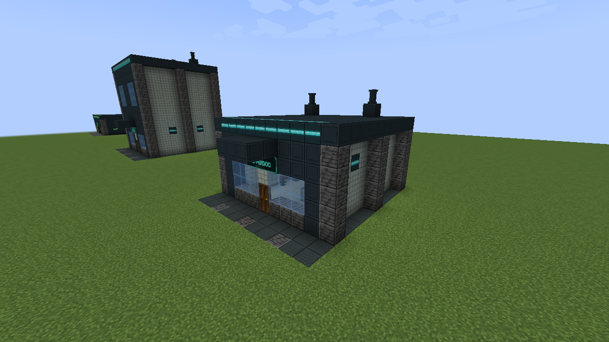
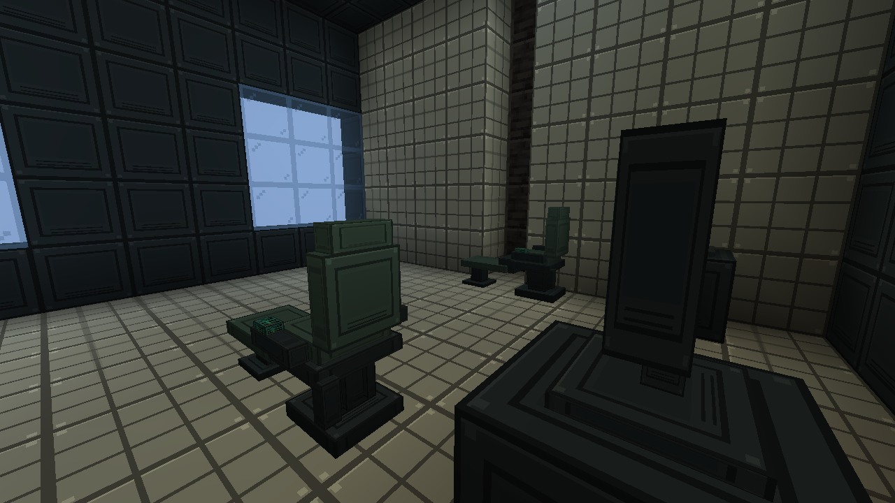
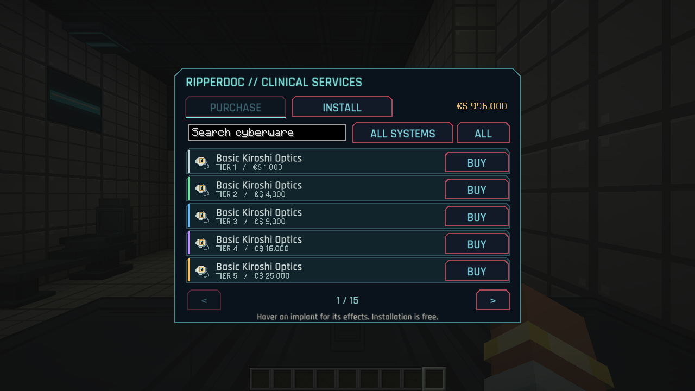
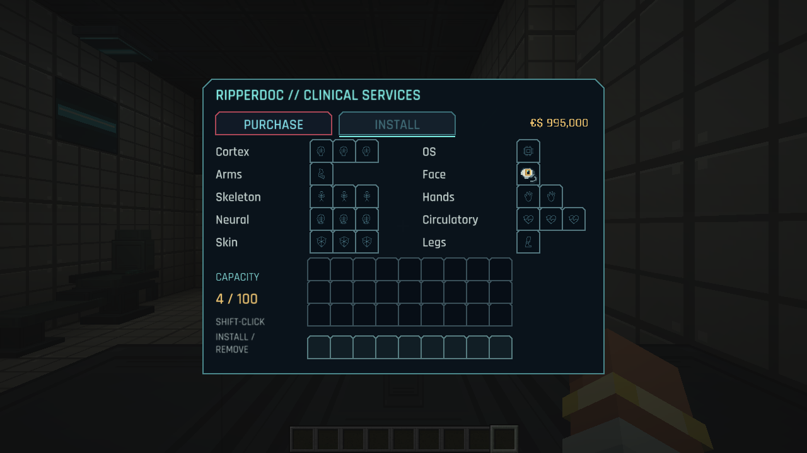
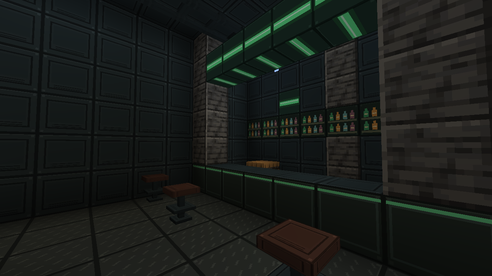
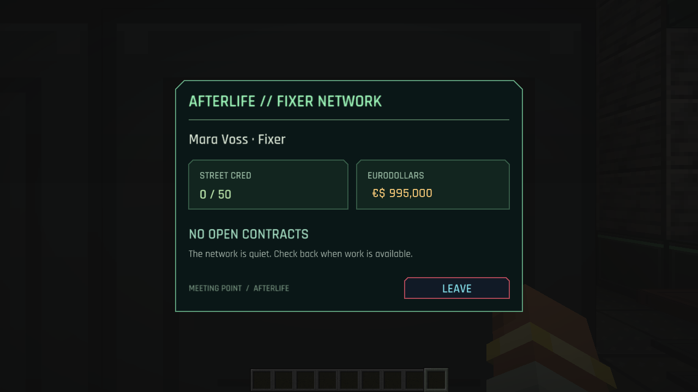

# Ripperdocs and the Afterlife

These buildings can appear in newly generated **plains, desert, savanna, snowy and taiga villages**. A small clinic is the common variant; a larger, two-storey clinic is rarer. The Afterlife is occasional. Not every village has these buildings. Existing villages are preserved; explore new chunks to find them.

## Ripperdoc clinics

Talk to **Dr. Vale** to open the clinic's two tabs:

- **Purchase:** search cyberware, filter by body system and tier, inspect an implant's tooltip, then buy it with eddies. Purchases go into your inventory. Both clinic sizes sell the full catalogue at the same prices, including cyberdecks, Short Circuit chips and Mantis Blades starting at tier 2.
- **Install:** move implants into their matching sockets, or shift-click to install/remove them. Existing capacity and duplicate-implant restrictions apply. Installation and removal are free.

The small clinic has one treatment chair. The larger clinic has three treatment bays across two floors, with a supported staircase and upper-floor guardrail. Doctors stay at reception.






## Eddies

Supply barrels in clinics and the Afterlife contain **Eurodollar Credit Chips** and workshop supplies. Use a chip to deposit **1,000 eddies** into your saved wallet. Money is retained on death. There are no recurring/free refills: a barrel generates its loot once, like other Minecraft loot containers.

Prices increase with tier: ordinary implants cost `1,000 × tier²`, Mantis Blades `1,600 × tier²`, and Short Circuit chips `300 × tier²` eddies. A full inventory or insufficient balance prevents a purchase without taking payment.

Operators can fund a player for testing:

```mcfunction
/cybernetics eddies add @s 50000
```

## The Afterlife

The village adaptation has a street-level entrance descending to an industrial bar, green lighting, bottle shelves, bar stools and two private meeting booths. **Mara Voss** and **Ren Calder** are the fixers. Talk to either to view your eddies and Street Cred.

**Contracts are not implemented yet.** The fixer menu reports that no contracts are available; it does not award unfinished contract rewards. Street Cred currently starts at zero and is saved for the future contract system.




## Blocks and deliberate placement

The update adds 19 original decoration blocks: reinforced panels, clinical tiles, service vent grilles, ribbed flooring, medical cabinets, diagnostic monitors, a surgical chair and footrest, surgical lights, service pipes, ceiling trusses, three light-strip colours, bar counters, stools, bottle shelves and the two signs. They are available in Creative's Functional Blocks tab and can be recovered from generated buildings. Furniture has directional placement.

The old Cybernetics Bench remains available. It is still useful for installation outside a village. Manage loaded quickhacks through the existing cyberware menu.

To inspect a specific building with cheats enabled, stand at the intended **street/floor height** and use one of these vanilla placement commands. Placement replaces blocks, as other `/place` commands do.

```mcfunction
/place jigsaw cybernetics2077:village/clinic_small minecraft:building_entrance 1 ~ ~-1 ~
/place jigsaw cybernetics2077:village/clinic_large minecraft:building_entrance 1 ~ ~-1 ~
/place jigsaw cybernetics2077:village/afterlife minecraft:building_entrance 1 ~ ~-1 ~
```

Ripperdoc and Fixer spawn eggs are also available in Creative. The building templates include their own persistent residents; they do not rely on a ticking spawner.

[Reference and building notes](research/VILLAGE-SERVICES.md) · [Block-layout audit](../art/city/audits) · [In-game previews](PREVIEWS.md)
