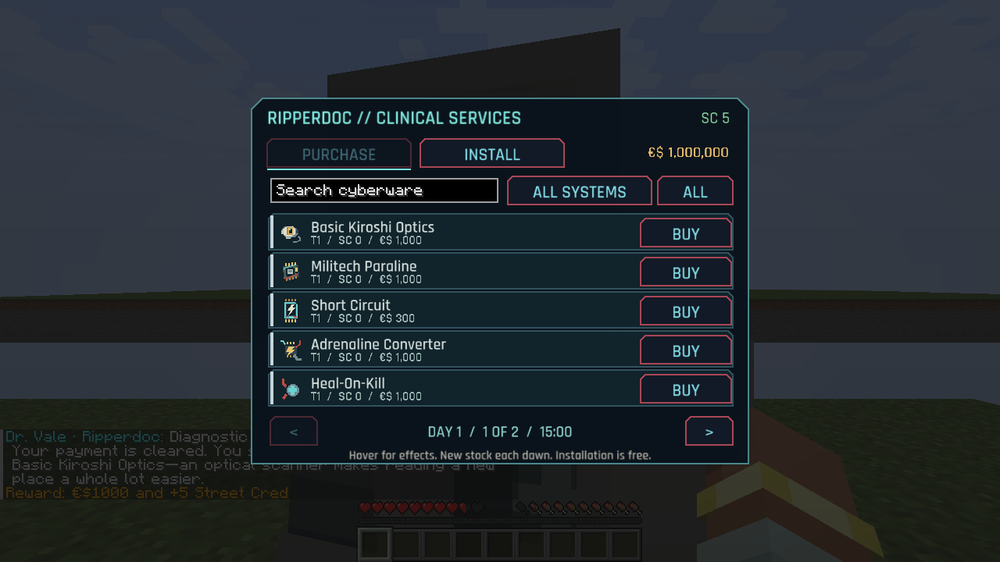
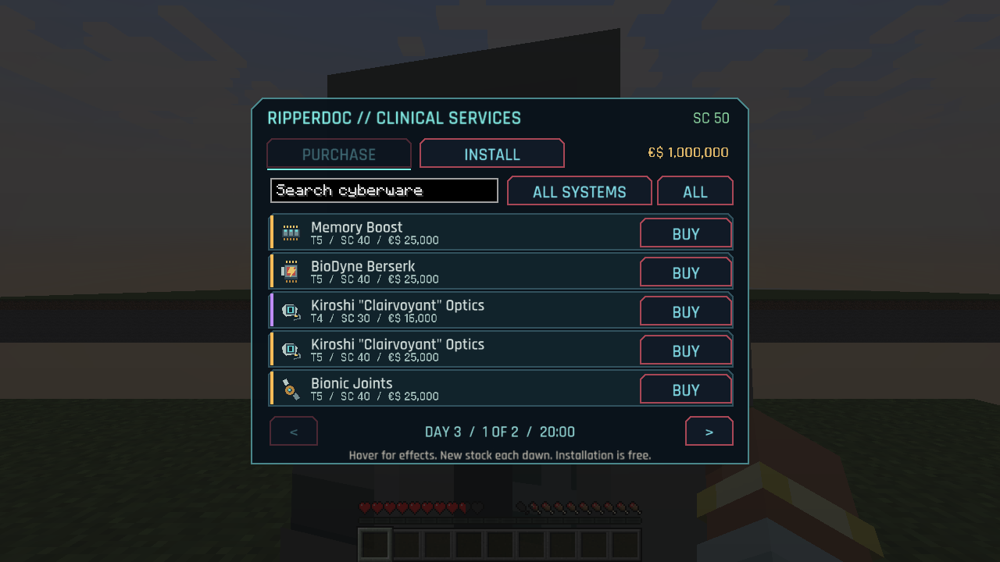
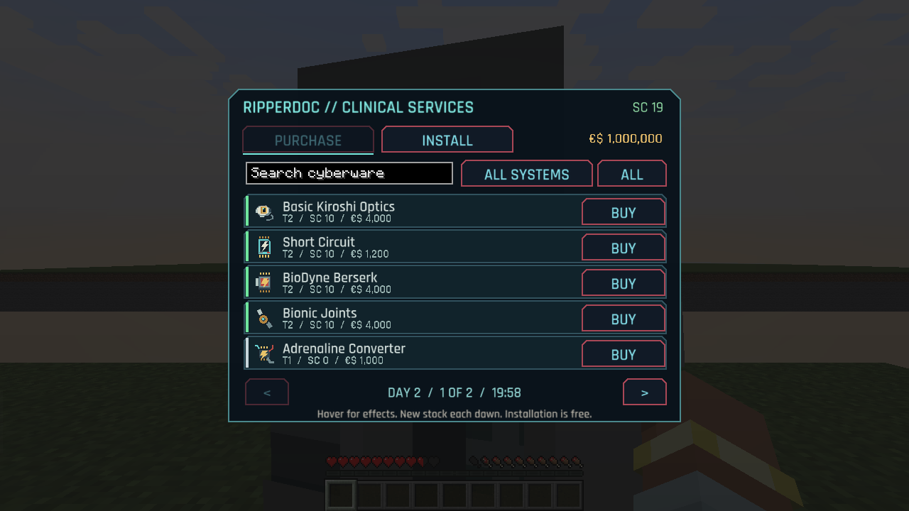

# Ripperdocs and the Afterlife

These buildings can appear in newly generated **plains, desert, savanna, snowy and taiga villages**. A small clinic is the common variant; a larger, two-storey clinic is rarer. The Afterlife is occasional. Not every village has these buildings. Existing villages are preserved; explore new chunks to find them. Updated block models, skins, item transforms and credit-chip values apply to existing saves; the revised building layouts need newly generated or newly placed copies.

## Ripperdoc clinics

Talk to **Dr. Vale** (small clinic) or **Dr. Iris** (large clinic) to open the clinic's two tabs:

- **Purchase:** search cyberware, filter by body system and tier, inspect an implant's tooltip, then buy it with eddies. Purchases go into your inventory. Both clinic sizes draw from the same catalogue and prices, including cyberdecks, Short Circuit chips and Mantis Blades starting at tier 2. Each doctor offers their own daily assortment based on your Street Cred; tiers you have not unlocked are hidden.
- **Install:** move implants into their matching sockets, or shift-click to install/remove them. Existing capacity and duplicate-implant restrictions apply. Installation and removal are free.

Tiers enter the daily stock pool at these saved **Street Cred** levels:

| Tier | Required Street Cred |
| --- | ---: |
| 1 | 0 |
| 2 | 10 |
| 3 | 20 |
| 4 | 30 |
| 5 | 40 |

The requirement applies to implants and quickhack chips. It gates purchases; you can still install equipment you already own. Existing installations are preserved.

### Daily stock

- Each ripperdoc offers **up to 10 different items** each Minecraft day. Starter inventories are smaller because fewer items are eligible.
- **Tier 1 Basic Kiroshi Optics are always available at Street Cred 0–10 inclusive**, ensuring the introductory delivery reward can buy your first scanner.
- A newly unlocked tier starts uncommon and appears more often as your Street Cred increases. At high reputation, higher tiers dominate the selection; lower tiers can still appear.
- Stock changes at **Overworld dawn** every 24,000 ticks, including after sleeping. All dimensions use that calendar. The purchase page shows the stock day and time until the next refresh.
- Reopening the menu, unloading the clinic or restarting the world does not reroll the day's selection. Different doctors can carry different items; players at the same Street Cred see the same assortment at that doctor. Gaining Street Cred updates your assortment immediately.
- The server rechecks stock before payment. Clicking an offer that rotated out takes no money. Purchases do not deplete quantities or reroll the selection.




The small clinic has one treatment chair. The larger clinic has three treatment bays across two floors, with a supported staircase and upper-floor guardrail. Doctors stay at reception.


## Eddies

Supply barrels in clinics and the Afterlife contain **Eurodollar Credit Chips** and workshop supplies. Use a chip to deposit **100 eddies** into your saved wallet. Money is retained on death. There are no recurring/free refills: a barrel generates its loot once, like other Minecraft loot containers.

Prices increase with tier: ordinary implants cost `1,000 × tier²`, Mantis Blades `1,600 × tier²`, and Short Circuit chips `300 × tier²` eddies. A full inventory or insufficient balance prevents a purchase without taking payment.

Operators can fund a player for testing:

```mcfunction
/cybernetics eddies add @s 50000
```

## The Afterlife

The village adaptation has a deeply framed industrial entrance descending to a chamfered island bar with continuous lime underlighting and an illuminated opal canopy. Exterior service pipes, inset wall bays, padded booths and rooftop machinery follow the original location artist’s references. **Mara Voss** and **Ren Calder** are the fixers. Talk to either to view your eddies and Street Cred.

### First Impressions

A **one-time delivery contract per player**, shared by both fixers.

1. Talk to a fixer and accept **First Impressions**. The fixer explains the job and gives you a **Delivery Contract Shard**.
2. Hover the shard for the destination coordinates, instructions and reward. The diagnostic packet is carried digitally; there is no separate cargo item.
3. Hold your scan key (default **V**) to see the clinic's coordinates, compass direction, distance, left/right guidance and elevation. Before you own optics, the shard provides navigation only. Target analysis and quickhacks still require their usual implants.
4. **Use the shard on a ripperdoc** to deliver it. Any ripperdoc accepts the packet, even if the original destination becomes unavailable.
5. Receive **€$1,000 and 5 Street Cred**. The doctor suggests buying **Basic Kiroshi Optics**. The reward covers the tier 1 eye implant; install it through the clinic's Install tab.

The fixer assigns the nearest recorded ripperdoc in your current dimension. Clinic addresses are recorded when their doctors load and persist through chunk unloading. If none is known, visit a clinic and return to the fixer; no guessed coordinates or expensive world-generation search is used.

Lost the shard? Return to a fixer and choose **Reissue Contract**. This invalidates earlier copies. The job, wallet and Street Cred persist across logout and death. Completed contracts cannot be repeated, including through another fixer or copied shard. The scanner route clears after completion.





[Island bar](images/afterlife-island-bar.png) · [Rear elevation](images/afterlife-rear.png) · [Night exterior](images/afterlife-exterior-night.png)


## Blocks and deliberate placement

The mod has 25 original decoration blocks: reinforced panels, clinical tiles, service vent grilles, ribbed flooring, medical cabinets, diagnostic monitors, a surgical chair and footrest, surgical lights, service pipes, ceiling trusses, three light-strip colours, bar counters, stools, bottle shelves the two signs, shaped bar corners, canopy panels, ceiling diffusers, recessed steel panels, facade ducts and padded booth seating. They are available in Creative's Functional Blocks tab and can be recovered from generated buildings. Furniture has directional placement.


[Held chair](images/held-surgical-chair.png) · [Held wall block](images/held-reinforced-panel.png) · [Held sign](images/held-afterlife-sign.png)

The old Cybernetics Bench remains available. It is still useful for installation outside a village. Manage loaded quickhacks through the existing cyberware menu.

To inspect a specific building with cheats enabled, stand at the intended **street/floor height** and use one of these vanilla placement commands. Placement replaces blocks, as other `/place` commands do.

```mcfunction
/place jigsaw cybernetics2077:village/clinic_small minecraft:building_entrance 1 ~ ~-1 ~
/place jigsaw cybernetics2077:village/clinic_large minecraft:building_entrance 1 ~ ~-1 ~
/place jigsaw cybernetics2077:village/afterlife minecraft:building_entrance 1 ~ ~-1 ~
```

Ripperdoc and Fixer spawn eggs are also available in Creative. The building templates include their own persistent residents; they do not rely on a ticking spawner.

[Reference and building notes](research/VILLAGE-SERVICES.md) · [Block-layout audit](../art/city/audits) · [In-game previews](PREVIEWS.md)
