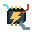

# Adrenaline Converter

[Wiki home](index.md) · [Cyberware](cyberware.md) · [Quickhacks](quickhacks.md) · [Village services](ripperdocs.md)

| System | Tiers | Capacity |
| --- | --- | --- |
| Nervous System | 1–5 | 6 |

Grants a movement-speed boost when entering combat. It requires **five quiet seconds** before a new fight and has a **20-second rearm time**.

| Tier | Speed bonus | Duration |
| --- | --- | --- |
| 1 | +8% | 5 s |
| 2 | +16% | 6 s |
| 3 | +24% | 7 s |
| 4 | +32% | 8 s |
| 5 | +40% | 9 s |

Equipment changes remove the temporary boost.

[All cyberware](cyberware.md) · [Installing implants](installation.md) · [Street Cred requirements](street-cred.md)
