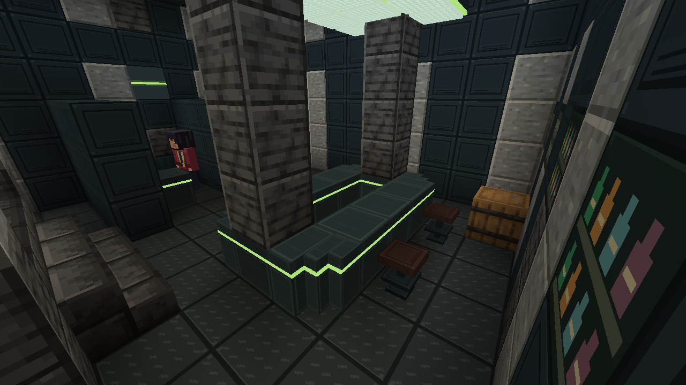

# The Afterlife

[Wiki home](index.md) · [Cyberware](cyberware.md) · [Quickhacks](quickhacks.md) · [Village services](ripperdocs.md)

The Afterlife occasionally appears in new villages. Look for its industrial entrance and sunken bar. Not every village has one.

**Mara Voss** and **Ren Calder** are the fixers. Talk to either for contracts and your eddies/Street Cred summary. The first job is **[First Impressions](contracts.md#first-impressions)**, a one-time clinic delivery.

Supply barrels contain [Eurodollar Credit Chips](street-cred.md#eddies) and workshop supplies.

[Contracts](contracts.md) · [Ripperdocs](ripperdocs.md)
