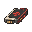

# Arasaka

[All cyberware](cyberware.md) · [Installation](installation.md) · [Daily stock](ripperdocs.md#daily-stock)

Control quickhacks cost **2 less RAM** (minimum 1) and last **25% longer**.

| Tier | Capacity | RAM | Program slots | Queue | RAM/s | Price | Street Cred |
| ---: | ---: | ---: | ---: | ---: | ---: | ---: | ---: |
| 1 | 14 | 5 | 2 | 2 | 0.2 | €$1,000 | 0 |
| 2 | 14 | 6 | 3 | 2 | 0.3 | €$4,000 | 10 |
| 3 | 14 | 7 | 4 | 3 | 0.4 | €$9,000 | 20 |
| 4 | 14 | 8 | 6 | 3 | 0.5 | €$16,000 | 30 |
| 5 | 14 | 9 | 8 | 4 | 0.6 | €$25,000 | 40 |

Install programs through the [cyberdeck menu](cyberdecks.md#load-programs). Chips must not exceed the deck’s tier. Programs stay on the physical deck when uninstalled.
