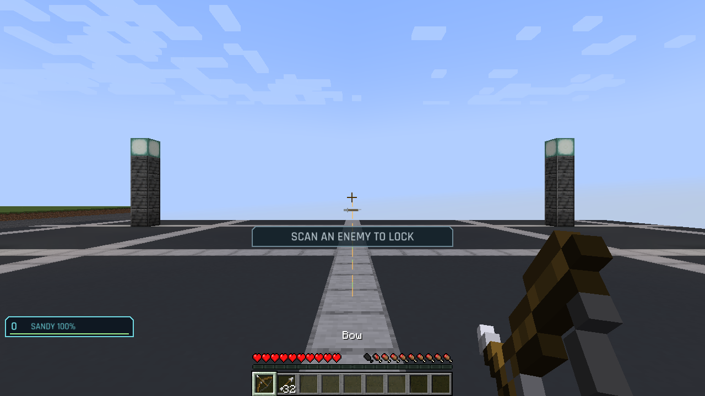

# Ballistic Coprocessor

[Wiki home](index.md) · [Cyberware](cyberware.md) · [Quickhacks](quickhacks.md) · [Village services](ripperdocs.md)

| System | Tiers | Capacity |
| --- | --- | ---: |
| Hands | 1–5 | 2 |

Arrows can **ricochet once** from a solid surface. The rebound follows the reflected angle. Draw a bow to see a dotted trajectory: **gold before** the bounce and **green after** it.

The preview estimates block collisions; enemy movement, spread and Smart Link guidance can change the actual path. Tridents do not ricochet. Enchantments, ammunition and arrow pickup remain intact.

| Tier | Speed retained | Arrow base-damage bonus after bounce |
| --- | --- | --- |
| 1 | 65% | +5% |
| 2 | 70% | +10% |
| 3 | 75% | +15% |
| 4 | 80% | +20% |
| 5 | 85% | +25% |

**Damage type:** Physical/projectile, using the arrow's normal damage rules. The bonus increases the arrow's base-damage coefficient; slower rebound speed also affects the final hit.

[All cyberware](cyberware.md) · [Installing implants](installation.md) · [Street Cred requirements](street-cred.md)
