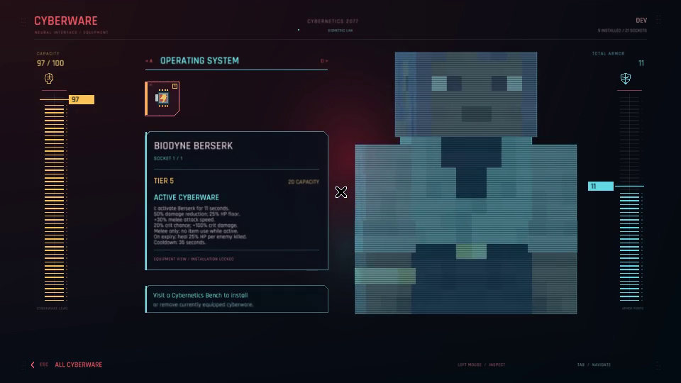

# BioDyne Berserk

[Wiki home](index.md) · [Cyberware](cyberware.md) · [Quickhacks](quickhacks.md) · [Village services](ripperdocs.md)

| System | Tiers | Capacity |
| --- | --- | --- |
| Operating System | 2–5 | 20 |

Press **I** to activate a timed melee combat mode. It replaces your cyberdeck in the Operating System socket.

| Tier | Duration | Damage reduction | Melee attack speed | Added crit chance | Crit damage bonus | Cooldown |
| --- | --- | --- | --- | --- | --- | --- |
| 2 | 8 s | 20% | 15% | 5% | 25% | 50 s |
| 3 | 9 s | 30% | 20% | 10% | 50% | 45 s |
| 4 | 10 s | 40% | 25% | 15% | 75% | 40 s |
| 5 | 11 s | 50% | 30% | 20% | 100% | 35 s |

While active, health cannot drop below **25% maximum HP**. Void damage and `/kill` remain lethal. Item use and ranged damage are blocked. Melee weapons and [Mantis Blades](mantis-blades.md) work; blade timing follows the attack-speed bonus.

On expiry, heal **25% maximum HP per enemy killed during Berserk**, capped to full health. Cooldown begins on activation and persists across logout/death.

[All cyberware](cyberware.md) · [Installing implants](installation.md) · [Street Cred requirements](street-cred.md)
