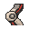

# Bionic Joints

[Wiki home](index.md) · [Cyberware](cyberware.md) · [Quickhacks](quickhacks.md) · [Village services](ripperdocs.md)

| System | Tiers | Capacity |
| --- | --- | --- |
| Skeleton | 1–5 | 4 |

Adds armor and toughness while installed. Armor uses Minecraft's normal damage calculations.

| Tier | Added armor | Added toughness |
| --- | ---: | ---: |
| 1 | 2 | 0.3 |
| 2 | 3 | 0.6 |
| 3 | 4 | 0.9 |
| 4 | 5 | 1.2 |
| 5 | 6 | 1.5 |

[All cyberware](cyberware.md) · [Installing implants](installation.md) · [Street Cred requirements](street-cred.md)
