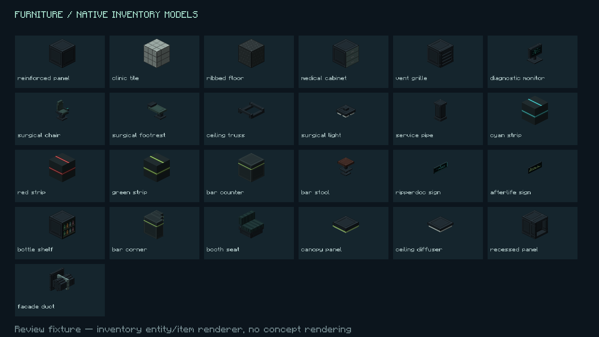

# Blocks and decorations

[Wiki home](index.md) · [Cyberware](cyberware.md) · [Quickhacks](quickhacks.md) · [Village services](ripperdocs.md)

Clinics and the Afterlife use **25 decoration blocks**. Find them in Creative's **Functional Blocks** tab, or recover them from generated buildings. Furniture has directional placement.

| Group | Blocks |
| --- | --- |
| Building materials | Reinforced Panel, Clinic Tile, Ribbed Floor, Vent Grille, Ceiling Truss, Recessed Panel, Facade Duct |
| Clinic furniture | Medical Cabinet, Diagnostic Monitor, Surgical Chair, Surgical Footrest, Surgical Light |
| Bar furniture | Bar Counter, Bar Corner, Bar Stool, Bottle Shelf, Booth Seat |
| Lighting | Cyan Strip, Red Strip, Green Strip, Canopy Panel, Ceiling Diffuser |
| Details and signs | Service Pipe, Ripperdoc Sign, Afterlife Sign |

[Ripperdoc clinics](ripperdocs.md) · [The Afterlife](afterlife.md) · [Item IDs](item-ids.md)
