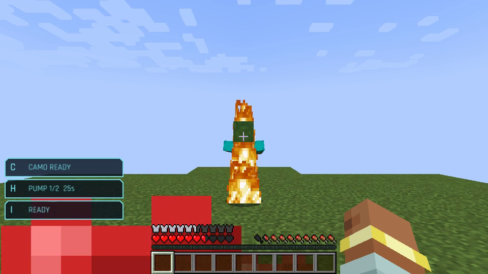

# Blood Pump

[Wiki home](index.md) · [Cyberware](cyberware.md) · [Quickhacks](quickhacks.md) · [Village services](ripperdocs.md)

| System | Tiers | Capacity |
| --- | --- | --- |
| Circulatory System | 2–5 | 15 |

Press **H** to heal. The pump has **two charges**. It does not spend a charge at full health.

| Tier | Immediate heal | HP regenerated each second | One-charge recovery |
| --- | --- | --- | --- |
| 2 | 20% max HP | 1% max HP | 40 s |
| 3 | 25% max HP | 1.5% max HP | 35 s |
| 4 | 30% max HP | 2% max HP | 30 s |
| 5 | 35% max HP | 2.5% max HP | 25 s |

Regeneration lasts **6 seconds**. Reuse refreshes its duration rather than stacking it. Healing is capped to full health. Charges and recovery persist across logout/death.

[All cyberware](cyberware.md) · [Installing implants](installation.md) · [Street Cred requirements](street-cred.md)
