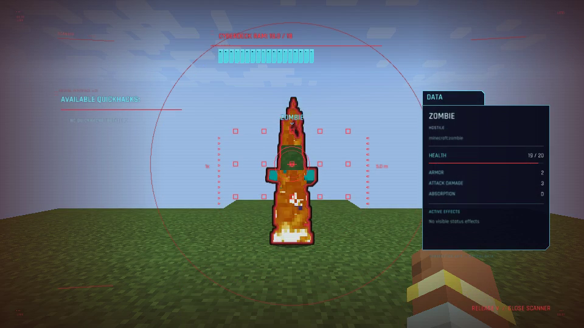

# Kiroshi “Clairvoyant” Optics

[Wiki home](index.md) · [Cyberware](cyberware.md) · [Quickhacks](quickhacks.md) · [Village services](ripperdocs.md)

| System | Tiers | Capacity |
| --- | --- | --- |
| Face | 3–5 | 8 |

Hold **V** to scan. Visible hostile mobs and combat opponents receive a retained outline; passive animals and allies are excluded.

| Tier | Scan range | Enemy-mark radius |
| --- | --- | --- |
| 3 | 48 blocks | 12 blocks |
| 4 | 56 blocks | 16 blocks |
| 5 | 64 blocks | 20 blocks |

Marks last **60 seconds** from the most recent scan and remain after closing the scanner. Initial marking requires line of sight. Up to 64 marks are retained.

[All cyberware](cyberware.md) · [Installing implants](installation.md) · [Street Cred requirements](street-cred.md)
