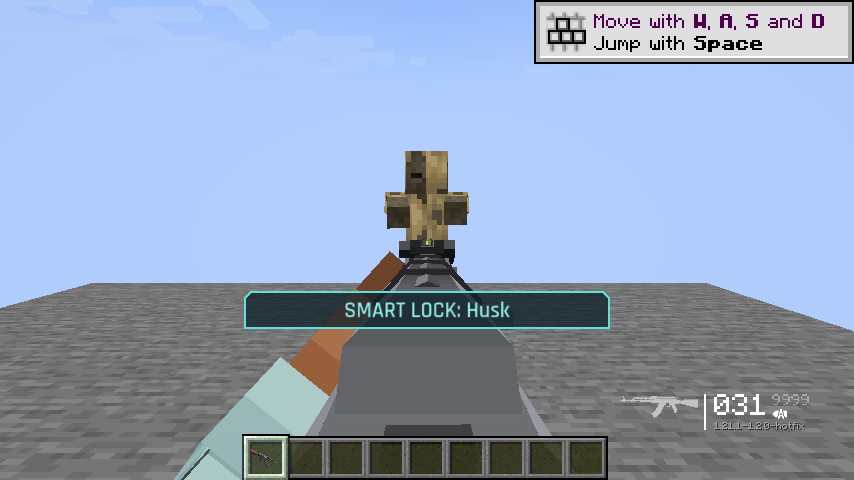
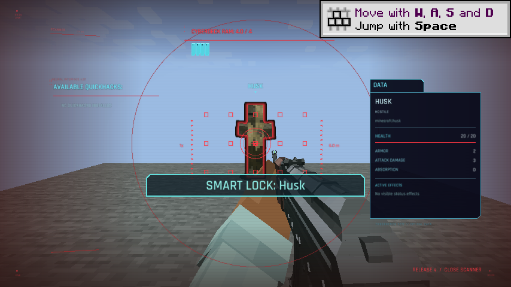

# Compatibility and TaCZ

Development currently targets **NeoForge 1.21.1**. The **Forge 1.20.1** version keeps its last release until a port update is requested. Install **only** the build matching your Minecraft version and loader. No extra dependency is needed; the Forge build embeds its MixinExtras dependency.

## TaCZ gun integration

TaCZ is optional. Tested versions are **1.1.8-hotfix2 on Forge 1.20.1** and **1.2.0-hotfix on NeoForge 1.21.1**. The bridge works with TaCZ's gun API, including gunpack weapons that use that API.

| Cyberware | Effect with TaCZ |
| --- | --- |
| Smart Link | Bullets gently steer toward your scanner lock for their first two seconds. Requires optics, a valid enemy and clear sight; bullets cannot turn through walls. |
| Ballistic Coprocessor | Non-explosive bullets can ricochet once, retaining 60% + 5% per tier of their speed. A bounced hit gains 5% damage per tier. Aim a gun to preview the reflected centre trajectory. |
| Microgenerator | Confirmed gun hits trigger the normal electric discharge, with its existing cooldown and target limit. Blocked hits do not trigger it. |
| Handle Wrap | Drawing a gun primes the implant's temporary critical-hit bonus. |
| Shock Absorber | Reduces camera recoil by 8% per tier. Its knockback resistance also works while aiming a gun. |
| Immovable Force | Iconic: reduces camera recoil by 10% and bullet spread by 8% per tier, including while moving. Recoil stacks multiplicatively with Shock Absorber, capped at 85% combined reduction. |
| Weapon critical bonuses | Apply once to a gun hit, including the native headshot multiplier. |
| Apogee / David’s | Their +20% / +25% headshot bonuses also apply to TaCZ headshots. David’s requires NeoForge 0.21.0. |
| Sandevistan | Gun firing intervals, burst spacing and firing/cycling animations follow the slowed world clock, including your own guns. Reload speed stays normal. Attachments, heat and native ammunition handling remain owned by TaCZ. |

With one Sandevistan active, TaCZ firing rate and bullet simulation run at **62.5% of normal with Dynalar, 18.75% with Apogee, and 6.25% with David’s**. Your personal movement and melee speed still accelerate; guns do not inherit that acceleration. Reloading takes its normal real time. Bullets return to normal speed after leaving the bubble. These rules use the strongest applicable field once and retain PvP/team protections. Arrows and thrown tridents keep their existing owner-relative timing.

**NeoForge 0.24.0:** non-explosive kinetic bullets advance smoothly every world tick, with fractional gravity, drag and lifetime. Their tracers shorten with local speed. Firing and cycling animations visibly slow, including their timed effects; reload and handling animations keep normal speed. Explosive rounds keep their existing native behavior.

Basic Kiroshi Optics retain Smart Link locks normally. While aiming a TaCZ gun, Smart Link shows its normal lock indicator. Opening the scanner fades the gun’s ammunition/heat display, interaction hints, crosshair and hit markers with the native HUD; releasing it restores them.

Deployed Mantis Blades and Berserk prevent firing and reloading guns. Scanner controls retain priority while scanning. TaCZ defaults use **Alt** for conflicting cyberware keys; see [controls](controls.md). Existing saved bindings are not reset.

The full-screen cyberware viewer reports its complete footprint so JEI does not cover the hologram or sockets. Normal inventory, bench and shop overlays remain available.

### TaCZ Tweaks

NeoForge **0.24.1+** supports ricochets with **TaCZ Tweaks 3.0.0-alpha.12** and **TaCZ 1.2.0-hotfix**. Update Cybernetics 2077 on both the server and clients. No Tweaks configuration change is needed for the fix.

Custom bullet-piercing rules can change where a round stops; the aiming line remains an estimate.

### Scanning with a gun

Aim after scanning an enemy to see your Smart Link lock. The scanner replaces the native gun HUD while held; it returns when you release the scanner.

## Large modpacks and the time bubble

The time bubble leaves complex machine and physics blocks at normal tick speed by default. This includes Create, Valkyrien Skies, Mekanism, Extreme Reactors, Immersive Engineering, Immersive Vehicles, Ad Astra, Refined Storage, Pipez, Cyclic, Botania and WebDisplays. This avoids skipping essential network, energy and physics updates. Ordinary supported blocks still use local time.

Server owners can adjust `timeBubbleExcludedBlockNamespaces` in the Cybernetics 2077 server config. Custom vehicle and contraption entities retain their native simulation.

## Checked pack

The supplied Forge pack list contains **159 pinned mod files**, including TaCZ, TaCZ: Creatified and Cybernetic System. Its sanitized manifest and detailed validation notes are in [the compatibility directory](https://github.com/Bithio999/Cybernetics-2077/tree/main/compat). Third-party mods and assets are not bundled with Cybernetics 2077.

Pack-specific configs, scripts and extra gunpacks were not supplied, so those settings require a check in your actual instance. Cybernetic System remains a separate mod with its own equipment and progression.

## Expanded implant integration

Smart Link predicts moving targets and uses stronger, bounded steering on the original projectile. It preserves bullet speed, native ammo, attachments, damage and headshot handling. Guidance requires a valid visible lock and cannot turn a shot backward.

Weapon Glitch blocks TaCZ firing before ammunition consumption. Cyberware Malfunction disables cybernetic guidance and other implants. Clutch Padding and Isometric Stabilizer accelerate firing mechanisms; Sandevistan still slows the gun mechanism on the world clock and leaves reloads normal. Cockatrice, Deep-Field, Black Mamba, Cellular Adapter, Tyrosine Injector and active-system crit bonuses feed the native gun damage path once.

Feedback Circuit and Electromag Recycler use steady aimed TaCZ hits, or fully drawn bows, as Minecraft’s charged-shot equivalent. TaCZ does not supply Cyberpunk’s Tech/Smart/Power weapon classes; ordinary compatible guns use the installed hand implant’s behavior.
