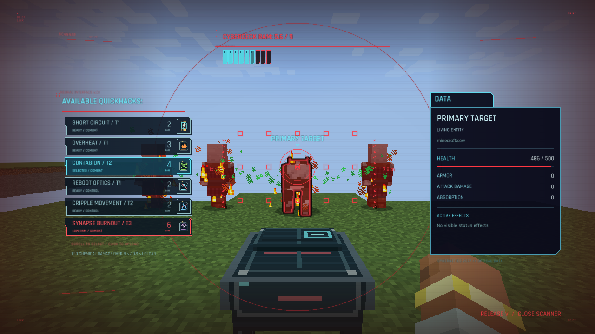

# Contagion

[Wiki home](index.md) · [Cyberware](cyberware.md) · [Quickhacks](quickhacks.md) · [Village services](ripperdocs.md)

**Tiers:** 2–5 · **Damage type:** Chemical

Deals chemical damage in **four pulses over 8 seconds** and spreads to nearby enemies. The table lists the total base damage per infected target.

| Tier | RAM | Total base damage | Secondary targets |
| --- | ---: | ---: | ---: |
| 2 | 4 | 12 | 2 |
| 3 | 5 | 18 | 4 |
| 4 | 6 | 24 | 4 |
| 5 | 7 | 30 | 4 |

Base spread radius is **8 blocks**. Raven increases it to **16 blocks** and adds its extra targets, up to seven secondary targets. Infection keeps full damage when spreading. Reapplying refreshes the effect.

Tier 4–5 infection can be [detonated with Overheat](overheat.md). Spread respects walls, teams, PvP settings and enemy targeting.

[All quickhacks](quickhacks.md) · [Load programs](cyberdecks.md#load-programs) · [Scanning](scanning.md)
