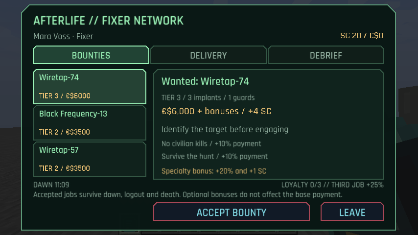
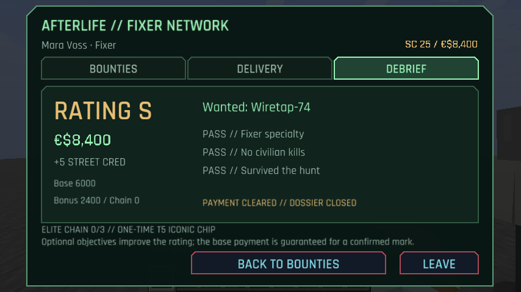

# Fixer contracts

[Wiki home](index.md) · [The Afterlife](afterlife.md) · [Street Cred](street-cred.md)

Talk to **Mara Voss** or **Ren Calder** at the Afterlife. Their menu has **Bounties**, **Delivery** and **Debrief** tabs. Accepted jobs provide a readable contract shard and scanner directions, even before you install optics.

## Bounties

Available on **NeoForge 0.22.0**. Forge 0.20.0 retains the introductory delivery only.

Each fixer has **three offers per player each Minecraft day**. Offers rotate at Overworld dawn. Reopening the menu does not reroll them. Street Cred unlocks stronger marks; some lower-difficulty work remains available.

| Required Street Cred | Difficulty | Target implant tier | Implants | Guards | Base payment | Base Street Cred |
| ---: | --- | ---: | ---: | ---: | ---: | ---: |
| 0 | Tier 1 | 1 | 1 | 0 | €$1,800 | 2 |
| 10 | Tier 2 | 2 | 2 | 0 | €$3,500 | 3 |
| 20 | Tier 3 | 3 | 3 | 1 | €$6,000 | 4 |
| 30 | Tier 4 | 4 | 4 | 1 | €$10,000 | 5 |
| 40 | Tier 5 | 5 | 5 | 2 | €$16,000 | 6 |
| 50 | Elite Tier 5 | 5 | 6 | 3 | €$24,000 | 7 |

The mark wears **real non-Iconic implants at the listed tier**. Guards are one tier lower, with up to three implants. The normal chromed-mob chassis and equipment effects apply. These are specific named targets, not a quota of random kills.

1. Choose an offer and **Accept Bounty**. You need one free inventory slot.
2. Hold the scan key to follow the lead. The encounter deploys on safe loaded ground as you approach, without changing blocks or force-loading distant chunks.
3. Eliminate your assigned mark. Your kill credit—or your tamed pet's—must confirm the kill. Another player's kill does not pay your contract.
4. Return to the issuing fixer, or another fixer in the same network, and **Claim Payment**. The shard can also be used on the correct fixer when payment is ready.
5. Read your rating, payment breakdown and optional results in **Debrief**.

### Fixer specialties and optional bonuses

| Optional objective | Reward |
| --- | --- |
| **Mara:** identify the mark through optical scanning before engaging its group | +20% base payment and +1 Street Cred |
| **Ren:** defeat the mark within 90 seconds of the first combat hit involving its group | +20% base payment and +1 Street Cred |
| Do not kill villagers, wandering traders or service NPCs during the hunt | +10% base payment |
| Do not die during the hunt | +10% base payment |

Optical identification requires an installed scanner; navigation alone does not identify a target. Missing an optional objective **never reduces the base payment**. Surviving, civilian protection and specialty results determine the rating: **S / A / B / C** for **3 / 2 / 1 / 0** successful optionals. Street Cred remains capped at 50.

Every **third completed bounty for the same fixer network** adds a **25% base-payment loyalty bonus**. Separately, your first **three Elite Tier 5 completions** award **one Tier 5 Iconic Requisition Chip**, once per player. If your inventory is full, the bonus chip drops at your feet. This grants purchase authorization, not an Iconic implant; eddies, stock, Street Cred and other purchase requirements still apply.

### Active jobs and recovery

You can hold **one bounty at a time**, alongside the introductory delivery. An active bounty takes priority in scanner navigation. Accepted jobs persist through dawn, logout and death. Death only loses the survival bonus.

Use **Reissue Shard** if the dossier is lost. To abandon a job, press **Abandon Job**, then confirm it. Accepted offers remain used for that day, including abandoned or failed jobs. Loaded abandoned targets are removed; unloaded ones are cleaned up when their chunk next loads.

Bounties start with an **Overworld fixer** and require non-Peaceful difficulty. If a target disappears without a confirmed kill, the job can redeploy when you approach safe ground again. If another player claims the kill, clear the failed dossier at a fixer before taking another job.

## First Impressions

**One completion per player · Reward: €$1,000 + 5 Street Cred**

1. Open the **Delivery** tab and accept the job. You need a free inventory slot.
2. Hover the shard for the clinic's coordinates. The diagnostic packet is digital; no separate cargo item is given.
3. Hold the scan key for directions. Contract navigation works before you own optics.
4. **Use the shard on a ripperdoc** to deliver it. Any ripperdoc accepts it if the original destination becomes unavailable.
5. The doctor recommends **[Basic Kiroshi Optics](kiroshi-optics.md)**; the reward covers the tier-1 implant's price.

If no clinic route is known, visit a clinic and return to the fixer. Choose **Reissue Contract** for a lost delivery shard. Completed deliveries cannot be repeated through another fixer or copied shard.

[The Afterlife](afterlife.md) · [Street Cred and purchases](street-cred.md)
