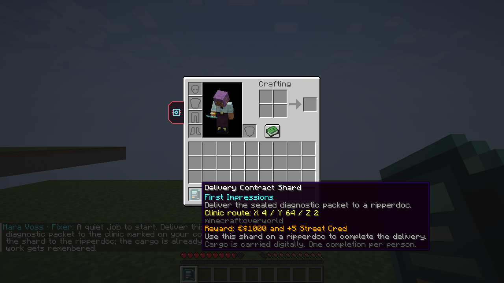

# Fixer contracts

[Wiki home](index.md) · [Cyberware](cyberware.md) · [Quickhacks](quickhacks.md) · [Village services](ripperdocs.md)

Talk to a fixer in the **[Afterlife](afterlife.md)** to accept work. A contract gives you a shard with hoverable objectives and rewards. An active job adds directions to the scanner.

## First Impressions

**One completion per player · Reward: €$1,000 + 5 Street Cred**

1. Accept the job from Mara Voss or Ren Calder. You need a free inventory slot for the contract shard.
2. Hover the shard for the clinic's coordinates and instructions. The diagnostic packet is digital; no separate cargo item is given.
3. Hold **V** to see directions. Contract navigation works before you own optics.
4. **Use the shard on a ripperdoc** to deliver it. Any ripperdoc accepts it if the original destination becomes unavailable.
5. Receive the reward. The doctor recommends **[Basic Kiroshi Optics](kiroshi-optics.md)**; the reward covers the tier-1 implant's price.

## No route or lost shard?

The fixer uses the nearest recorded clinic in your dimension. If no destination is known, **visit a clinic, then return to the fixer**.

For a lost shard, choose **Reissue Contract** at a fixer. Earlier copies become invalid. Progress and rewards persist across logout and death. Completed jobs cannot be repeated through another fixer or copied shard.

[Find the Afterlife](afterlife.md) · [Street Cred and rewards](street-cred.md)
