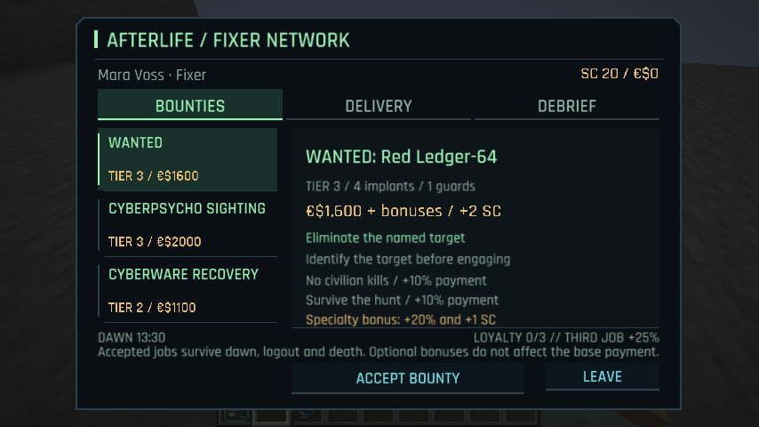
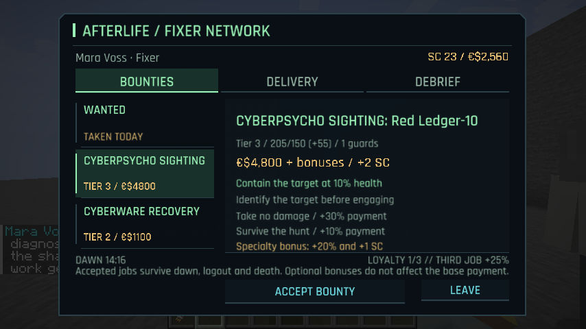
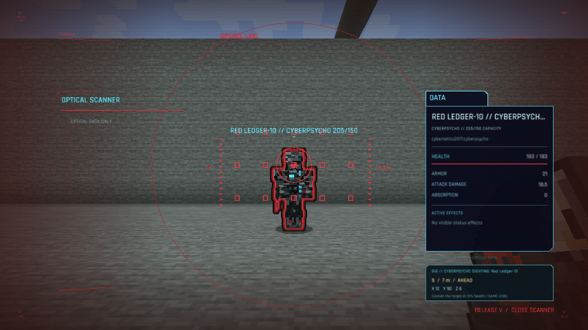
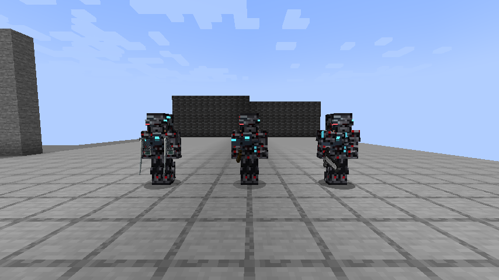
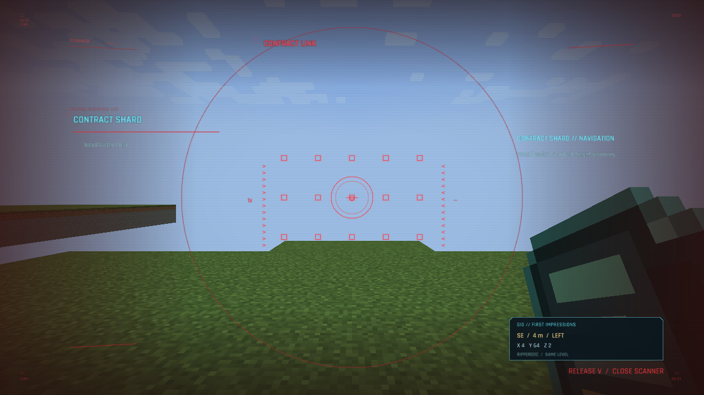

# Fixer contracts

[Wiki home](index.md) · [The Afterlife](afterlife.md) · [Street Cred](street-cred.md)

Talk to **Mara Voss** or **Ren Calder** at the Afterlife. Their menu has **Bounties**, **Delivery** and **Debrief** tabs. Accepted jobs provide a readable contract shard and scanner directions, even before you install optics.

## Bounties

Available on **NeoForge 0.22.0 and later**. Forge 0.20.0 retains the introductory delivery only.

Each fixer has **three offers per player each Minecraft day**. The board includes a **Wanted** mark, a **Cyberpsycho Sighting** and a **Cyberware Recovery** job. Offers rotate at Overworld dawn. Reopening the menu does not reroll them. Street Cred unlocks stronger marks; some lower-difficulty work remains available.

| Required Street Cred | Difficulty | Target implant tier | Implants | Guards | Base payment | Base Street Cred |
| ---: | --- | ---: | ---: | ---: | ---: | ---: |
| 0 | Tier 1 | 1 | 2 | 0 | €$600 | 1 |
| 10 | Tier 2 | 2 | 3 | 0 | €$1,000 | 1 |
| 20 | Tier 3 | 3 | 4 | 1 | €$1,600 | 2 |
| 30 | Tier 4 | 4 | 5 | 1 | €$2,400 | 2 |
| 40 | Tier 5 | 5 | 6 | 2 | €$3,400 | 3 |
| 50 | Elite Tier 5 | 5 | 6 | 3 | €$4,800 | 3 |

The table shows standard Wanted jobs. Previously accepted dossiers keep their quoted base payment.

The mark wears **real non-Iconic combat implants at the listed tier**, including armor and, at higher tiers, Blood Pump and Neofiber. Named targets have additional health, damage, armor, toughness and pursuit range. Guards are one tier lower, with up to three implants. The normal chromed-mob chassis and equipment effects apply. These are specific named targets, not a quota of random kills.

1. Choose an offer and **Accept Bounty**. You need one free inventory slot.
2. Hold the scan key to follow the lead. The encounter deploys on safe loaded ground as you approach, without changing blocks or force-loading distant chunks.
3. Complete the assigned objective below. For Wanted jobs, eliminate your assigned mark. Your kill credit—or your tamed pet's—must confirm the kill. Another player's kill does not pay your contract.
4. Return to the issuing fixer, or another fixer in the same network, and **Claim Payment**. The shard can also be used on the correct fixer when payment is ready.
5. Read your rating, payment breakdown and optional results in **Debrief**.

### Cyberpsycho Sighting

Fight the named cyberpsycho down to **10% maximum health**. Your hit—or your tamed pet's—automatically contains them, even if that hit would otherwise be fatal. A contained target stops fighting and is protected from normal follow-up damage. Return to the issuing fixer network to collect payment.

Cyberpsychos are dedicated, heavily chromed humanoids with three combat builds: **Berserker**, **Netrunner** and **Blitz**. Their armored frames, exposed machinery and role-specific silhouettes distinguish them from ordinary NPCs.

Their normal capacity is **150**. Actual installed capacity determines contract difficulty. Each dossier has a persistent, varied, socket-valid loadout; two targets in the same band need not have the same implants.

| Contract tier | Installed capacity | Implant tiers | Base payment |
| ---: | ---: | --- | ---: |
| 1 | 151–175 | 2–3 | €$1,800 |
| 2 | 176–200 | 2–3 | €$3,000 |
| 3 | 201–225 | 3–4 | €$4,800 |
| 4 | 226–250 | 3–4 | €$7,200 |
| 5 | 251–275 | 4–5 | €$10,200 |
| 6 | 276–325 | 4–5 | €$14,400 |

A family's minimum tier still applies. Iconics never appear in enemy loadouts.

- **Berserkers** rush with melee weapons or Mantis Blades, backed by one of the ordinary Berserk systems.
- **Netrunners** use bows and real cyberdecks with installed quickhacks. Their programs match the deck's tier and slot limit. Uploads spend regenerating RAM, queue sequentially and require range and line of sight at completion. Break sight to evade an enemy upload; Self-ICE can block it.
- **Blitz** builds use a Dynalar, Zetatech or QianT Sandevistan, fast pursuit and melee. Their time bubbles interact with player Sandevistans using the same relative-time rules.

Medical implants, defenses, crit bonuses, jumps, camouflage and other installed combat implants operate through shared mob cyberware behavior. Blood Pump has two charges. Second Heart can save a fatal hit when ready. Berserk's temporary HP floor must end before containment is possible.

Cyberpsycho base payment is **three times** a standard Wanted job of the same contract tier, before optional bonuses. A target killed by another player or the environment before containment fails the job.

### Cyberware Recovery

Defeat the assigned courier, then find the **sealed barrel cache** at their last location. Hold scan for the updated waypoint. With the contract shard in your hand, **use it within four blocks of the cache with clear sight** to secure the payload. Return to the fixer for payment.

Killing the courier alone does not complete this job. The payload is recorded on your contract, so it does not need a separate inventory slot. Other players cannot collect your cache. Reissue a lost shard at a fixer; the cache remains part of the same job. Abandoning the job removes its cache and remaining guards.

Recovery jobs offer **10% higher base payment** than the table and run one rank below your current maximum, with Tier 1 as the minimum. Ren's 90-second specialty timer includes retrieving the cache.

### Fixer specialties and optional bonuses

| Optional objective | Reward |
| --- | --- |
| **Mara:** identify the mark through optical scanning before engaging its group | +20% base payment and +1 Street Cred |
| **Ren:** defeat the mark within 90 seconds of the first combat hit involving its group | +20% base payment and +1 Street Cred |
| Take no HP damage before completing the objective | **+30% base payment** |
| Do not die during the hunt | +10% base payment |

Optical identification requires an installed scanner; navigation alone does not identify a target. Missing an optional objective **never reduces the base payment**. Survival, no-damage and specialty results determine the rating: **S / A / B / C** for **3 / 2 / 1 / 0** successful optionals. Street Cred remains capped at 50.

Every **third completed bounty for the same fixer network** adds a **25% base-payment loyalty bonus**. Separately, your first **three Elite Tier 5 completions** award **one Tier 5 Iconic Requisition Chip**, once per player. If your inventory is full, the bonus chip drops at your feet. This grants purchase authorization, not an Iconic implant; eddies, stock, Street Cred and other purchase requirements still apply.

### Active jobs and recovery

You can hold **one bounty at a time**, alongside the introductory delivery. An active bounty takes priority in scanner navigation. Accepted jobs persist through dawn, logout and death. Death loses the survival and no-damage bonuses. Blocked hits and fully absorbed hits preserve the no-damage bonus; any positive final HP damage loses it. Damage after completing the objective does not change the result.

Use **Reissue Shard** if the dossier is lost. To abandon a job, press **Abandon Job**, then confirm it. Accepted offers remain used for that day, including abandoned or failed jobs. Loaded abandoned targets are removed; unloaded ones are cleaned up when their chunk next loads.

Bounties start with an **Overworld fixer** and require non-Peaceful difficulty. If a target disappears without a confirmed kill, the job can redeploy when you approach safe ground again. If another player claims the kill, clear the failed dossier at a fixer before taking another job.

## First Impressions

**One completion per player · Reward: €$1,000 + 5 Street Cred**

1. Open the **Delivery** tab and accept the job. You need a free inventory slot.
2. Hover the shard for the clinic's coordinates. The diagnostic packet is digital; no separate cargo item is given.
3. Hold the scan key for directions. Contract navigation works before you own optics.
4. **Use the shard on a ripperdoc** to deliver it. Any ripperdoc accepts it if the original destination becomes unavailable.
5. The doctor recommends **[Basic Kiroshi Optics](kiroshi-optics.md)**; the reward covers the tier-1 implant's price.

If no clinic route is known, visit a clinic and return to the fixer. Choose **Reissue Contract** for a lost delivery shard. Completed deliveries cannot be repeated through another fixer or copied shard.

[The Afterlife](afterlife.md) · [Street Cred and purchases](street-cred.md)
