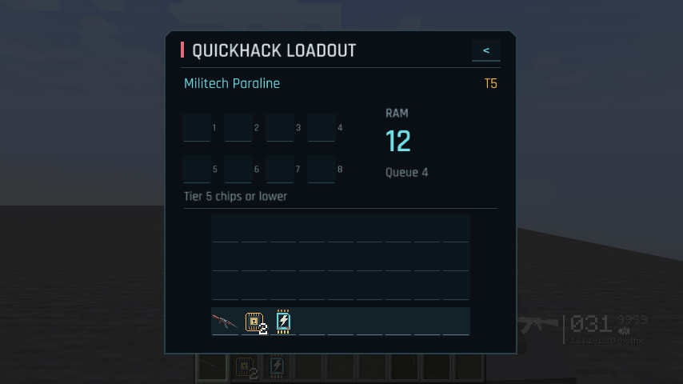

# Cyberdecks

[Wiki home](index.md) · [Cyberware](cyberware.md) · [Quickhacks](quickhacks.md) · [Village services](ripperdocs.md)

A cyberdeck occupies the single **Operating System** socket, shared with [Berserk](biodyne-berserk.md) and [Sandevistan](dynalar-sandevistan.md). Install [optics](kiroshi-optics.md) as well to upload quickhacks.

| Deck | Tiers | Best suited to |
| --- | --- | --- |
| [Militech Paraline](militech-paraline.md) | 1–5 | Larger RAM pool and a direct quickhack damage bonus |
| [Raven Microcyber](raven-microcyber.md) | 3–5 | Relaying hacks to nearby enemies |

## Load programs

Open **Operating System → Manage Quickhacks** in the inventory cyberware menu, or use the bench's **Cyberdeck** button. Shift-click a chip to install it, or place it in a socket.

- The chip must be the **same tier as the deck or lower**.
- Different programs can share a deck; only one copy of each program is allowed.
- Programs stay on the physical deck when you remove it.
- Removing a program or switching decks cancels affected uploads and refunds reserved RAM, up to your current capacity.

[Programs and costs](quickhacks.md) · [How scanning works](scanning.md)

## Specialist decks

| Deck | Tiers | Focus |
| --- | --- | --- |
| [Arasaka](arasaka.md) | 1–5 | Cheaper, longer Control programs |
| [Biotech Σ](biotech-sigma.md) | 2–5 | Longer damage-over-time programs |
| [NetWatch Netdriver](netwatch-netdriver.md) | 5 Iconic | Damage and duration |
| [Tetratronic Rippler](tetratronic-rippler.md) | 1–5 | Combat → Control queues and weapon follow-up |
