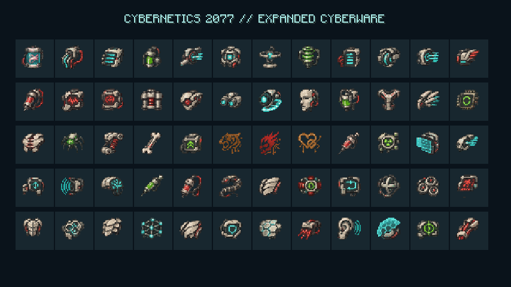

# Cyberware

[Wiki home](index.md) · [Cyberware](cyberware.md) · [Quickhacks](quickhacks.md) · [Village services](ripperdocs.md)

Choose a body system below. Each link opens an implant's effects, tiers and stats. [Learn installation](installation.md).

| System | Implants |
| --- | --- |
| Frontal Cortex | [Ex-Disk](ex-disk.md), [Memory Boost](memory-boost.md), [RAM Upgrade](ram-upgrade.md), [Self-ICE](self-ice.md), [Axolotl](axolotl.md), [Bioconductor](bioconductor.md), [Camillo RAM Manager](camillo-ram-manager.md), [COX-2 Cybersomatic Optimizer](cox-2-cybersomatic-optimizer.md), [Kerenzikov Boost System](kerenzikov-boost-system.md), [Mechatronic Core](mechatronic-core.md), [Newton Module](newton-module.md), [Quantum Tuner](quantum-tuner.md), [RAM Reallocator](ram-reallocator.md) |
| Operating System | [Militech Paraline](militech-paraline.md), [Raven Microcyber](raven-microcyber.md), [BioDyne Berserk](biodyne-berserk.md), [Dynalar Sandevistan](dynalar-sandevistan.md), [Militech “Apogee” Sandevistan](militech-apogee.md), [David’s Sandevistan](davids-sandevistan.md), [Zetatech Sandevistan](zetatech-sandevistan.md), [QianT “Warp Dancer” Sandevistan](qiant-warp-dancer.md), [Militech “Falcon” Sandevistan](militech-falcon-sandevistan.md), [Moore Tech Berserk](moore-tech-berserk.md), [Zetatech Berserk](zetatech-berserk.md), [Militech Berserk](militech-berserk.md), [Chrome Compressor](chrome-compressor.md), [Arasaka](arasaka.md), [Biotech Σ](biotech-sigma.md), [NetWatch Netdriver](netwatch-netdriver.md), [Tetratronic Rippler](tetratronic-rippler.md) |
| Arms | [Physical Mantis Blades](mantis-blades.md), [Thermal](thermal-mantis-blades.md), [Electrifying](electrifying-mantis-blades.md), [Toxic](toxic-mantis-blades.md) |
| Hands | [Smart Link](smart-link.md), [Ballistic Coprocessor](ballistic-coprocessor.md), [Microgenerator](microgenerator.md), [Handle Wrap](handle-wrap.md), [Shock Absorber](shock-absorber.md), [Immovable Force](immovable-force.md), [Tattoo: Tyger Claws Dermal Imprint](tyger-claws-dermal-imprint.md), [Tattoo: Johnny’s Special](johnnys-special.md), [Tattoo: Together Forever](together-forever.md) |
| Face | [Basic Kiroshi Optics](kiroshi-optics.md), [Clairvoyant Optics](clairvoyant-optics.md), [Kiroshi “Doomsayer” Optics](doomsayer-optics.md), [Kiroshi “Stalker” Optics](stalker-optics.md), [Kiroshi “Cockatrice” Optics](kiroshi-cockatrice-optics.md), [Kiroshi “Sentry” Optics](kiroshi-sentry-optics.md), [Kiroshi “The Oracle” Optics](kiroshi-oracle-optics.md), [Behavioral Imprint-synced Faceplate](behavioral-imprint-synced-faceplate.md) |
| Skeleton | [Bionic Joints](bionic-joints.md), [Epimorphic Skeleton](epimorphic-skeleton.md), [Dense Marrow](dense-marrow.md), [Para Bellum](para-bellum.md), [Feen-X](feen-x.md), [Kinetic Frame](kinetic-frame.md), [Rara Avis](rara-avis.md), [RAM Recoup](ram-recoup.md), [Scar Coalescer](scar-coalescer.md), [Scarab](scarab.md), [Spring Joints](spring-joints.md), [Titanium Bones](titanium-bones.md), [Universal Booster](universal-booster.md) |
| Nervous System | [NeoFiber](neofiber.md), [Adrenaline Converter](adrenaline-converter.md), [Stabber](stabber.md), [Visual Cortex Support](visual-cortex-support.md), [Adreno-trigger](adreno-trigger.md), [Atomic Sensors](atomic-sensors.md), [Deep-field Visual Interface](deep-field-visual-interface.md), [Kerenzikov](kerenzikov.md), [Reflex Tuner](reflex-tuner.md), [Revulsor](revulsor.md), [Synaptic Accelerator](synaptic-accelerator.md), [Tyrosine Injector](tyrosine-injector.md) |
| Circulatory System | [Blood Pump](blood-pump.md), [Heal-On-Kill](heal-on-kill.md), [Biomonitor](biomonitor.md), [Second Heart](second-heart.md), [Adrenaline Booster](adrenaline-booster.md), [Black Mamba](black-mamba.md), [Clutch Padding](clutch-padding.md), [Electromag Recycler](electromag-recycler.md), [Feedback Circuit](feedback-circuit.md), [Isometric Stabilizer](isometric-stabilizer.md), [Microrotors](microrotors.md), [ThreatEvac](threatevac.md) |
| Integumentary System | [Subdermal Armor](subdermal-armor.md), [Optical Camo](optical-camo.md), [Shock-n-Awe](shock-n-awe.md), [Pain Editor](pain-editor.md), [Carapace](carapace.md), [Cellular Adapter](cellular-adapter.md), [Chitin](chitin.md), [Cogito Lattice](cogito-lattice.md), [Countershell](countershell.md), [Defenzikov](defenzikov.md), [Nano-plating](nano-plating.md), [Painducer](painducer.md), [Peripheral Inverse](peripheral-inverse.md), [ProxiShield](proxishield.md), [RangeGuard](rangeguard.md) |
| Legs | [Reinforced Tendons](reinforced-tendons.md), [Fortified Ankles](fortified-ankles.md), [Lynx Paws](lynx-paws.md), [Jenkins’ Tendons](jenkins-tendons.md), [Leeroy Ligament System](leeroy-ligament-system.md) |

## Tiers and buying

Tiers run from **1–5**: white, green, blue, purple and orange. Each family starts at its listed tier and continues through tier 5. Higher tiers improve its effects.

Buy implants from [daily ripperdoc stock](ripperdocs.md#daily-stock). Tiers 1–5 enter the pool at Street Cred **0 / 10 / 20 / 30 / 40**. Owning equipment allows you to install it regardless of its purchase requirement.

[Iconics](iconics.md) also need one matching-tier requisition chip and have a higher purchase price. David’s Sandevistan specifically requires Street Cred **50** and an unequipped Apogee.

[Compare cyberdecks](cyberdecks.md) · [Quickhack programs](quickhacks.md) · [Obtaining higher tiers](recipes.md)
