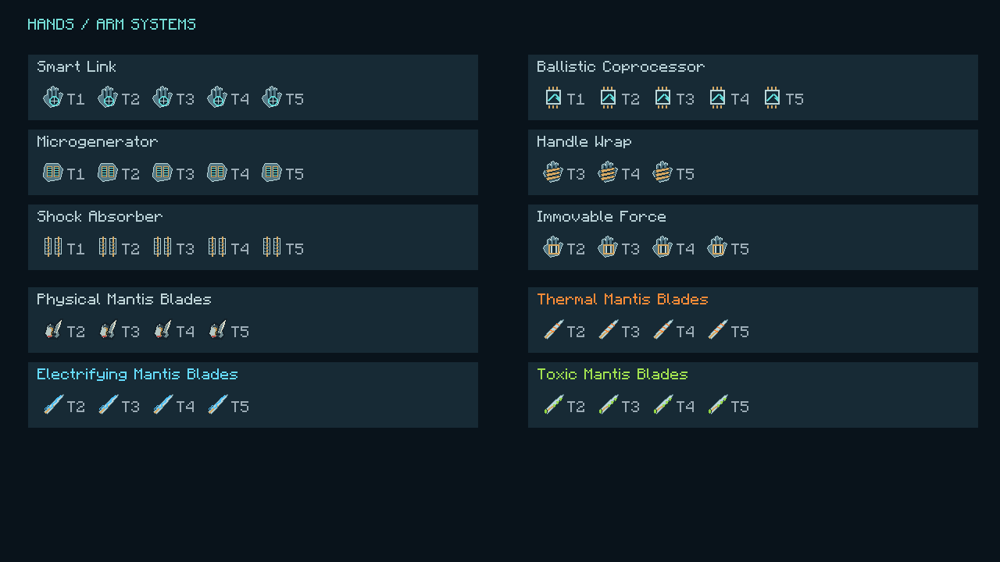

# Cyberware

[Wiki home](index.md) · [Cyberware](cyberware.md) · [Quickhacks](quickhacks.md) · [Village services](ripperdocs.md)

Choose a body system below. Each link opens an implant's effects, tiers and stats. [Learn installation](installation.md).

| System | Implants |
| --- | --- |
| Frontal Cortex | [Ex-Disk](ex-disk.md), [Memory Boost](memory-boost.md), [RAM Upgrade](ram-upgrade.md), [Self-ICE](self-ice.md) |
| Operating System | [Militech Paraline](militech-paraline.md), [Raven Microcyber](raven-microcyber.md), [BioDyne Berserk](biodyne-berserk.md), [Dynalar Sandevistan](dynalar-sandevistan.md), [Militech “Apogee” Sandevistan](militech-apogee.md), [David’s Sandevistan](davids-sandevistan.md) |
| Arms | [Physical Mantis Blades](mantis-blades.md), [Thermal](thermal-mantis-blades.md), [Electrifying](electrifying-mantis-blades.md), [Toxic](toxic-mantis-blades.md) |
| Hands | [Smart Link](smart-link.md), [Ballistic Coprocessor](ballistic-coprocessor.md), [Microgenerator](microgenerator.md), [Handle Wrap](handle-wrap.md), [Shock Absorber](shock-absorber.md), [Immovable Force](immovable-force.md) |
| Face | [Basic Kiroshi Optics](kiroshi-optics.md), [Clairvoyant Optics](clairvoyant-optics.md), [Kiroshi “Doomsayer” Optics](doomsayer-optics.md), [Kiroshi “Stalker” Optics](stalker-optics.md) |
| Skeleton | [Bionic Joints](bionic-joints.md), [Epimorphic Skeleton](epimorphic-skeleton.md), [Dense Marrow](dense-marrow.md), [Para Bellum](para-bellum.md) |
| Nervous System | [NeoFiber](neofiber.md), [Adrenaline Converter](adrenaline-converter.md), [Stabber](stabber.md), [Visual Cortex Support](visual-cortex-support.md) |
| Circulatory System | [Blood Pump](blood-pump.md), [Heal-On-Kill](heal-on-kill.md), [Biomonitor](biomonitor.md), [Second Heart](second-heart.md) |
| Integumentary System | [Subdermal Armor](subdermal-armor.md), [Optical Camo](optical-camo.md), [Shock-n-Awe](shock-n-awe.md), [Pain Editor](pain-editor.md) |
| Legs | [Reinforced Tendons](reinforced-tendons.md), [Fortified Ankles](fortified-ankles.md), [Lynx Paws](lynx-paws.md), [Jenkins’ Tendons](jenkins-tendons.md) |

## Tiers and buying

Tiers run from **1–5**: white, green, blue, purple and orange. Each family starts at its listed tier and continues through tier 5. Higher tiers improve its effects.

Buy implants from [daily ripperdoc stock](ripperdocs.md#daily-stock). Tiers 1–5 enter the pool at Street Cred **0 / 10 / 20 / 30 / 40**. Owning equipment allows you to install it regardless of its purchase requirement.

[Iconics](iconics.md) also need one matching-tier requisition chip and have a higher purchase price. David’s Sandevistan specifically requires Street Cred **50** and an unequipped Apogee.

[Compare cyberdecks](cyberdecks.md) · [Quickhack programs](quickhacks.md) · [Obtaining higher tiers](recipes.md)
