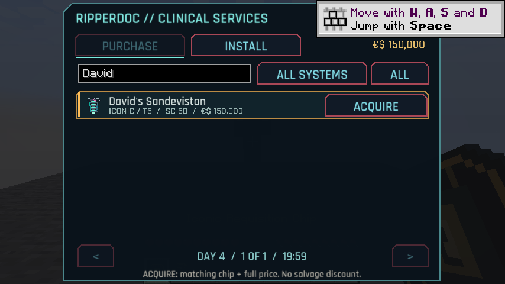
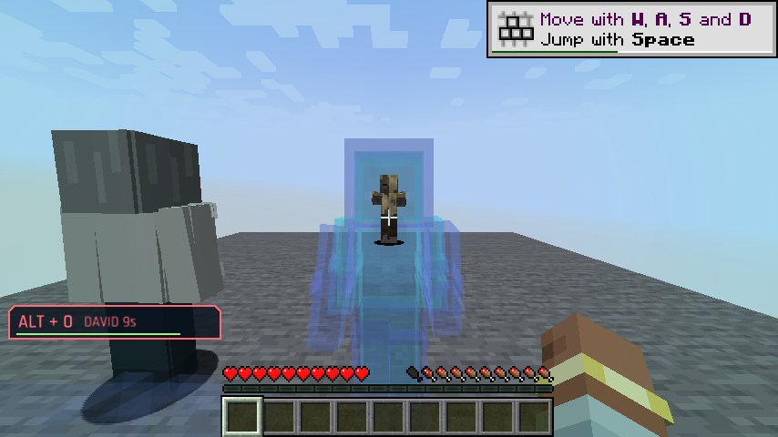

# David’s Sandevistan

[Cyberware](cyberware.md) · [Iconics](iconics.md) · [Ripperdocs](ripperdocs.md)

An original **Tier 5 Iconic Operating System** for extended bursts of overwhelming speed. Available in **Minecraft 1.21.1 NeoForge 0.21.0**.

| Requirement | Value |
| --- | --- |
| Capacity | 60 |
| Street Cred | 50 |
| Purchase | €$150,000 + one Tier 5 Iconic Requisition Chip + one Militech “Apogee” Sandevistan |

## Obtaining and installing

At Street Cred **50**, David’s can appear in a ripperdoc’s rotating daily stock. Bring the chip and an **unequipped Apogee in your main inventory or hotbar**, then choose **ACQUIRE**. Both items and the eddies are consumed together. An installed Apogee does not count; remove it through the **Install** tab first.

Install David’s in your Operating System socket. It replaces your cyberdeck, Berserk or other Sandevistan. There is no crafting recipe or damaged-part discount.

## Effects

Press **O** to toggle. The field slows opponents by **95% relative to your temporal pace**, within **32 blocks**.

| Effect while active | Value |
| --- | ---: |
| Full battery duration | 10 seconds |
| Full recharge while inactive | 40 seconds |
| Weapon critical chance | +25% |
| Weapon critical damage | +30% |
| Arrow, thrown-trident and TaCZ gun headshot damage | +25% |
| Battery restored per enemy kill | 1 second |
| Second Wind: health restored per enemy kill | 10% maximum health |

Second Wind can trigger **once per second**. Kills cannot raise the remaining duration above **10 seconds**. They also remove **0.88 food exhaustion**. Passive animals and protected allies do not grant kill recovery. Critical chance from implants shares the normal **50% cap**; the headshot bonus applies to the impact itself.

## Time and battery

Your temporal pace is **125% of normal**. Ordinary affected entities and environment updates run at **6.25% of normal**, which is **5% of your pace**. An active Apogee user in your field runs at approximately **41.67% of normal**. Two David’s users have equal pace. Overlapping fields apply the strongest effect once.

The [time bubble](dynalar-sandevistan.md#time-bubble) includes supported machines, scheduled blocks and fluids, pistons, loose objects, animated vanilla block textures and rain visuals. The sun and shared weather clock retain normal time.

Early deactivation preserves charge, with a **1-second rearm**. Activation requires enough charge for one tick. Battery charge and its recharge profile persist across saves and reinstallation; switching models does not refill it. Death, logout, dimension changes or removal end activation.

[Apogee](militech-apogee.md) · [Requisition chips](iconics.md#requisition-chips)
