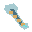

# Dense Marrow

[Wiki home](index.md) · [Cyberware](cyberware.md) · [Quickhacks](quickhacks.md) · [Village services](ripperdocs.md)

| System | Tiers | Capacity |
| --- | ---: | ---: |
| Skeleton | 2–5 | 16 |

Increases melee damage, including Mantis Blade strikes. Each hit adds a little hunger exhaustion. Does not increase projectile, quickhack or retaliation damage.

| Tier | Melee damage | Extra exhaustion/hit |
| --- | ---: | ---: |
| 2 | +12% | 0.008 |
| 3 | +18% | 0.012 |
| 4 | +24% | 0.016 |
| 5 | +30% | 0.020 |

[All cyberware](cyberware.md) · [Installing implants](installation.md) · [Street Cred requirements](street-cred.md)
