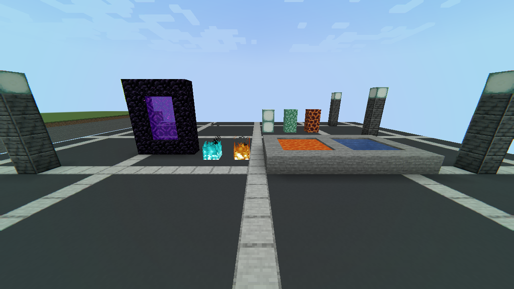
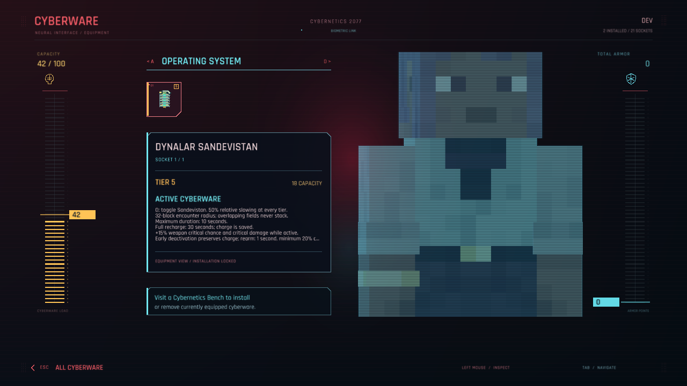
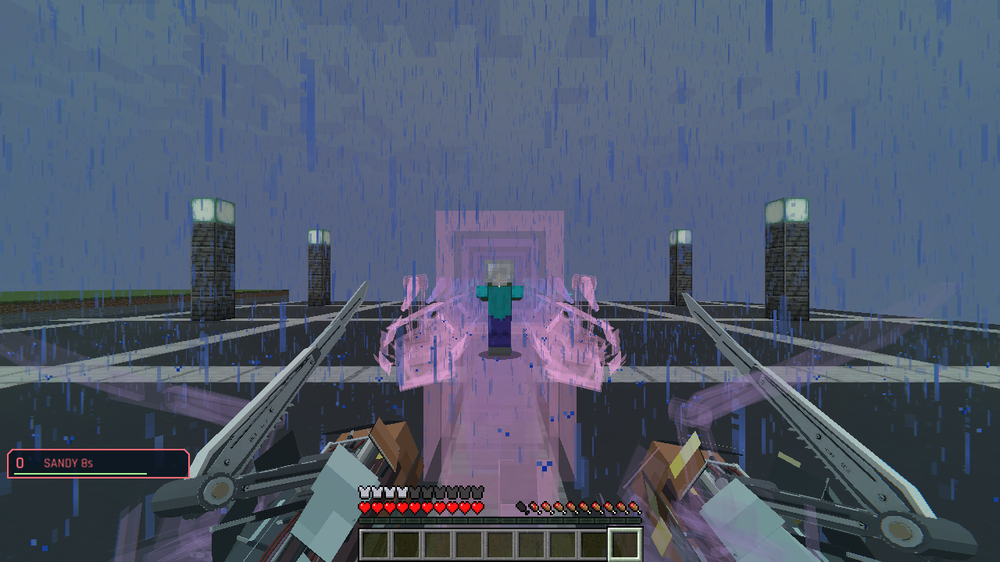

# Dynalar Sandevistan

[Wiki home](index.md) · [Cyberware](cyberware.md) · [Village services](ripperdocs.md)

| System | Tiers | Capacity |
| --- | --- | --- |
| Operating System | 2–5 | 18 |

Press **O** to activate or deactivate. Dynalar replaces your cyberdeck or Berserk in the Operating System socket. Buy it through normal daily ripperdoc stock; it has no crafting recipe.

**Every tier has the same 50% relative slowing.** Higher tiers improve duration, recharge and critical bonuses.

| Tier | Maximum duration | Full recharge | Extra weapon crit chance | Crit damage bonus | Purchase Street Cred |
| --- | ---: | ---: | ---: | ---: | ---: |
| 2 | 7 s | 45 s | 6% | 6% | 10 |
| 3 | 8 s | 40 s | 9% | 9% | 20 |
| 4 | 9 s | 35 s | 12% | 12% | 30 |
| 5 | 10 s | 30 s | 15% | 15% | 40 |

Critical bonuses apply to weapons and Mantis Blades while active, not quickhacks or retaliation damage. Critical chance combines with other implants under the existing 50% cyberware chance limit.

With [TaCZ](compatibility.md#tacz-gun-integration), your gunfire, firing/cycling animations and bullets slow with the world; **reload speed stays normal**. Guns do not receive your personal speed increase.

## Charge

Deactivating early preserves unused charge. Charge refills while inactive, including elapsed server time while logged out. You need **20% charge** and a **1-second rearm** before activating again. A partially charged implant provides a shorter activation.

The HUD shows remaining active time or charge percentage. Death, dimension changes, logout or removing the implant end the activation; reinstallation does not reset its battery.

## Combat and other players

The encounter radius is **32 blocks**. Nearby non-allied mobs and projectiles slow in movement, attacks and reaction time. Your walking and weapon recovery accelerate by 25%; the shared encounter clock keeps ordinary opponents at half your pace. Mantis attack animations and lunges follow that same clock. Camera input, the world tick rate, shared weather cycle and battery timing remain normal. Environmental updates follow the time bubble described below.

With one Dynalar active, the user runs at **125%** normal movement/weapon recovery while affected ordinary opponents run at **62.5%**. Opponents therefore run at half the user's pace. This changes nearby combat updates, not the server's 20 TPS. Players' regeneration and battery timers use normal game time.

Two active Dynalar users have equal temporal pace, regardless of tier. Overlapping fields apply their strongest strength once; they do not multiply. The [Iconic Apogee](militech-apogee.md) has a stronger model profile; an active Dynalar user in its field runs at 37.5% of normal, versus the Apogee user's 125%. **Tier upgrades never increase Dynalar’s slowing**.

Server PvP settings and team protections prevent slowing protected players or their projectiles. Creative players and spectators are protected. Mounted entities retain normal vehicle physics. Normal defensive effects still work; Sandevistan does not grant invulnerability or ignore armor.

## Time bubble

While active, a **32-block spherical field** slows nearby environmental simulation to **62.5% of normal speed**, half the active user's 125% movement/weapon pace. Strongest-field rules apply; overlapping bubbles do not multiply.

| Inside the field | Effect |
| --- | --- |
| Furnaces, hoppers and standard ticking machines | Their update-driven progress slows |
| Scheduled redstone and fluid updates | Remaining delays advance in local time |
| Crop growth, fire and other random block updates | Updates occur less frequently |
| Dropped items, XP, falling blocks and primed TNT | Movement and entity timers slow |
| Empty boats and minecarts | Physics slows; occupied vehicles keep normal handling |
| Animated vanilla block textures | Water, lava, fire, Nether portals and other animated block surfaces advance in local time |
| Moving pistons | Smaller movement steps every tick, with normal collision handling and smooth rendering |
| Rain | Falling streaks and splash particles look slower, blending back to normal near the edge |

Pending updates keep their unfinished delay when the field moves away; they do not replay missed ticks in a burst. Local delays are saved with the world, and unloaded chunks are not forced to stay loaded.

The sun, shared weather cycle, server tick rate and player resource/battery clocks keep normal time. Rain and texture slowing are visual. The machine effect covers Minecraft's standard block-entity tickers; machines driven by their own global timers keep those clocks.

Animated surfaces blend between local clocks near the field edge. When the field ends, their remaining phase is preserved briefly and then fades back to the normal animation over two seconds. Blocks elsewhere, inventory icons and held items retain native animation. Frames are cached with mipmaps; this does not rebuild chunks for every animation frame. This covers vanilla animated atlas textures, rather than procedural renderer effects such as the End portal's layered shader. Shader packs and replacement chunk renderers may need separate integration.

Pistons keep running their native pushing code every tick, reducing their movement distance instead of skipping updates. This prevents the repeated interpolation jumps of the earlier bubble. Straight pushed lines use the base piston's pace across the field boundary; slime launch velocity also follows local pace.

## Effects

Movement and attacks leave a roughly **two-second trail** of textured poses, including your skin, armor and deployed Mantis Blades. Each pose receives its color when created and keeps that color until it fades. New poses advance through **mint and cyan → blue and violet → muted pink and amber → yellow-green**, then repeat. Saved poses stay at their captured locations when you turn or move the camera. Older poses do not cycle through the palette. A new activation starts the palette again; hands and body use the same color timing.

Your full-body trail is visible in **first person**, third person and to other players. In first person, a saved body becomes visible once you are at least **1.25 blocks** away from its captured position. Look back, circle or move backward to see it. Near-camera and live-body clipping keep overlapping poses from filling the view; subtler hand and blade echoes remain.

Activation adds a brief lens pulse, restrained color separation, a small FOV transition and original electronic audio. Environmental sounds become lower and quieter; player sounds remain clear. Your camera stays responsive.

[Controls](controls.md) · [Installing cyberware](installation.md) · [Ripperdoc stock](ripperdocs.md)
