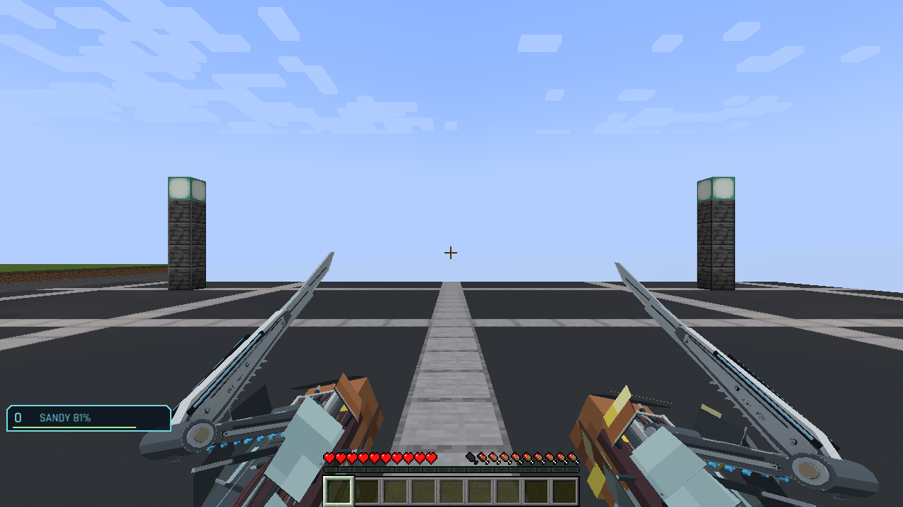

# Electrifying Mantis Blades

[Wiki home](index.md) · [Cyberware](cyberware.md) · [Quickhacks](quickhacks.md) · [Village services](ripperdocs.md)

| System | Tiers | Capacity |
| --- | --- | --- |
| Arms | 2–5 | 15 / 18 / 21 / 24 |

**Damage type:** Electrical. Armor and applicable damage defenses still apply.

**On-hit status:** Applies **Slowness II and Weakness I for 2 seconds**. Slashes have a **20% chance** to apply it; lunges guarantee it if the target survives. The direct hit can still kill.

**Appearance:** Insulated conductor rails, induction coils and cyan contact strips.

| Tier | Slashes 1–2 | Rising cut | Lunge |
| --- | --- | --- | --- |
| 2 | 10 | 12.5 | 17.5 |
| 3 | 12 | 15.0 | 21.0 |
| 4 | 14 | 17.5 | 24.5 |
| 5 | 16 | 20.0 | 28.0 |

[Deploy, attack and lunge controls](mantis-blades.md) are shared across all four variants. Equip one at a ripperdoc or Cybernetics Bench; changing the implant changes both its mechanics and model.

[All cyberware](cyberware.md) · [Installing implants](installation.md) · [Street Cred requirements](street-cred.md)
