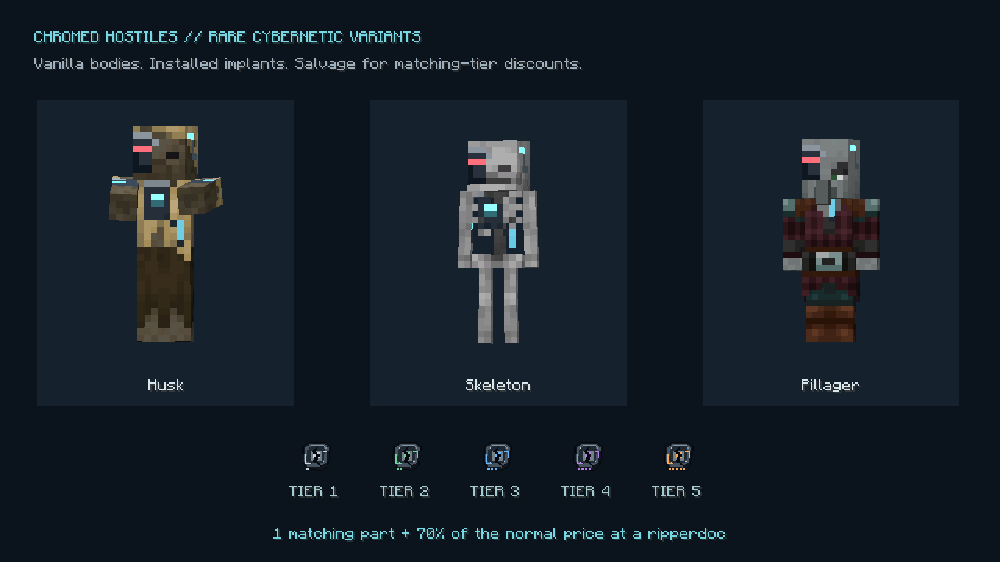
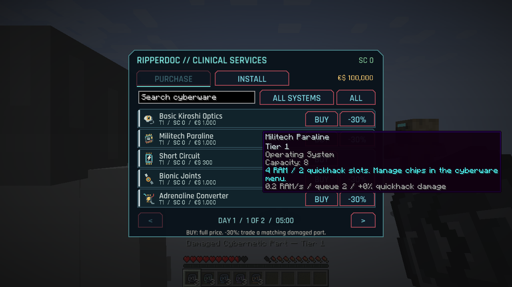

# Cybernetically enhanced mobs

[Wiki home](index.md) · [Cyberware](cyberware.md) · [Quickhacks](quickhacks.md) · [Village services](ripperdocs.md)

Rare **Chromed** variants of zombies, husks, drowned, skeletons, strays, bogged, pillagers and vindicators can appear. About **1 in 50 eligible natural spawns** is enhanced, including mobs generated with structures such as woodland mansions. Bosses, spawners, trial spawners, raids, summoned reinforcements and spawn eggs do not roll for enhancements. This replaces an ordinary spawn; it does not add more mobs.

## What makes them stronger

Each has **1–6 installed implants**, with most carrying only a few. Their cyan name shows their average implant tier and count. Scanning also reveals these values. Metal plates, illuminated circuitry and small combat sparks distinguish them from ordinary mobs.

Every variant has **Subdermal Armor**. Available additions depend on its loadout tier:

| Implant | Effect on the mob |
| --- | --- |
| Bionic Joints | More armor |
| Adrenaline Converter | Periodic speed burst during combat |
| Blood Pump | Automatic healing below half health, followed by regeneration; has a cooldown |
| NeoFiber | Chance to reduce an incoming hit |
| Epimorphic Skeleton | More armor and maximum health |

The reinforced chassis also adds **15% maximum health and 8% attack damage per total implant tier**. Ranged weapon attacks receive the same damage bonus. Existing AI and normal equipment remain in use. Loadouts and implant cooldowns persist through saves and ordinary mob conversions. Normal hostile despawning still applies.

Low-tier loadouts are common among variants. The initial loadout-tier roll is **62% Tier 1, 25% Tier 2, 10% Tier 3, 2.7% Tier 4 and 0.3% Tier 5**. Individual additional implants can be one tier lower, so their displayed average may differ.

## Damaged cybernetic parts

Defeating a variant drops **one damaged cybernetic part, Tier 1–5**. The actual equipped implants determine its tier: a higher **average tier** or **implant count** improves the chances of better salvage. Looting does not multiply these parts. Normal mobs do not drop them, and `doMobLoot=false` disables the drop.

Examples, rounded:

| Average implant tier / count | T1 | T2 | T3 | T4 | T5 |
| --- | ---: | ---: | ---: | ---: | ---: |
| 1 / 1 | 72.6% | 26.2% | 1.2% | <0.1% | <0.1% |
| 2 / 2 | 15.9% | 56.5% | 26.0% | 1.6% | <0.1% |
| 3 / 3 | 0.3% | 11.9% | 53.8% | 31.6% | 2.4% |
| 4 / 4 | <0.1% | 0.2% | 9.0% | 51.9% | 39.0% |
| 5 / 6 | <0.1% | <0.1% | 0.1% | 9.6% | 90.3% |

## Using a part

At a ripperdoc's **Purchase** tab, choose **−30%** beside an implant. You pay **70% of its normal price plus one matching-tier damaged part**. Hover the button to see the discounted price and how many matching parts you have. **BUY** pays full price and keeps your parts.

The implant must be in today's stock, and you still need its normal Street Cred. Parts work for implants and cyberdecks, **not quickhack chips**. Discounts do not stack. The part is consumed only when the purchase succeeds. Keep parts in your main inventory or hotbar.

Server owners can adjust `enhancedMobSpawnChance` in the mod's server configuration. The default is `0.02`; `0` disables new variants without removing existing ones.

[Ripperdoc stock and prices](ripperdocs.md) · [Scanning](scanning.md) · [Item IDs](item-ids.md)
