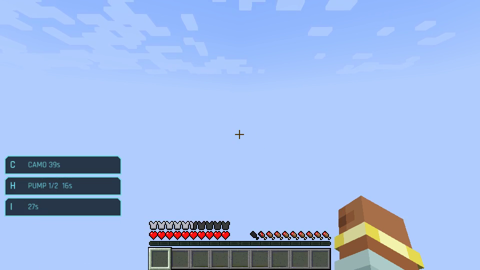

# Fortified Ankles

[Wiki home](index.md) · [Cyberware](cyberware.md) · [Quickhacks](quickhacks.md) · [Village services](ripperdocs.md)

| System | Tiers | Capacity |
| --- | --- | --- |
| Legs | 2–5 | 6 |

Hold **jump on the ground**, then release for a charged jump. Full charge takes **one second**. A quick tap makes a normal jump. Charging in midair is disabled; normal fall damage applies.

| Tier | Maximum upward impulse |
| --- | ---: |
| 2 | 0.76 |
| 3 | 0.84 |
| 4 | 0.92 |
| 5 | 1.0 |

Only one leg implant can be installed.

[All cyberware](cyberware.md) · [Installing implants](installation.md) · [Street Cred requirements](street-cred.md)
