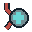

# Heal-On-Kill

[Wiki home](index.md) · [Cyberware](cyberware.md) · [Quickhacks](quickhacks.md) · [Village services](ripperdocs.md)

| System | Tiers | Capacity |
| --- | --- | --- |
| Circulatory System | 1–5 | 10 |

Killing a hostile mob or combat opponent heals you. Passive animals do not count; healing is capped to full HP.

| Tier | Healing per enemy kill |
| --- | --- |
| 1 | 2% max HP |
| 2 | 3% max HP |
| 3 | 4% max HP |
| 4 | 5% max HP |
| 5 | 6% max HP |

[All cyberware](cyberware.md) · [Installing implants](installation.md) · [Street Cred requirements](street-cred.md)
