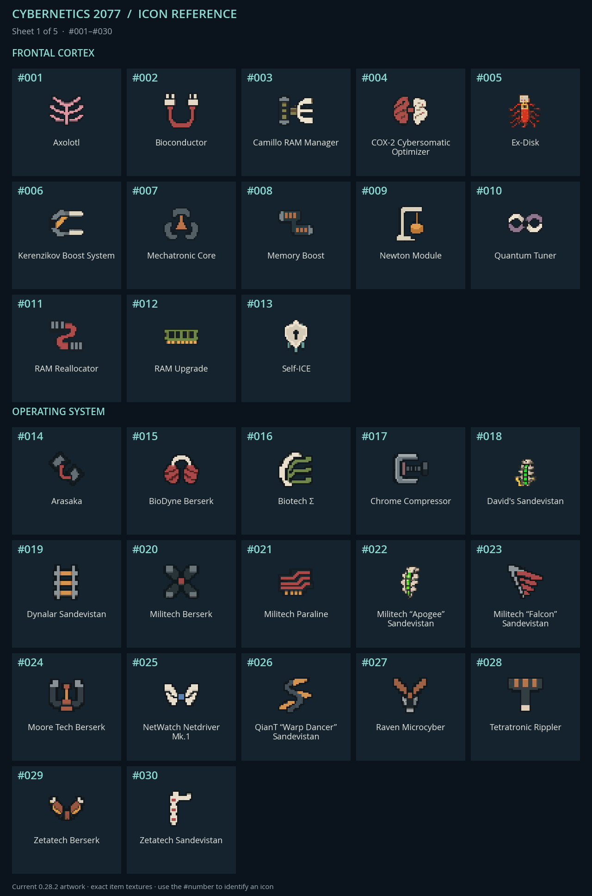
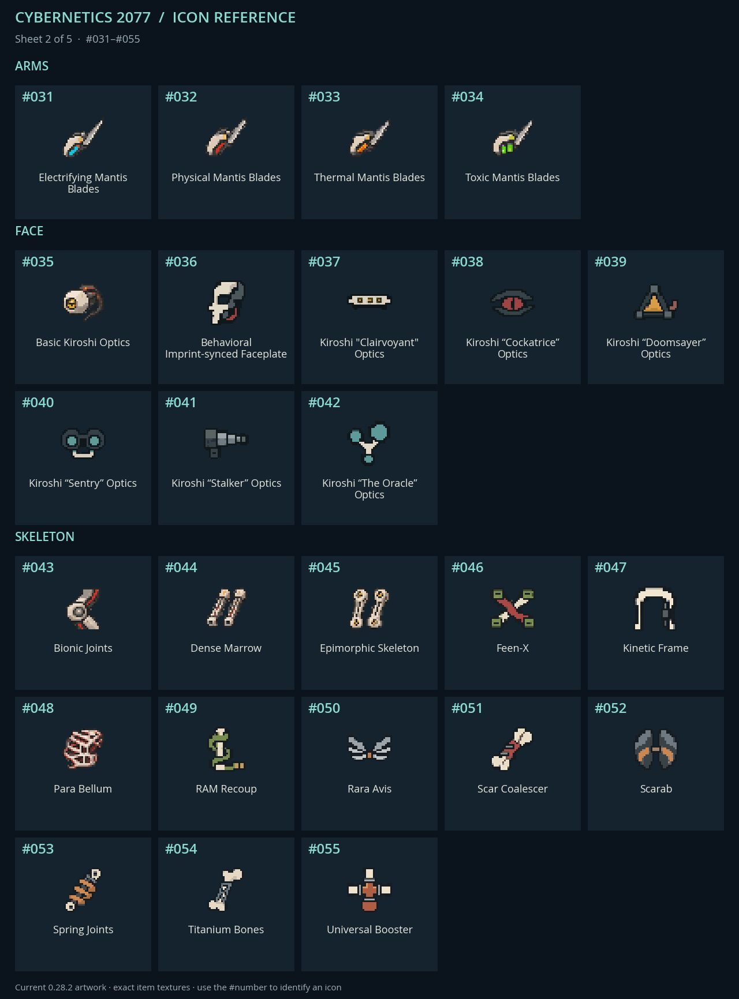
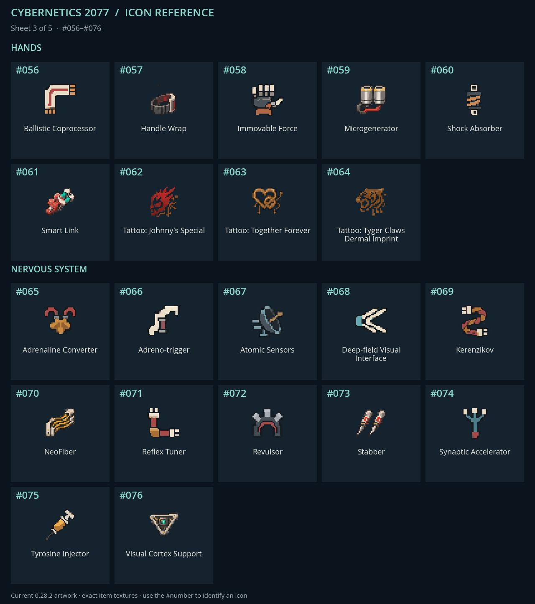
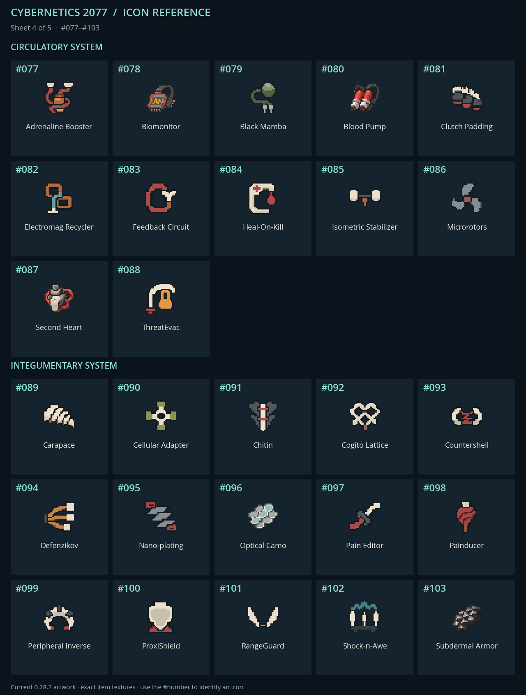
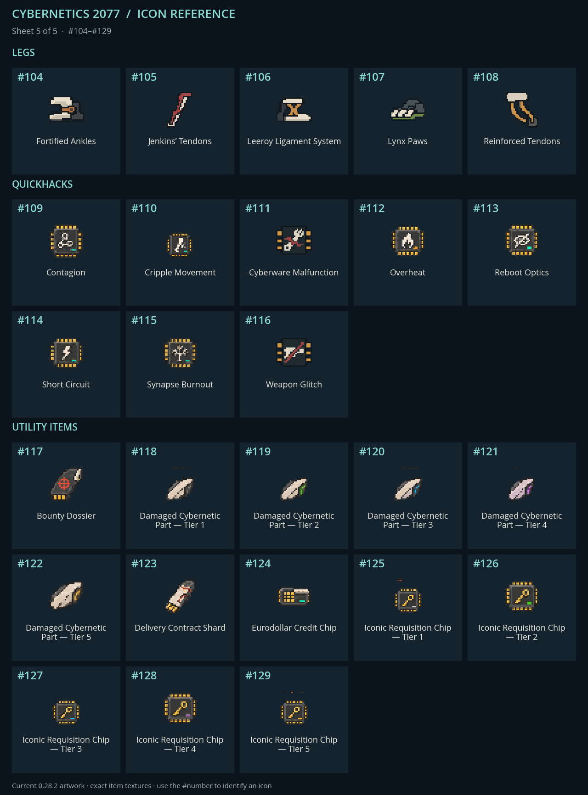

# Numbered icon reference

Each icon has a name and a stable number, so you can refer to it as **#042**, for example. These are the exact current item textures. Each cyberware or quickhack design appears once; tier variants share that artwork. Utility items with separate tier icons are listed individually.

**[Search the gallery](assets/icon-reference.html)** · [Download the PDF](assets/icon-reference.pdf) · [Download all sheets](assets/icon-reference.zip) · [Number/name list](assets/icon-reference.csv)

**#001–#030: Frontal Cortex / Operating System**

**#031–#055: Arms / Face / Skeleton**

**#056–#076: Hands / Nervous System**

**#077–#103: Circulatory System / Integumentary System**

**#104–#129: Legs / Quickhacks / Utility**

