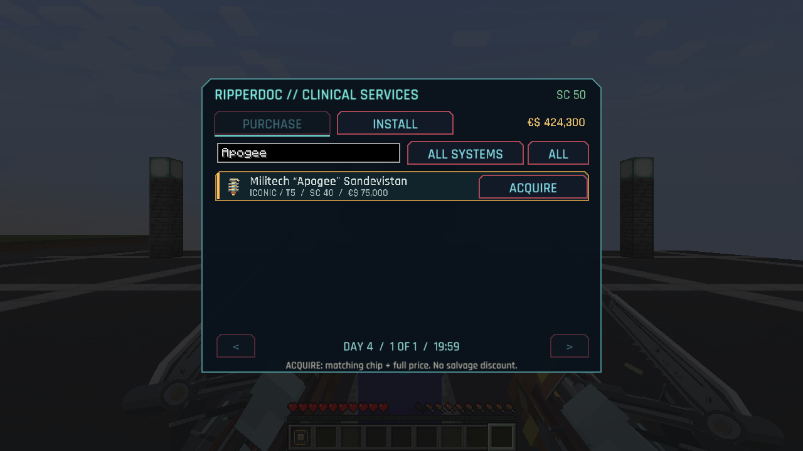

# Iconic cyberware

[Cyberware](cyberware.md) · [Chromed mobs](enhanced-mobs.md) · [Ripperdocs](ripperdocs.md)

Iconics are special implants within the normal **Tier 1–5** system. They require a matching-tier **Iconic Requisition Chip** and cost more than ordinary cyberware. Available Iconics include [Apogee](militech-apogee.md), [David’s Sandevistan](davids-sandevistan.md), [Immovable Force](immovable-force.md), [NetWatch Netdriver](netwatch-netdriver.md), [Axolotl](axolotl.md), [COX-2 Cybersomatic Optimizer](cox-2-cybersomatic-optimizer.md), [Quantum Tuner](quantum-tuner.md), [RAM Reallocator](ram-reallocator.md), [Militech “Falcon” Sandevistan](militech-falcon-sandevistan.md), [Militech Berserk](militech-berserk.md), [Chrome Compressor](chrome-compressor.md), [Kiroshi “Cockatrice” Optics](kiroshi-cockatrice-optics.md), [Behavioral Imprint-synced Faceplate](behavioral-imprint-synced-faceplate.md), [Rara Avis](rara-avis.md), [Adreno-trigger](adreno-trigger.md), [Deep-field Visual Interface](deep-field-visual-interface.md), [Revulsor](revulsor.md), [Electromag Recycler](electromag-recycler.md), [Isometric Stabilizer](isometric-stabilizer.md), [Chitin](chitin.md), [Peripheral Inverse](peripheral-inverse.md), [Leeroy Ligament System](leeroy-ligament-system.md).

## Requisition chips

Defeating a chromed mob has a separate chance to drop **one** chip in addition to its usual damaged part. The chance is **1% × average implant tier + 0.5% × additional installed implants**: from **1%** for a single Tier 1 implant to **7.5%** for six Tier 5 implants.

Chip tiers use the [same loadout-based tier distribution as salvage](enhanced-mobs.md#damaged-cybernetic-parts), rolled independently. Higher average tiers and more implants favor higher-tier chips. Normal mobs do not drop them; `doMobLoot=false` disables these drops, and Looting does not multiply them.

Keep chips in your main inventory or hotbar. Chips exist at tiers 1–5; **Tiers 2–5 can purchase Immovable Force**. Chips cannot be combined into higher tiers.

Your first **three [Elite Tier 5 bounty completions](contracts.md#fixer-specialties-and-optional-bonuses)** also award **one Tier 5 chip**, once per player.

## Purchasing

1. Find a ripperdoc stocking the Iconic you want. Owning a chip does not add it to stock.
2. Meet the displayed Street Cred requirement and bring the full Iconic price plus one matching-tier chip.
3. For David’s, also bring an **unequipped Apogee** in your main inventory or hotbar.
4. Choose **ACQUIRE**. The chip, eddies and any required implant are consumed together, and the new implant enters your inventory.
5. Use **Install** to equip it in its normal body-system socket.

Failed purchases consume nothing. A single chip can free its inventory slot for the implant. Damaged cybernetic parts cannot replace chips or discount Iconics. Buying one does not consume the doctor's daily offer, so another purchase needs another chip and payment.

| Iconic | Tier | Capacity | Street Cred | Eddies | Chip |
| --- | ---: | ---: | ---: | ---: | --- |
| [Immovable Force](immovable-force.md) | 2–5 | 35 | 10–40 | 12,000–75,000 | Matching tier |
| [Militech “Apogee” Sandevistan](militech-apogee.md) | 5 | 44 | 40 | 75,000 | Tier 5 |
| [David’s Sandevistan](davids-sandevistan.md) | 5 | 60 | 50 | 150,000 + one Apogee | Tier 5 |

Other Iconic families use **3,000 × tier² eddies**, normal tier Street Cred and one matching-tier chip. Their individual pages list tier starts and effects.

