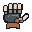
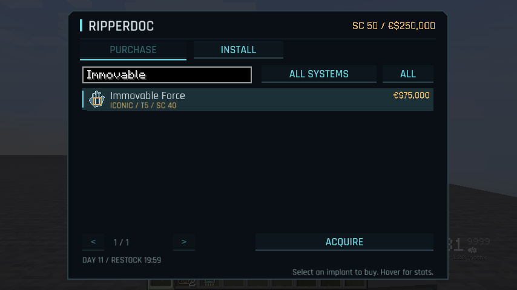

# Immovable Force

[Wiki home](index.md) · [Cyberware](cyberware.md) · [Quickhacks](quickhacks.md) · [Village services](ripperdocs.md)

| System | Tiers | Capacity |
| --- | --- | ---: |
| Hands | 2–5 | 35 |

**NeoForge 0.23.0 · Iconic.** Faster bow, crossbow and trident charging, flatter arrow flight, and improved gun control. Benefits remain active while moving or airborne.

| Tier | Extra charge tick | Arrow gravity reduction | TaCZ recoil reduction | TaCZ spread reduction | Price |
| --- | --- | --- | --- | --- | ---: |
| 2 | Every 4 ticks | 36% | 20% | 16% | €$12,000 |
| 3 | Every 3 ticks | 44% | 30% | 24% | €$27,000 |
| 4 | Every 2 ticks | 52% | 40% | 32% | €$48,000 |
| 5 | Every 2 ticks | 60% | 50% | 40% | €$75,000 |

Purchase from [daily ripperdoc stock](ripperdocs.md) with **one matching-tier Iconic Requisition Chip** and eddies. Normal tier Street Cred requirements apply. Damaged-part discounts cannot be used. Chromed mobs do not equip it.

No-gravity projectiles retain their flight. The flatter-flight effect applies to arrows; it does not alter TaCZ bullet gravity. Gun recoil stacks multiplicatively with Shock Absorber, up to 85% total reduction. [Gun integration](compatibility.md).

[All cyberware](cyberware.md) · [Installing implants](installation.md) · [Street Cred requirements](street-cred.md)
