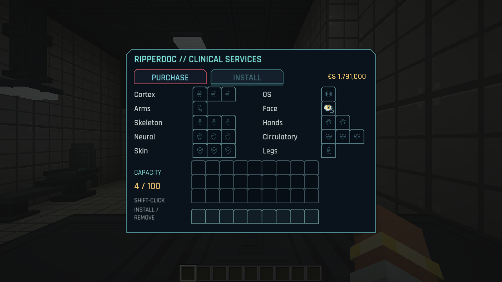

# Installing and viewing cyberware

[Wiki home](index.md) · [Cyberware](cyberware.md) · [Quickhacks](quickhacks.md) · [Village services](ripperdocs.md)

## Equip an implant

Talk to a **[ripperdoc](ripperdocs.md)** and choose **Install**, or right-click a **Cybernetics Bench**. Move an implant into its matching body-system socket, or shift-click to install it. Move it back to your inventory to remove it. Installation and removal are free.

Carrying an implant gives no effects. Installed equipment stays with your character on death.

## Capacity and sockets

Base cyberware capacity is **100** and can be changed in the world's server configuration. Each implant lists its cost. Only one version of each implant family can be installed.

| Body system | Sockets |
| --- | ---: |
| Frontal Cortex | 3 |
| Operating System | 1 |
| Arms | 1 |
| Face | 1 |
| Skeleton | 3 |
| Hands | 2 |
| Nervous System | 3 |
| Circulatory System | 3 |
| Integumentary System | 3 |
| Legs | 1 |

Choose up to **two different [Hands implants](cyberware.md)**. Operating System holds **one cyberdeck, Berserk or Sandevistan**, so these cannot be equipped together.

## View your loadout

Open your inventory and press the **cyberware tab beside it**. Select a socket to inspect the implant and zoom into that body system. **A / D** changes systems; **Esc** returns to the overview, then to inventory. The hologram displays your skin.

Implant sockets in this viewer are read-only. **Manage Quickhacks** edits the installed deck's programs without a bench.

[Cyberware list](cyberware.md) · [Recipes](recipes.md)
