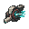

# Kerenzikov Boost System

[All cyberware](cyberware.md) · [Installation](installation.md) · [Daily stock](ripperdocs.md#daily-stock)

| System | Available tiers | Capacity |
| --- | --- | ---: |
| Frontal Cortex | 3–5 | 8 |

| Tier | Effects | Price | Street Cred |
| ---: | --- | ---: | ---: |
| 3 | Kerenzikov lasts 1s longer and slows enemies by another 10%. | €$9,000 | 20 |
| 4 | Kerenzikov lasts 1s longer and slows enemies by another 10%. | €$16,000 | 30 |
| 5 | Kerenzikov lasts 1s longer and slows enemies by another 10%. | €$25,000 | 40 |

[All cyberware](cyberware.md) · [Installation](installation.md) · [Daily stock](ripperdocs.md#daily-stock)
