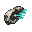

# Kerenzikov

[All cyberware](cyberware.md) · [Installation](installation.md) · [Daily stock](ripperdocs.md#daily-stock)

| System | Available tiers | Capacity |
| --- | --- | ---: |
| Nervous System | 2–5 | 12 |

| Tier | Effects | Price | Street Cred |
| ---: | --- | ---: | ---: |
| 2 | Aim a ranged weapon while sprinting or airborne: 60% enemy slow for 2.7s / recharge 6s. | €$4,000 | 10 |
| 3 | Aim a ranged weapon while sprinting or airborne: 60% enemy slow for 3.05s / recharge 6s. | €$9,000 | 20 |
| 4 | Aim a ranged weapon while sprinting or airborne: 60% enemy slow for 3.4s / recharge 6s. | €$16,000 | 30 |
| 5 | Aim a ranged weapon while sprinting or airborne: 60% enemy slow for 3.75s / recharge 6s. | €$25,000 | 40 |

[All cyberware](cyberware.md) · [Installation](installation.md) · [Daily stock](ripperdocs.md#daily-stock)
