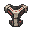

# Kinetic Frame

[All cyberware](cyberware.md) · [Installation](installation.md) · [Daily stock](ripperdocs.md#daily-stock)

| System | Available tiers | Capacity |
| --- | --- | ---: |
| Skeleton | 2–5 | 16 |

| Tier | Effects | Price | Street Cred |
| ---: | --- | ---: | ---: |
| 2 | Above 85% hunger (mobs: above 85% HP): +6.4% mitigation chance. +1.2 armor / +0.4 toughness. | €$4,000 | 10 |
| 3 | Above 85% hunger (mobs: above 85% HP): +9.600000000000001% mitigation chance. +1.8 armor / +0.6 toughness. | €$9,000 | 20 |
| 4 | Above 85% hunger (mobs: above 85% HP): +12.8% mitigation chance. +2.4 armor / +0.8 toughness. | €$16,000 | 30 |
| 5 | Above 85% hunger (mobs: above 85% HP): +16.0% mitigation chance. +3.0 armor / +1.0 toughness. | €$25,000 | 40 |

[All cyberware](cyberware.md) · [Installation](installation.md) · [Daily stock](ripperdocs.md#daily-stock)
