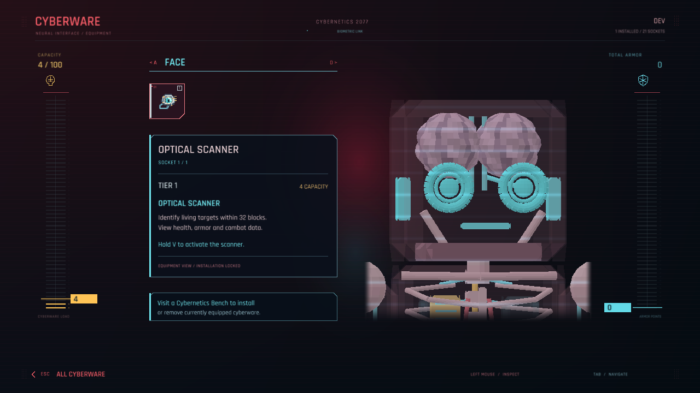

# Basic Kiroshi Optics

[Wiki home](index.md) · [Cyberware](cyberware.md) · [Quickhacks](quickhacks.md) · [Village services](ripperdocs.md)

| System | Tiers | Capacity |
| --- | --- | --- |
| Face | 1–5 | 4 / 5 / 6 / 7 / 8 |

Hold **V** to scan a living target with clear line of sight. Shows health, armor, attack damage, absorption and visible effects. A loaded cyberdeck adds quickhack controls.

| Tier | Capacity | Scan range |
| --- | ---: | ---: |
| 1 | 4 | 32 blocks |
| 2 | 5 | 40 blocks |
| 3 | 6 | 48 blocks |
| 4 | 7 | 56 blocks |
| 5 | 8 | 64 blocks |

Tier 1 costs **€$1,000** and is **always stocked at Street Cred 0–10 inclusive**. The first delivery contract pays enough to buy it. The original optics have [crafting and smithing recipes](recipes.md).

[All cyberware](cyberware.md) · [Installing implants](installation.md) · [Street Cred requirements](street-cred.md)
