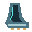

# Lynx Paws

[Wiki home](index.md) · [Cyberware](cyberware.md) · [Quickhacks](quickhacks.md) · [Village services](ripperdocs.md)

| System | Tiers | Capacity |
| --- | ---: | ---: |
| Legs | 2–5 | 5 |

Makes footstep audio **50% quieter**, increases crouching speed and reduces fall damage. Does **not** silence sculk vibrations or make enemies unable to detect you. Normal walking and sprinting speed are unchanged.

| Tier | Crouching speed | Fall damage reduction |
| --- | ---: | ---: |
| 2 | +8% | 8% |
| 3 | +12% | 12% |
| 4 | +16% | 16% |
| 5 | +20% | 20% |

[All cyberware](cyberware.md) · [Installing implants](installation.md) · [Street Cred requirements](street-cred.md)
