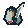
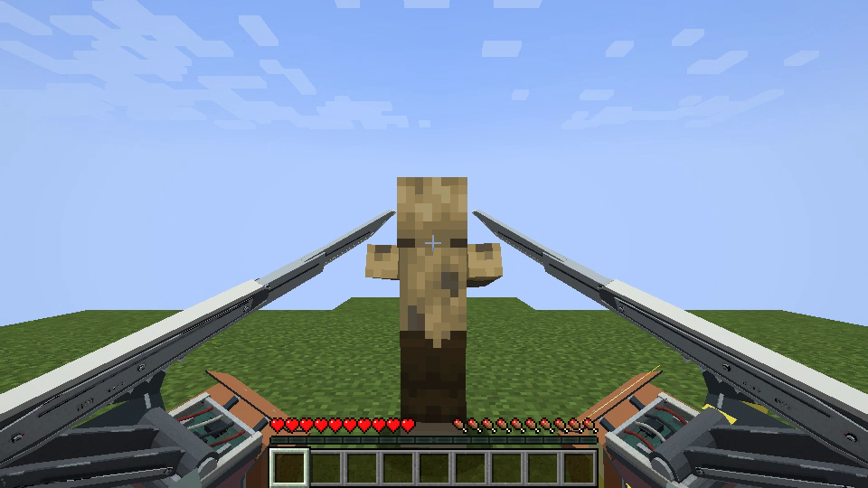

# Mantis Blades

[Wiki home](index.md) · [Cyberware](cyberware.md) · [Quickhacks](quickhacks.md) · [Village services](ripperdocs.md)

| System | Tiers | Capacity |
| --- | --- | --- |
| Arms | 2–5 | 15 / 18 / 21 / 24 |

Press **G** with **both hands empty** to deploy. Press G again to retract. Left-click for alternating slashes and a rising third hit. Hold right-click for at least **0.4 seconds**, then release to lunge.

**Damage type: physical.**

| Tier | Capacity | Slashes 1–2 | Rising cut | Lunge |
| --- | ---: | ---: | ---: | ---: |
| 2 | 15 | 10 | 12.5 | 17.5 |
| 3 | 18 | 12 | 15 | 21 |
| 4 | 21 | 14 | 17.5 | 24.5 |
| 5 | 24 | 16 | 20 | 28 |

Light attacks have a **0.5-second** interval; lunges have a **1.1-second** interval. Deployment takes **1.5 seconds**.

## Lunging and held items

Aim at a visible living target within **8 blocks** to leap toward it, including from midair. With no target, leap **6 blocks** along your look direction. Normal collision applies. The leap retains its remaining momentum when it ends.

After deployment, changing the selected inventory item keeps the blades active. Held items stay stored and act as empty hands: their stats, enchantments, use actions and durability do not affect blade attacks. Retract the blades to use those items again.

[Deployment video](../media/mantis-claws.mp4) · [Attacks and lunges](../media/mantis-attacks.mp4) · [Idle animation](../media/mantis-idle.mp4)

[All cyberware](cyberware.md) · [Installing implants](installation.md) · [Street Cred requirements](street-cred.md)
