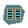

# Microgenerator

[Wiki home](index.md) · [Cyberware](cyberware.md) · [Quickhacks](quickhacks.md) · [Village services](ripperdocs.md)

| System | Tiers | Capacity |
| --- | --- | ---: |
| Hands | 1–5 | 9 |

A successful melee, Mantis Blade, arrow or thrown-trident hit releases an electrical burst around the struck enemy. Hits that kill the main target can still discharge onto nearby enemies.

**Radius:** 3 blocks. **Targets:** up to 4, with clear line of sight. The struck target and nearby hostile mobs/combat opponents are eligible; allies and protected players are excluded. A discharge cannot trigger another discharge.

**Damage type:** Electrical. Armor and applicable damage defenses still apply. The secondary burst can land alongside its triggering weapon hit without removing that hit's normal invulnerability protection.

| Tier | Damage per target | Recharge |
| --- | --- | --- |
| 1 | 4 | 11 s |
| 2 | 6 | 10 s |
| 3 | 8 | 9 s |
| 4 | 10 | 8 s |
| 5 | 12 | 7 s |

Recharge is saved across logout and reinstalling the implant. This is a weapon-hit adaptation for Minecraft; it does not require firearm reloads.

[All cyberware](cyberware.md) · [Installing implants](installation.md) · [Street Cred requirements](street-cred.md)
