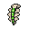
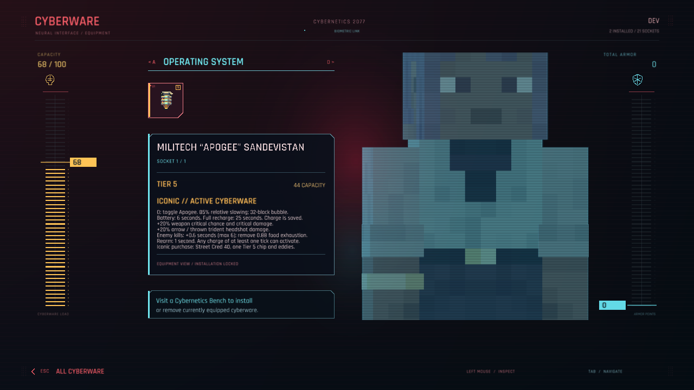
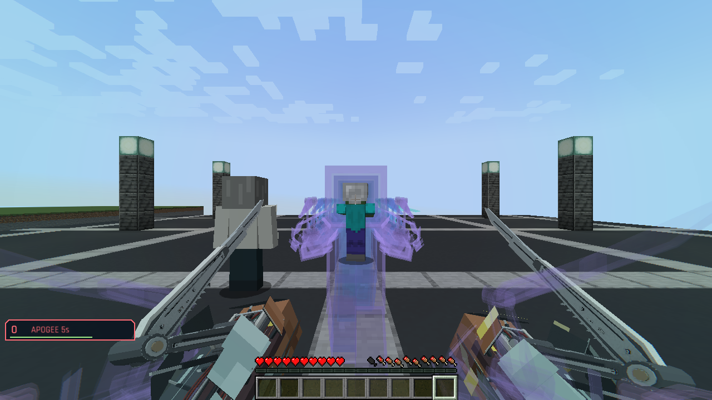

# Militech “Apogee” Sandevistan

[Cyberware](cyberware.md) · [Iconics](iconics.md) · [Ripperdocs](ripperdocs.md)

| Classification | System | Tier | Capacity | Street Cred | Price |
| --- | --- | ---: | ---: | ---: | --- |
| Iconic | Operating System | 5 | 44 | 40 | €$75,000 + one Tier 5 Iconic Requisition Chip |

Buy it with **ACQUIRE** when it appears in a ripperdoc's daily stock, then install it in your Operating System socket. It replaces your cyberdeck, Berserk or Dynalar. It has no crafting recipe and cannot use the damaged-part discount.

## Activation

Press **O** to toggle. Apogee slows affected opponents to **15% of your temporal pace** within 32 blocks. Your movement and weapon recovery run at **125% of normal**; ordinary affected entities and environmental updates run at **18.75%**. The [time bubble](dynalar-sandevistan.md#time-bubble) includes standard machine tickers, scheduled blocks/fluids, smooth piston movement, loose objects, animated vanilla block textures and visual rain slowing. The sun and shared weather clock keep normal time.

| Effect | Value |
| --- | ---: |
| Full battery duration | 6 seconds |
| Full recharge while inactive | 25 seconds |
| Weapon critical chance bonus | +20% |
| Weapon critical damage bonus | +20% |
| Arrow / thrown-trident headshot damage | +20% |
| Recovery per enemy killed while active | 0.6 seconds |

Headshots use impacts in the top quarter of a living target's hitbox. Weapon critical chance combines with other implants under the existing **50% cap**. The headshot bonus applies to that projectile impact, not later damage or quickhacks.

Enemy kills restore duration, capped at **6 seconds remaining**. They also remove **0.88 food exhaustion** as Minecraft's equivalent of stamina recovery; this creates no food or saturation. Passive animals do not restore duration.

## Battery and other users

Early deactivation preserves charge. Activation needs only enough charge for **one tick**, with a **1-second rearm** after switching off. Charge and its recharge profile persist across saves and reinstallation. Switching models does not refill the battery. Death, logout, dimension changes or removal end the activation.

Equal Apogee users have equal temporal pace. In an Apogee field, an active Dynalar user runs at **37.5% of normal**, compared with the Apogee user's 125%. Strongest-field rules apply once; bubbles never multiply. Server PvP and team protections remain in effect.

Apogee uses the same animated lens, audio and captured-color pose trails as the existing Sandevistan, including full-body echoes in first person.

An unequipped Apogee is also required to purchase [David’s Sandevistan](davids-sandevistan.md) at Street Cred 50 on NeoForge.

[Obtaining requisition chips](iconics.md#requisition-chips) · [Dynalar comparison](dynalar-sandevistan.md)
