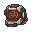

# Militech Berserk

[All cyberware](cyberware.md) · [Installation](installation.md) · [Daily stock](ripperdocs.md#daily-stock)

| System | Available tiers | Capacity |
| --- | --- | ---: |
| Operating System | 4–5 | 35 |

**Iconic:** purchase requires one matching-tier [Iconic Requisition Chip](iconics.md), full price and Street Cred.

| Tier | Effects | Price | Street Cred |
| ---: | --- | ---: | ---: |
| 4 | I: Berserk for 12s / recharge 25s. Damage immunity, +30% melee speed and +20% movement. Up to +50% melee damage at low HP. | €$48,000 | 30 |
| 5 | I: Berserk for 12s / recharge 25s. Damage immunity, +30% melee speed and +20% movement. Up to +50% melee damage at low HP. | €$75,000 | 40 |

[All cyberware](cyberware.md) · [Installation](installation.md) · [Daily stock](ripperdocs.md#daily-stock)
