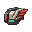

# Militech “Falcon” Sandevistan

[All cyberware](cyberware.md) · [Installation](installation.md) · [Daily stock](ripperdocs.md#daily-stock)

| System | Available tiers | Capacity |
| --- | --- | ---: |
| Operating System | 4–5 | 39 |

**Iconic:** purchase requires one matching-tier [Iconic Requisition Chip](iconics.md), full price and Street Cred.

| Tier | Effects | Price | Street Cred |
| ---: | --- | ---: | ---: |
| 4 | O: 70% slow for 10s / recharge 30s. +10% damage, +15% crit chance. Kills heal 12% HP and extend battery. | €$48,000 | 30 |
| 5 | O: 70% slow for 10s / recharge 30s. +10% damage, +15% crit chance. Kills heal 12% HP and extend battery. | €$75,000 | 40 |

[All cyberware](cyberware.md) · [Installation](installation.md) · [Daily stock](ripperdocs.md#daily-stock)
